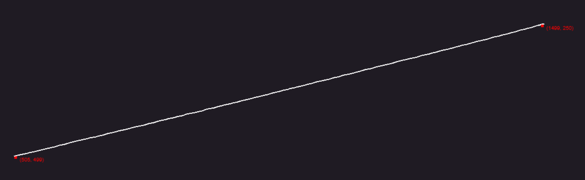
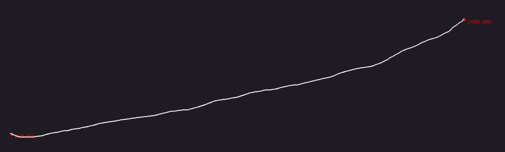

# Сглаживание движения мыши

Обычно курсор прыгает в нужную точку сразу. Если выбрать **Mouse Move smoothing algorithm**, EyeAuras проведёт его по пути из промежуточных точек с паузами. Это удобно, когда хочется видеть, как курсор идёт к элементу. Клик добавляется отдельно.

## Сравнить переход и плавное движение

Нужно обычное открытое окно со свободной, хорошо заметной точкой внутри. Берите абсолютный Mouse Move и Windows Input: при относительном смещении алгоритм не строит такой же путь к абсолютной цели.

1. В **Send Sequence → Advanced input settings** выберите **Target Window** и **Input Simulator = Windows Input**. Выключите **Mouse position** в группе Restore after Action is completed, а Randomize Mouse Movement X/Y оставьте равными 0.
2. Нажмите **Mouse → Move**. В свойствах добавленного шага выключите **Relative movement**.
3. В **Mouse position** нажмите прицел **Pick mouse position** и выберите свободную точку внутри окна. Кнопки мыши в последовательность не добавляйте.
4. Выберите **Mouse Move smoothing algorithm = Disabled** и выполните действие. Курсор сразу перескочит в точку.
5. Отведите курсор подальше, выберите **Linear Normal** и снова нажмите Execute. Теперь курсор пройдёт через промежуточные точки и остановится у той же цели.
6. Для сравнения попробуйте **Randomized Normal**. Нужно быстрее — сравните Fast, нужно заметнее — Slow. Смотрите не только на путь, но и на конечную точку.

Длина пути зависит от того, откуда стартует курсор. Чтобы сравнение было честным, начинайте из одного места и не трогайте мышь, пока идёт движение.

## Доступные варианты

| Алгоритм | Как строится движение |
|---|---|
| Disabled | Сразу в целевую точку, без промежуточного пути |
| Linear Fast / Normal / Slow | Семейство WindMouse: курсор сильно тянет к цели, отклонение небольшое. Идеально прямой линии не будет |
| Randomized Fast / Normal / Slow | То же семейство, но случайное отклонение больше. Варианты отличаются паузами и разбивкой пути |
| ML Human Move / ML Human Move Fast | Локальная модель предсказывает параметры пути, по ним строится ограниченная кривая с профилем по времени. У Fast профиль быстрее |

Linear и Randomized работают без ML-модели. Вариантам ML нужен свой локальный набор моделей. Имя в списке ещё не значит, что набор готов.

Что ещё влияет на результат

| Параметр или контекст | Что проверить |
|---|---|
| Target Window | Если окно выбрано, цель считается относительно него. Если Target Window пустой, это точка на экране |
| Relative movement | Задаёт смещение от текущего положения курсора. Сглаживание абсолютного движения в этом случае не применяется |
| Randomize Mouse Movement | Меняет саму целевую точку, а не только форму пути. Для точного попадания оставьте 0 |
| Restore → Mouse position | Может сразу вернуть курсор назад, и вы не увидите, куда он пришёл |
| Windows Message API | Шлёт сообщения окну и не водит системный курсор по видимому пути. Сглаживание с этим способом ввода не применяется |
| Общее время | Зависит от расстояния, пауз алгоритма и способа ввода. Задать длительность движения в миллисекундах сглаживанием нельзя |

Если курсор приходит мимо, сначала исправьте [координаты](/ru/features/coordinate-system) и источник окна.
