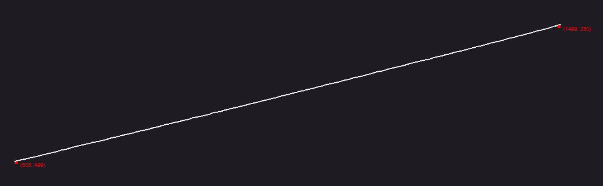
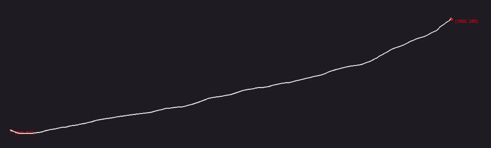

# Сглаживание движения мыши

Чтобы курсор двигался к выбранной точке постепенно, выберите **Mouse Move smoothing algorithm**. Вместо одного перемещения EyeAuras создаст путь из промежуточных точек и задержек. Это удобно, когда нужно видеть движение к элементу интерфейса; клик добавляется отдельно.

Сглаживание меняет траекторию и время движения. Оно не определяет нужную кнопку, не распознаёт интерфейс и не гарантирует, что программа сочтёт ввод физическим.

## Сравнить переход и плавное движение

Нужно обычное открытое окно с хорошо видимой свободной точкой внутри него. Используйте абсолютный Mouse Move и Windows Input: в относительном режиме смещения выбранный алгоритм не строит такой же путь к абсолютной цели.

1. В **Send Sequence → Advanced input settings** выберите **Target Window** и **Input Simulator = Windows Input**. Выключите **Mouse position** в группе Restore after Action is completed, а Randomize Mouse Movement X/Y оставьте равными 0.
2. Нажмите **Mouse → Move**. В свойствах добавленного шага выключите **Relative movement**.
3. В **Mouse position** нажмите прицел **Pick mouse position** и выберите свободную точку внутри целевого окна. Кнопки мыши в последовательность не добавляйте.
4. Сначала выберите **Mouse Move smoothing algorithm = Disabled** и выполните действие. Курсор должен сразу перейти к точке.
5. Отведите курсор подальше, выберите **Linear Normal** и повторите Execute. Движение должно состоять из промежуточных перемещений и закончиться у той же цели.
6. Для сравнения повторите с **Randomized Normal**. Если важнее короткое время перехода, сравните Fast; если нужно более заметное движение — Slow. Проверяйте не только вид пути, но и конечную точку.

Начальная позиция влияет на длину маршрута. Для честного сравнения начинайте из одного места и не двигайте мышь вручную во время воспроизведения.

## Доступные варианты

| Алгоритм | Как строится движение |
|---|---|
| Disabled | Одна целевая точка без промежуточного маршрута |
| Linear Fast / Normal / Slow | Семейство WindMouse с сильным притяжением к цели и небольшим отклонением. Это не обещание идеально прямой линии |
| Randomized Fast / Normal / Slow | То же семейство с большим случайным отклонением. Варианты отличаются паузами и разбивкой пути |
| ML Human Move / ML Human Move Fast | Локальная модель предсказывает параметры маршрута, затем строится ограниченная кривая с временным профилем. Fast использует более быстрый профиль; это отдельная функция от AI Search |

Linear и Randomized не требуют ML-модели. Вариантам ML нужен их локальный набор моделей; одно имя в списке не подтверждает его готовность. В обычном редакторе действий выбирается готовый алгоритм: отдельных полей Gravity, Wind или «вероятность обхода защиты» здесь нет.

На старых GIF показано различие почти прямого и более отклоняющегося пути. Это иллюстрации формы, а не измерение времени на вашем компьютере или обещание идентичной траектории.

Что ещё влияет на результат

| Параметр или контекст | Что проверить |
|---|---|
| Target Window | Для оконного движения цель считается относительно выбранного окна; при пустом Target Window это экранная точка |
| Relative movement | Задаёт смещение от текущего курсора. В этом пути выбранный абсолютный smoother не применяется |
| Randomize Mouse Movement | Меняет саму целевую точку, а не только форму пути. Для точного попадания оставьте 0 |
| Restore → Mouse position | Может вернуть курсор сразу после операции, скрыв её конечный результат |
| Windows Message API | Передаёт сообщения окну, а не водит системный курсор по видимой траектории; реализация этого provider не применяет smoother |
| Общее время | Зависит от расстояния, задержек алгоритма и provider. Smoothing не означает заданную длительность движения в миллисекундах |

Если курсор приходит мимо, сначала исправьте [координаты](/ru/features/coordinate-system) и источник окна. Смена формы траектории не исправляет ошибку между экранной и оконной системой отсчёта.
