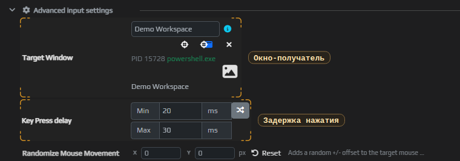
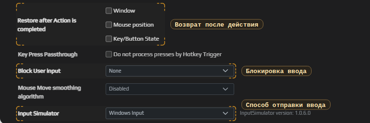

# Общие параметры ввода

Настройки **Advanced input settings** задают, куда и каким способом Send Sequence отправит собранные события. Если сочетание клавиш открыло поиск не в том документе, сначала проверьте **Target Window** и фокус внутри окна. Target Window выбирает только окно — не текстовое поле, кнопку или вкладку в нём.

## Проверить адресата короткой команды

Допустим, у вас уже есть короткий Send Sequence с парой Down/Up для **Ctrl+F**. В просмотрщике открыт тестовый документ, где это сочетание открывает поиск.

1. Раскройте **Advanced input settings → Target Window** и выберите окно документа. Если совпадений несколько, уточните [выражение выбора окна](/ru/features/window-matching-expressions).
2. Выберите **Input Simulator = Windows Input**. Оставьте **Block User input = None**, **Randomize Mouse Movement X/Y = 0** и **Mouse Move smoothing algorithm = Disabled**: сочетанию клавиш движение мыши не нужно.
3. Включите **Restore after Action is completed → Key/Button State**. Возврат окна и мыши для первого раза выключите, чтобы видеть, где выполнилась команда.
4. Поставьте фокус в документ и нажмите **Execute**. Нужное окно должно получить ввод и открыть панель поиска. Если команда попала в другое поле, исправляйте окно или фокус внутри него, а не задержку.

Windows Input и симуляторы физической или виртуальной клавиатуры обычно активируют указанное окно и шлют обычный ввод. Курсор и фокус у них общие с рабочим столом. **Target Window не означает универсальный фоновый ввод.**

## Основные настройки

| Настройка | Смысл и границы |
|---|---|
| Target Window | Окно-получатель. Если выражение задано, а окно не найдено, ввод завершится ошибкой. Пустое поле получателя не закрепляет: ввод уйдёт в текущий контекст |
| Key Press delay | Задержка между нажатием и отпусканием. В Send Sequence общая задержка работает, когда включён Use default Key Down / Key Up delay |
| Randomize у задержки | Берёт случайное время между нижним и верхним значениями |
| Randomize Mouse Movement X / Y | Сдвигает целевую точку случайно, в пределах плюс-минус указанного числа пикселей. Для точной проверки оставьте оба значения 0 |
| Restore after Action is completed → Mouse position | Возвращает курсор после отдельной операции ввода с координатой. В цепочке Move → Click курсор может вернуться раньше клика, поэтому для неё начните с выключенного возврата |
| Restore after Action is completed → Key/Button State | В конце Send Sequence пытается отпустить клавиши из последовательности, если они ещё нажаты. Явные Up всё равно нужны |
| Restore after Action is completed → Window | Флажок в редакторе остался, но текущий Send Sequence фокус по нему не возвращает. Если после ввода нужно определённое окно, добавьте отдельное действие Win Activate |
| Key Press Passthrough → Do not process presses by Hotkey Trigger | Hotkey Trigger не видит отправляемые нажатия, поэтому действие не запустит через него само себя. Горячие клавиши Windows при этом работают как обычно |
| Mouse Move smoothing algorithm | Добавляет промежуточные точки в абсолютное движение |
| Input Simulator | Способ доставки ввода. Имя в списке не значит, что нужный драйвер или устройство установлены |

Вернуться к известному окну помогает [Win Activate](/ru/actions/win-activate). О траектории и о том, сколько времени она отнимает, — в статье про [сглаживание мыши](/ru/actions/sendinput/mouseinputsmoothing).

Блокировка пользовательского ввода

| Block User input | Что блокируется на время действия |
|---|---|
| None / Disabled | Ничего |
| All / Block All input | Клавиатура, кнопки и движение мыши |
| Keyboard / Block Keyboard input | Клавиатура |
| Mouse / Block Mouse input | Кнопки мыши. Двигать мышь можно |
| MouseMove / Block Mouse movement | Движение мыши. Кнопки работают |

Пока настраиваете короткую последовательность, оставьте None. Блокировка нужна, только когда вы точно хотите исключить ручной ввод во время действия.

## Выбрать симулятор

| Input Simulator | Что доставляет ввод |
|---|---|
| Windows Input | Системный SendInput. С него обычно начинают: клавиатура и мышь в активном приложении |
| Windows Message API | Сообщения PostMessage указанному окну. Может работать без активации окна, если приложение такие сообщения обрабатывает. Многие программы их игнорируют. Координаты мыши считаются от клиентской области |
| Granny's Send Input | Старые системные события клавиатуры и мыши |
| TetherScript Driver | Виртуальные HID-устройства драйвера Tetherscript. Нужен [подготовленный драйвер](/ru/actions/sendinput/tetherscript) |
| Usb2Kbd device | Команды совместимому физическому USB HID-устройству. Нужны [устройство и его параметры](/ru/actions/sendinput/usb2kbd) |
| Input driver | Отдельный драйверный механизм ввода. Пока драйвер не установлен и не готов, ввод работать не будет |
| Low-level Windows Input / Low-level Input Injection | Отдельные низкоуровневые способы ввода. Берите только тот, что есть в вашей поставке и готов к работе |

Другие способы ввода появляются с подключёнными модулями. **Install...** может открыть установщик, сайт или окно настройки устройства — это зависит от выбранного способа. Смотрите его Status и его собственное руководство.

Если одинаковые настройки нужны группе аур, задайте их в **Folder Properties → Triggers/Actions/Overlays Defaults → Input Simulator**. Для уже существующих компонентов отдельно проверьте привязки и на что действует **Apply to All** — подробнее в [настройках по умолчанию](/ru/features/default-properties).
