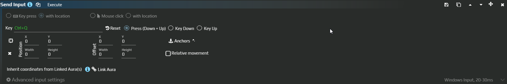

# Старое действие Send Input

Если в старой ауре настроен один клик или сочетание клавиш, его можно перенести в **Send Sequence** и сохранить тот же результат. Например, старое `Ctrl+A` должно по-прежнему выделять содержимое поля, а не выполняться дважды после переноса.

**Send Input — устаревший тип действия.** В текущем редакторе для нового ввода добавляйте [Send Sequence](/ru/actions/sendinput/send-sequence). У старого типа был отдельный WPF-редактор; снимок ниже показывает именно его, а не дополнительный режим нового Send Sequence.

## Перенести старое Ctrl+A

Нужна существующая аура со старым действием и обычное текстовое поле с тестовым текстом. На время переноса отключите автоматический запуск ауры: проверять нужно одно действие за раз.

1. Запишите **Key**, тип события и [общие параметры](/ru/actions/sendinput/options), прежде всего **Target Window** и **Input Simulator**. Для полного нажатия старое действие должно использовать **Press (Down+Up)**, а не только Key Down.
2. Если действие открывается в старом редакторе, нажмите **Convert to Send Sequence**. Команда **добавляет новое действие следом**, сохраняя старое на месте. Не запускайте всю ауру с обоими действиями.
3. Откройте полученный Send Sequence. Для Ctrl+A проверьте пару **Ctrl+A Key down → задержка → Ctrl+A Key up**, а в **Advanced input settings** — окно и способ ввода.
4. Если старый редактор недоступен или показывает **This item type is not supported**, добавьте Send Sequence вручную. Через **Keyboard** добавьте A и в свойствах обоих событий **Hotkey** задайте Ctrl+A. Сохраните направления **Key down** и **Key up**, а между ними — задержку, например 50 мс.
5. В тестовом приложении установите фокус в поле с текстом. Выполните только новое действие через **Execute**: содержимое поля должно выделиться.
6. После проверки удалите старое действие из этого списка ауры. Повторный запуск должен выполнять одно выделение. Перенос остальных настроек проверяйте по таблице ниже.

## Как перенести разные операции

| Старый вариант | Соответствие в Send Sequence |
|---|---|
| Key Press | Пара Key down / Key up для одной клавиши или сочетания с задержкой между ними |
| Key Down | Только событие Key down. Если нужно удержание на время, добавьте Delay и соответствующий Key up |
| Key Up | Отпускание той же клавиши или сочетания, которое было нажато ранее |
| Key Press with Location | Сначала Mouse Move, затем события клавиши |
| Mouse Click | Пара нажатия и отпускания выбранной кнопки; поддерживаются модификаторы |
| Mouse Click with Location | Mouse Move перед парой событий кнопки |
| Колесо мыши | Отдельный шаг Wheel Up или Wheel Down; это прокрутка, а не удерживаемая кнопка |
| Relative movement | Перемещение на смещение от текущего курсора. Не используйте здесь абсолютную точку окна |
| Link Aura | Связь области через Linked auras в свойствах Mouse Move. Проверьте якоря и окно отдельно |

В старом поле клавиши сочетание задавалось захватом нажатия; кнопка мыши выбиралась двойным щелчком этой кнопкой в поле. В новом редакторе используйте **Keyboard**, **Numpad**, **Fn**, **Mouse** и свойства **Hotkey**, а не пытайтесь вставить описание действия в текстовый шаг.

При конвертации координаты, относительный режим и привязки движения переносятся в отдельный Mouse Move. Старый Send Input мог получать Target Window из связанной области. В Send Sequence **проверьте Target Window самого действия**: координаты найденного значка и окно, в которое отправляется ввод, должны соответствовать друг другу. Подробнее — [система координат](/ru/features/coordinate-system).

Key Down без последующего Key Up оставляет кнопку нажатой. В новом действии проверьте **Restore after Action is completed → Key/Button State** и всё равно сохраняйте явное отпускание в последовательности. Работа с фоновыми окнами определяется выбранным симулятором, а не тем, что действие называется Send Input.
