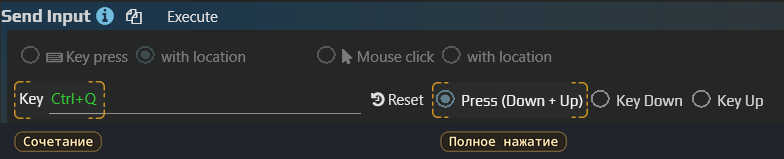

# Старое действие Send Input

**Send Input — устаревший тип действия.** Он отправлял один клик или одно сочетание клавиш. Новый ввод добавляйте через [Send Sequence](/ru/actions/sendinput/send-sequence), а старые действия можно туда перенести. Результат должен остаться тем же: старое `Ctrl+A` по-прежнему выделяет содержимое поля и не срабатывает дважды.

У старого типа был отдельный WPF-редактор. На снимке ниже именно он, а не какой-то режим нового Send Sequence.

На снимке задано Ctrl+Q. Для упражнения ниже откройте в своей ауре действие с Ctrl+A. [Полная панель прежнего действия с координатами и дополнительными настройками](/assets/legacy/eyeauras_vkyrrjgchm.png).

## Перенести старое Ctrl+A

Нужна аура со старым действием и обычное текстовое поле с пробным текстом. На время переноса отключите автоматический запуск ауры, чтобы проверять по одному действию.

1. Запишите **Key**, тип события и [общие параметры](/ru/actions/sendinput/options), в первую очередь **Target Window** и **Input Simulator**. Для полного нажатия в старом действии должен стоять **Press (Down+Up)**, а не только Key Down.
2. Если действие открывается в старом редакторе, нажмите **Convert to Send Sequence**. Команда **добавляет новое действие следом**, а старое оставляет на месте. Не запускайте всю ауру, пока в ней оба действия.
3. Откройте получившийся Send Sequence. Для Ctrl+A там должна быть пара **Ctrl+A Key down → задержка → Ctrl+A Key up**. В **Advanced input settings** проверьте окно и способ ввода.
4. Если старый редактор недоступен или пишет **This item type is not supported**, добавьте Send Sequence вручную. Через **Keyboard** добавьте A и в свойствах обоих событий в **Hotkey** задайте Ctrl+A. Оставьте направления **Key down** и **Key up**, а между ними задержку, например 50 мс.
5. В тестовом приложении поставьте фокус в поле с текстом. Выполните только новое действие через **Execute** — содержимое поля должно выделиться.
6. После проверки удалите старое действие из списка ауры. При повторном запуске выделение должно сработать один раз. Остальные настройки сверяйте по таблице ниже.

## Как перенести разные операции

| Старый вариант | Соответствие в Send Sequence |
|---|---|
| Key Press | Пара Key down / Key up для клавиши или сочетания, между ними задержка |
| Key Down | Только Key down. Чтобы удерживать клавишу какое-то время, добавьте Delay и соответствующий Key up |
| Key Up | Отпускание той же клавиши или сочетания, что были нажаты раньше |
| Key Press with Location | Сначала Mouse Move, затем события клавиши |
| Mouse Click | Пара нажатия и отпускания выбранной кнопки. Модификаторы поддерживаются |
| Mouse Click with Location | Mouse Move перед парой событий кнопки |
| Колесо мыши | Отдельный шаг Wheel Up или Wheel Down. Это прокрутка, а не удерживаемая кнопка |
| Relative movement | Смещение от текущего положения курсора. Абсолютную точку окна сюда не подставляйте |
| Link Aura | Связь области через Linked auras в свойствах Mouse Move. Якоря и окно проверьте отдельно |

В старом поле клавиши сочетание задавали, нажав его. Кнопку мыши выбирали двойным щелчком этой кнопкой по полю. В новом редакторе для этого есть **Keyboard**, **Numpad**, **Fn**, **Mouse** и свойства **Hotkey**. Не пытайтесь вписать описание действия в текстовый шаг.

При конвертации координаты, относительный режим и привязки движения уходят в отдельный Mouse Move. Старый Send Input мог брать Target Window из связанной области. В Send Sequence **проверьте Target Window самого действия**: координаты найденного значка и окно, куда идёт ввод, должны относиться к одному и тому же окну. Подробнее — [система координат](/ru/features/coordinate-system).

Key Down без последующего Key Up оставляет клавишу нажатой. В новом действии проверьте **Restore after Action is completed → Key/Button State** и всё равно оставьте в последовательности явное отпускание. Сработает ли ввод в фоновом окне, зависит от выбранного симулятора, а не от названия действия.
