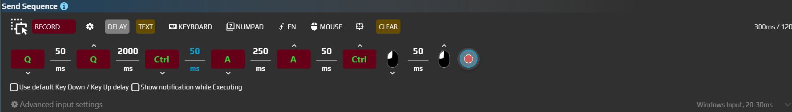

# Send Sequence

Чтобы одной командой выделить первую строку черновика, соберите два сочетания: **Ctrl+Home**, затем **Shift+End**. Send Sequence воспроизводит список событий по порядку: клавиши, кнопки мыши, перемещения, текст и задержки. Содержимое приложения он не проверяет, поэтому нужное поле должно быть готово к вводу.

## Выделить первую строку

Подготовьте многострочный черновик в обычном текстовом редакторе с двумя строками, например «Черновик» и «Проверить вложения». В нём должны штатно работать Ctrl+Home и Shift+End. Проверка только выделяет текст и ничего не удаляет.

1. Добавьте в ауру действие **Send Sequence**. В **Advanced input settings** выберите **Target Window** редактора, **Input Simulator = Windows Input**, **Block User input = None**.
2. Через **Keyboard** добавьте клавишу Home. Редактор создаёт **Key down**, задержку и **Key up**. В свойствах **Hotkey** обоих событий задайте **Ctrl+Home**, сохранив их направления.
3. Через **Delay** добавьте паузу **100 ms** после отпускания Home. Выключите Randomize у этой паузы, если нужен фиксированный интервал.
4. Аналогично добавьте End и задайте **Shift+End** в обоих событиях пары. Не заменяйте пару одним событием Press.
5. Включите **Use default Key Down / Key Up delay**. В Advanced input settings задайте **Key Press delay = 50 ms** без случайного диапазона. Обычная пауза 100 ms между сочетаниями останется отдельной паузой.
6. Включите **Restore after Action is completed → Key/Button State**. Установите фокус в тексте черновика и нажмите **Execute** у действия.
7. В редакторе должна выделиться первая строка. Повторите проверку, начав с другой позиции курсора: Ctrl+Home должен сначала возвращать его к началу документа.

На старом снимке показан тот же принцип списка событий, но расположение панелей отличается. В текущем редакторе на панели есть Record, Delay, Text, Keyboard, Numpad, Fn и Mouse; элементы можно добавлять и переставлять перетаскиванием.

## Событие и полное нажатие

| Элемент | Что означает |
|---|---|
| Keyboard / Numpad / Fn | Выбор обычных, цифровых и функциональных клавиш. Например, Esc соответствует Escape, а NumPad1 отличается от цифры 1 в основном ряду |
| Hotkey | Клавиша с модификаторами, например Ctrl+A. Для клавиатурного сочетания изменяйте и Down, и Up одной пары |
| Event type → Key down | Нажать и оставить нажатым до соответствующего Up |
| Event type → Key up | Отпустить ранее нажатую клавишу или кнопку |
| Event type → Press | Пункт редактора одного события. Для полного нажатия в текущем Send Sequence используйте явную пару Down/Up с задержкой: один такой пункт её не заменяет |
| Delay | Пауза между шагами; можно задать диапазон и Randomize |
| Mouse | Кнопки, колесо и Mouse Move. Полный клик тоже состоит из нажатия и отпускания |
| Text | Буквальный текст с выбранным способом доставки. Командные записи вроде `{Enter}` здесь не исполняются |

Удержание на 300 мс — это **Key down → Delay 300 ms → Key up** для одной клавиши. Включённый **Use default Key Down / Key Up delay** подменяет задержки, помеченные как задержки нажатия, общим значением. Для собственного времени удержания оставьте обычный Delay и проверьте, что он не заменён общим.

**Key/Button State** в конце выполнения, в том числе при отмене, пытается отпустить использованные последовательностью клавиши, которые ещё считаются нажатыми. Это дополнительная очистка, а не замена явным Up и не восстановление всех физических клавиш пользователя.

## Записать вместо ручного добавления

1. Нажмите **Record**, чтобы открыть панель записи. Выберите, какие события записывать.
2. Внутри панели нажмите **Record**, выполните короткую операцию в выбранном приложении и завершите через **Stop** или настроенную **Start/stop hotkey**.
3. Просмотрите результат до воспроизведения: уберите лишние клики, проверьте пары Down/Up, задержки и координаты.

| Параметр записи | Как выбрать |
|---|---|
| Record keys | Записывать клавиатуру |
| Record mouse clicks | Записывать кнопки мыши |
| Record mouse position → No / Absolute / Relative | Не записывать движение, сохранять точки или относительные смещения |
| Sample every | Интервал записи движения: в текущей панели 50–1000 ms. Меньше интервал — больше элементов |
| Start/stop hotkey | Управляет записью; значение по умолчанию берётся из Settings → Start/Stop sequence recording. Это не клавиша отмены воспроизведения |

Лимиты, уведомление и отмена

| Настройка | Что учитывать |
|---|---|
| Счётчики item(s), ms и max items | Показывают объём последовательности и ограничения редактора. Стандартная конфигурация задаёт 120 секунд записи и 500 элементов; ориентируйтесь на показанные значения |
| Show notification while Executing | Показывает уведомление о выполнении и текущем шаге |
| Sequence Can Be Interrupted | Разрешает отмену выполняемого действия. Не путайте с остановкой записи |

Перед длинной последовательностью проверьте способ её остановки в своей версии. Start/stop hotkey в панели управляет записью и не является универсальной клавишей отмены воспроизведения. Для первого опыта используйте короткую последовательность без удерживаемых кнопок.

Лимит записи не следует понимать как точную длительность любого воспроизведения: реальные задержки включают работу целевого приложения, движения и выбранного симулятора.

Для клика по найденному объекту сначала настройте [координаты и привязку области](/ru/features/coordinate-system). Общие ограничения окна, фокуса, восстановления и providers разобраны в [параметрах ввода](/ru/actions/sendinput/options). Записанное действие не ждёт появления нужного элемента само по себе: такое условие задают триггеры ауры.
