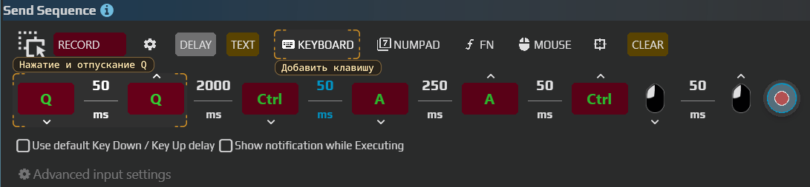
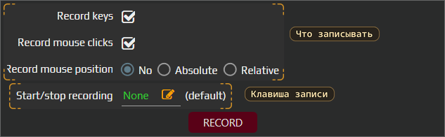

# Send Sequence

Send Sequence воспроизводит по порядку список событий: клавиши, кнопки мыши, перемещения, текст и паузы. Например, два сочетания подряд — **Ctrl+Home**, затем **Shift+End** — выделят первую строку черновика. Что происходит в приложении, действие не проверяет, поэтому нужное поле должно быть готово к вводу.

## Выделить первую строку

Откройте обычный текстовый редактор и напишите две строки, например «Черновик» и «Проверить вложения». Ctrl+Home и Shift+End должны работать в нём как обычно.

1. Добавьте в ауру действие **Send Sequence**. В **Advanced input settings** выберите **Target Window** редактора, **Input Simulator = Windows Input**, **Block User input = None**.
2. Через **Keyboard** добавьте клавишу Home. Появятся **Key down**, задержка и **Key up**. В свойствах **Hotkey** обоих событий задайте **Ctrl+Home**, направления не меняйте.
3. Через **Delay** добавьте паузу **100 ms** после отпускания Home. Если нужна фиксированная пауза, выключите у неё Randomize.
4. Так же добавьте End и задайте **Shift+End** в обоих событиях пары. Не заменяйте пару одним событием Press.
5. Включите **Use default Key Down / Key Up delay**. В Advanced input settings задайте **Key Press delay = 50 ms** без случайного диапазона. Пауза 100 ms между сочетаниями останется отдельной.
6. Включите **Restore after Action is completed → Key/Button State**. Поставьте фокус в текст черновика и нажмите **Execute** у действия.
7. В редакторе выделится первая строка. Повторите с другой позиции курсора: Ctrl+Home сначала вернёт его в начало документа.

В текущем редакторе на панели есть Record, Delay, Text, Keyboard, Numpad, Fn и Mouse. Элементы можно добавлять и переставлять перетаскиванием.

## Событие и полное нажатие

| Элемент | Что означает |
|---|---|
| Keyboard / Numpad / Fn | Обычные, цифровые и функциональные клавиши. Например, Esc — это Escape, а NumPad1 — не то же самое, что 1 в основном ряду |
| Hotkey | Клавиша с модификаторами, например Ctrl+A. У сочетания меняйте и Down, и Up одной пары |
| Event type → Key down | Нажать и держать до соответствующего Up |
| Event type → Key up | Отпустить нажатую раньше клавишу или кнопку |
| Event type → Press | Пункт редактора одного события. Пару Down/Up он не заменяет: для полного нажатия в текущем Send Sequence ставьте явную пару с задержкой |
| Delay | Пауза между шагами. Можно задать диапазон и Randomize |
| Mouse | Кнопки, колесо и Mouse Move. Полный клик — это тоже нажатие и отпускание |
| Text | Текст как есть, выбранным способом доставки. Команды вроде `{Enter}` здесь не исполняются |

Чтобы удержать клавишу 300 мс, соберите **Key down → Delay 300 ms → Key up**. Включённый **Use default Key Down / Key Up delay** подменяет общим значением те задержки, что помечены как задержки нажатия. Если нужно своё время удержания, оставьте обычный Delay и проверьте, что общий его не заменил.

**Key/Button State** в конце выполнения, в том числе при отмене, пытается отпустить клавиши из последовательности, которые ещё считаются нажатыми. Это подстраховка. Она не заменяет явные Up.

## Записать вместо ручного добавления

1. Нажмите **Record** — откроется панель записи. Выберите, какие события записывать.
2. В панели нажмите **Record**, выполните короткую операцию в нужном приложении и остановите запись через **Stop** или настроенную **Start/stop hotkey**.
3. Просмотрите результат до запуска: уберите лишние клики, проверьте пары Down/Up, задержки и координаты.

| Параметр записи | Как выбрать |
|---|---|
| Record keys | Записывать клавиатуру |
| Record mouse clicks | Записывать кнопки мыши |
| Record mouse position → No / Absolute / Relative | Не записывать движение, сохранять точки или относительные смещения |
| Sample every | Интервал записи движения, в текущей панели 50–1000 ms. Чем меньше интервал, тем больше элементов |
| Start/stop hotkey | Запускает и останавливает запись. Значение по умолчанию берётся из Settings → Start/Stop sequence recording. Воспроизведение эта клавиша не отменяет |

Лимиты, уведомление и отмена

| Настройка | Что учитывать |
|---|---|
| Счётчики item(s), ms и max items | Показывают размер последовательности и ограничения редактора. В стандартной конфигурации это 120 секунд записи и 500 элементов |
| Show notification while Executing | Показывает уведомление о выполнении и текущем шаге |
| Sequence Can Be Interrupted | Разрешает отменить выполняемое действие |

Перед длинной последовательностью проверьте, как она останавливается в вашей версии. Для начала возьмите короткую последовательность без удерживаемых кнопок.

Чтобы запускать проверенную последовательность клавишей, добавьте в её ауру [Hotkey Is Active](/ru/triggers/hotkey-is-active) и положите действие в **On Enter**. Если сочетание нужно только в окне вашего документа, в том руководстве описана настройка для выбранного окна.

Для клика по найденному объекту сначала настройте [координаты и привязку области](/ru/features/coordinate-system). Ограничения окна, фокуса, восстановления и способов ввода разобраны в [параметрах ввода](/ru/actions/sendinput/options). Записанное действие само не ждёт, пока появится нужный элемент: такое условие задают триггеры ауры.
