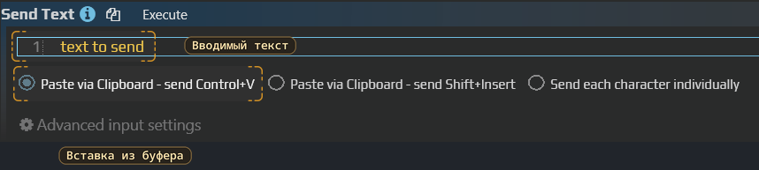

# Ввод текста из старого Send Text

Готовый текст теперь вводит шаг **Text** в [Send Sequence](/ru/actions/sendinput/send-sequence). Например, он может вставить в поле формы комментарий `Документы получены. Проверить вложения.`, а отправите форму вы сами.

Отдельное действие **Send Text** устарело. От него остались старый WPF-редактор и команда переноса, в списке новых действий его нет.

## Вставить подпись через Text

Подготовьте тестовую форму или черновик без автоматической отправки. Нужное многострочное поле должно быть открыто для редактирования. Выбор окна поле внутри него не выбирает.

1. Добавьте в ауру **Send Sequence**, нажмите **Text** на панели последовательности и выберите добавленный шаг.
2. В его поле **Text** введите `Документы получены. Проверить вложения.` — без кавычек вокруг.
3. В **Send method** выберите **Control+V**.
4. Раскройте **Advanced input settings**, выберите нужный **Target Window** и **Input Simulator = Windows Input**. Enter и другие шаги отправки формы пока не добавляйте.
5. Поставьте фокус в поле формы и запустите действие через **Execute**. В поле должна появиться ровно заданная подпись. Проверьте её перед отправкой формы.

Control+V кладёт текст в системный буфер обмена и отправляет сочетание вставки. Прежнее содержимое буфера само не восстанавливается. Вставка попадает в очередь ввода, поэтому конец текстового шага ещё не значит, что приложение уже обработало текст.

## Выбрать способ

| Send method | Что происходит |
|---|---|
| Control+V | Текст копируется в буфер обмена, затем отправляется Ctrl+V. Подходит для полей, которые принимают обычную вставку |
| Shift+Insert | Тот же буфер обмена, но сочетание Shift+Insert. Берите, если приложение принимает именно его |
| Type characters | Каждый символ превращается в клавишу с нужными модификаторами. Зависит от раскладки и от того, можно ли набрать символ клавишами |

**Type characters** определяет раскладку. Но произвольный многоязычный текст или символы, которых нет в доступной раскладке, он может не набрать. Смешанный текст и Unicode обычно проще вставить через буфер.

В поле Text пишется текст как есть, а не команды AutoHotkey или строка C#. `Ctrl+A`, `{Enter}` и `\n` не превратятся в сочетание, Enter и перевод строки. Настоящий перевод строки вводите прямо в многострочное поле. Отдельное нажатие Enter добавляйте как события клавиши через Keyboard. Обратную косую черту, плюсы и фигурные скобки экранировать не нужно.

## Перенести существующее действие

1. В старом Send Text проверьте **Text**, **Input Method**, окно и симулятор.
2. Если старый редактор доступен, нажмите **Convert to Send Sequence**. Новое действие появится **после старого**, а не вместо него.
3. В новом шаге Text сравните весь текст и Send method. Старые **Paste via Clipboard (Ctrl+V)**, **Paste via Clipboard (Shift+Insert)** и **Send Each Character Individually** — это три варианта из таблицы.
4. Выполните только новое действие в тестовом поле. После проверки удалите старое из списка, иначе аура вставит текст дважды. Если старый редактор недоступен, создайте Text вручную по шагам выше.

[Общие параметры](/ru/actions/sendinput/options) задают, куда и как доставляется ввод. Ни Ctrl+V, ни посимвольный ввод не отправляют текст в фон: обычный Windows Input работает с активированным окном и текущим фокусом в нём.
