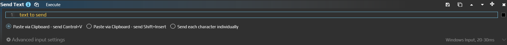

# Ввод текста из старого Send Text

Чтобы вставить готовую подпись в форму, теперь добавьте шаг **Text** в [Send Sequence](/ru/actions/sendinput/send-sequence). Например, можно заполнить поле комментарием `Документы получены. Проверить вложения.` и оставить отправку формы за собой.

Отдельное действие **Send Text** — устаревшее. У него сохранился старый WPF-редактор и команда переноса; это не название нового действия в списке. Снимок показывает прежние переключатели способов ввода.

## Вставить подпись через Text

Подготовьте тестовую форму или черновик без автоматической отправки. Нужное многострочное поле должно быть доступно для редактирования; выбор окна сам по себе не выбирает поле внутри него.

1. Добавьте в ауру **Send Sequence**, нажмите **Text** на панели последовательности и выберите добавленный шаг.
2. В его поле **Text** введите `Документы получены. Проверить вложения.` — без внешних кавычек.
3. В **Send method** выберите **Control+V**.
4. Раскройте **Advanced input settings**, выберите нужный **Target Window** и **Input Simulator = Windows Input**. Для этой проверки не добавляйте Enter и другие шаги отправки формы.
5. Установите фокус в поле формы и запустите действие через **Execute**. После вставки там должна появиться ровно заданная подпись. Проверьте результат перед отправкой формы.

Control+V меняет содержимое системного буфера обмена и отправляет сочетание вставки. Автоматическое восстановление прежнего буфера этим способом не предусмотрено. Вставка ставится в очередь ввода, поэтому не считайте окончание текстового шага подтверждением, что приложение уже обработало текст.

## Выбрать способ

| Send method | Что происходит |
|---|---|
| Control+V | Текст копируется в буфер обмена, затем отправляется Ctrl+V. Подходит для полей, принимающих обычную вставку |
| Shift+Insert | Тот же буфер обмена, но сочетание Shift+Insert. Используйте, если именно его принимает целевое приложение |
| Type characters | Каждый символ преобразуется в клавишу с нужными модификаторами. Зависит от раскладки и возможности представить символ клавишами |

Для **Type characters** работает определение раскладки. Оно не гарантирует ввод произвольного многоязычного текста или символов, которых нет в доступной раскладке. Для смешанного текста и Unicode обычно проще проверить вставку через буфер. Сам по себе другой метод не заставляет приложение принимать запрещённый им ввод.

В поле Text вводится буквальный текст, а не команды AutoHotkey или строка C#: `Ctrl+A`, `{Enter}` и `\n` не превращаются в сочетание, Enter и перевод строки. Настоящий перевод строки вводите в многострочное поле; для отдельного нажатия Enter добавляйте события клавиши через Keyboard. Обратная косая черта, плюсы и фигурные скобки в тексте не требуют специального экранирования EyeAuras.

## Перенести существующее действие

1. В старом Send Text проверьте **Text**, **Input Method**, окно и симулятор.
2. Нажмите **Convert to Send Sequence**, если доступен старый редактор. Новое действие появится **после старого**, а не вместо него.
3. В новом шаге Text сравните весь текст и Send method. Старые **Paste via Clipboard (Ctrl+V)**, **Paste via Clipboard (Shift+Insert)** и **Send Each Character Individually** соответствуют трём вариантам таблицы.
4. Выполните только новое действие в тестовом поле. После проверки удалите старое из списка, чтобы аура не вставляла текст дважды. Если старый редактор недоступен, создайте Text вручную по шагам выше.

[Общие параметры](/ru/actions/sendinput/options) задают адресата и способ доставки. Ни Ctrl+V, ни посимвольный ввод не означают универсальную отправку в фон: обычный Windows Input работает с активированным окном и текущим фокусом внутри него.
