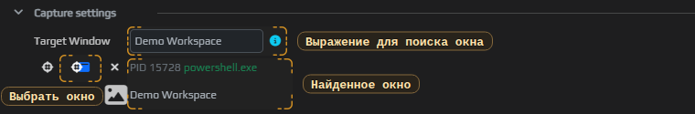

# Win Activate — вернуться к нужному окну

Win Activate выводит на передний план уже открытое окно. Например, можно вернуть Блокнот из-под других окон, не перебирая их через Alt+Tab.

Перед настройкой откройте Блокнот и оставьте только одно его окно, чтобы не перепутать.

## Выведите Блокнот на передний план

1. Добавьте в ауру действие **Win Activate**, например в группу **On Enter**.
2. В **Target Window** раскройте список окон и выберите Блокнот. Убедитесь, что рядом с выражением показано именно нужное окно.

   

   На снимке найдено окно Demo Workspace. У себя выберите Блокнот и сверьте название в строке результата.
3. Если поле **Timeout** доступно, задайте `1000` мс на попытку активации.
4. Откройте поверх Блокнота другое окно. Затем вернитесь в редактор действия EyeAuras и нажмите **Execute** у Win Activate.

Блокнот должен оказаться на переднем плане. Так вы проверили выбор окна и само действие. Чтобы вызывать его клавишей, добавьте в ту же ауру [Hotkey Is Active](/ru/triggers/hotkey-is-active), задайте свободную клавишу и режим Hold. Теперь по нажатию группа On Enter выполнит Win Activate.

## Настройки

| Настройка | Что делает |
| --- | --- |
| Target Window | Выбирает окно по [выражению сопоставления](/ru/features/window-matching-expressions). Для начала можно выбрать готовое окно из списка. |
| Timeout | Время попытки активации в миллисекундах. Это не ожидание запуска программы и не гарантия общей длительности операции. |

При выборе из списка может сохраниться дескриптор окна — его временный идентификатор. После перезапуска программы он меняется. Для постоянной настройки подберите выражение по заголовку или процессу и проверьте, какие окна оно находит: слишком широкое выражение может выбрать не то окно.

Windows может не дать вывести чужое окно на передний план. Если действие не сработало, сначала проверьте выбранную цель. Есть ли окно, можно отдельно отслеживать через [Window Exists](/ru/triggers/window-exists), а на переднем ли оно плане — через [Window Is Active](/ru/triggers/window-is-active).
