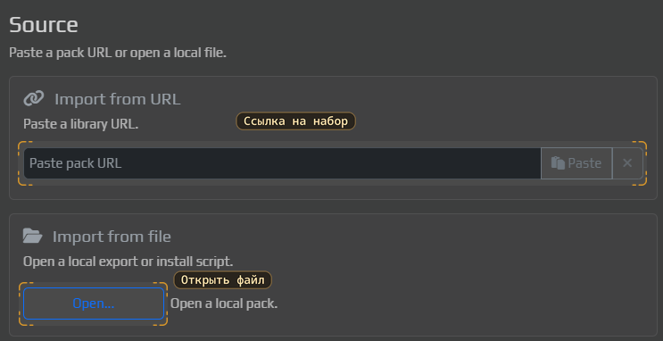

# Найти подходящий набор в библиотеке аур

[Aura Library](https://eyeauras.net/library) — это каталог наборов, которые пользователи выложили публично. Найдите там набор под свою задачу и сначала прочитайте его описание, чтобы не собирать всё с нуля.

## Найти и просмотреть набор

Чтобы смотреть библиотеку, хватит браузера. Для импорта нужны установленный EyeAuras подходящей версии и доступ к содержимому набора.

1. Откройте [библиотеку](https://eyeauras.net/library). Например, чтобы найти учебные материалы, выберите тег **Tutorial** в **by Tags** и нажмите **Apply**.
2. Результатов много — введите в **Search** слова из названия или описания. Наборы одного автора ищите через **by User**, наборы для приложения — через **by Application/Game**. **Reset** сбрасывает фильтры.
3. Нажмите на название набора. Прочитайте описание, посмотрите автора, ревизию и версию EyeAuras. Проверьте требования к окну, разрешению, языку, ресурсам и внешним компонентам.
4. Набор подходит — выберите в таблице ниже, как его получить.

| Элемент библиотеки | Что делает |
| --- | --- |
| Search | Ищет по имени, краткому и полному описанию. |
| by Application/Game | Показывает только наборы с тегом приложения или игры. |
| by Tags | Фильтрует по тегам набора. Чем больше тегов выбрано, тем уже поиск. |
| by User | Фильтрует по имени автора. |
| Date DESC / Date ASC, Page size | Меняют порядок и число результатов на странице. |
| Название набора | Открывает страницу публикации с описанием и доступными действиями. |
| Import | Передаёт ссылку установленному приложению через протокол eyeauras:. Браузер может спросить, разрешить ли открыть EyeAuras. Содержимое при этом не запускается. |
| Download pack | Открывает скачивание готового комплекта. Условия и состав зависят от публикации. |

## Просмотреть импорт до применения

1. Скопируйте обычную ссылку со страницы публикации или нажмите **Import** на сайте. Если приложение не открылось, откройте в EyeAuras **Import → Source** и вставьте ссылку вручную.

   

   Ссылку вставьте в верхнее поле Paste pack URL. Нижняя кнопка Open… открывает уже сохранённый файл.
2. Нажмите **Download** и посмотрите **Preview**, **Overview** и **Pack Options**. Проверьте состав и требования автора до того, как нажмёте **Import**.
3. В **Import Options** решите, нужна ли подписка на обновления. Если такие элементы у вас уже есть, выберите **Copy**, **Replace** или пропуск конфликтов. Подробно — в статье [Экспорт и импорт](/ru/features/export-import).
4. После импорта проверьте свои окна, пути и внешние зависимости.

| Вариант | Что будет с обновлениями |
| --- | --- |
| Разовый импорт | Вы получаете ту версию, которую загрузили. Новые ревизии автора сами её не заменят. |
| Subscribe to updates | Локальная папка связана с источником. Обновления приходят через синхронизацию, а не простым копированием всех файлов заново. |
| Clone locally вместе с подпиской | Создаётся копия с отдельными локальными ID. Связь с источником сохраняется. |

Набор может зависеть от других аур, встроенных ресурсов, файлов, модели или отдельной лицензии. Ссылка на внешний файл не устанавливает сам файл. Права на запуск, редактирование и распространение задаются отдельно: см. [модель разрешений](/ru/features/permission-model) и [паки](/ru/features/packs).

Сделать свой набор видимым в библиотеке

Сначала [опубликуйте свой набор](/ru/features/export-import). Проверьте название, описание и теги. Укажите нужную версию, подготовку, разрешение и другие условия работы. Перед публикацией проверьте содержимое и уберите секреты.

1. Откройте страницу своей публикации под аккаунтом, у которого есть право ей управлять.
2. В **Danger Zone → Change visibility in Library** выберите **Change visibility to Public**. Теперь набор можно найти в библиотеке.
3. Проверьте, что набор находится по вашему имени автора или по названию. Вернуть как было можно кнопкой **Change visibility to Unlisted**.

| Состояние | Что означает |
| --- | --- |
| Public | Набор виден в публичной библиотеке. |
| Unlisted | В публичном списке набора нет. Прямая ссылка работает для тех, кому разрешён просмотр. Это не пароль и не защита исходников. |

Когда вы обновляете публикацию, библиотека показывает её активную ревизию. Уже импортированные копии от этого сами не обновятся.

Не выкладывайте чужую работу как свою. Если взяли её за основу в рамках разрешённых прав, укажите автора. Лимиты загрузки смотрите в окне публикации и в условиях сервиса.

