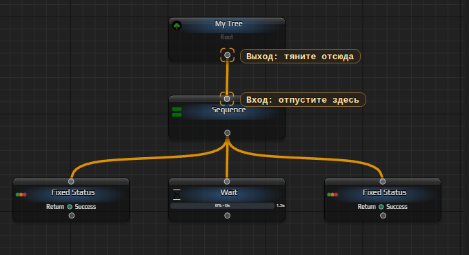
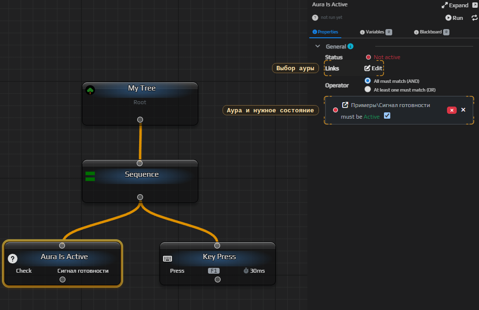
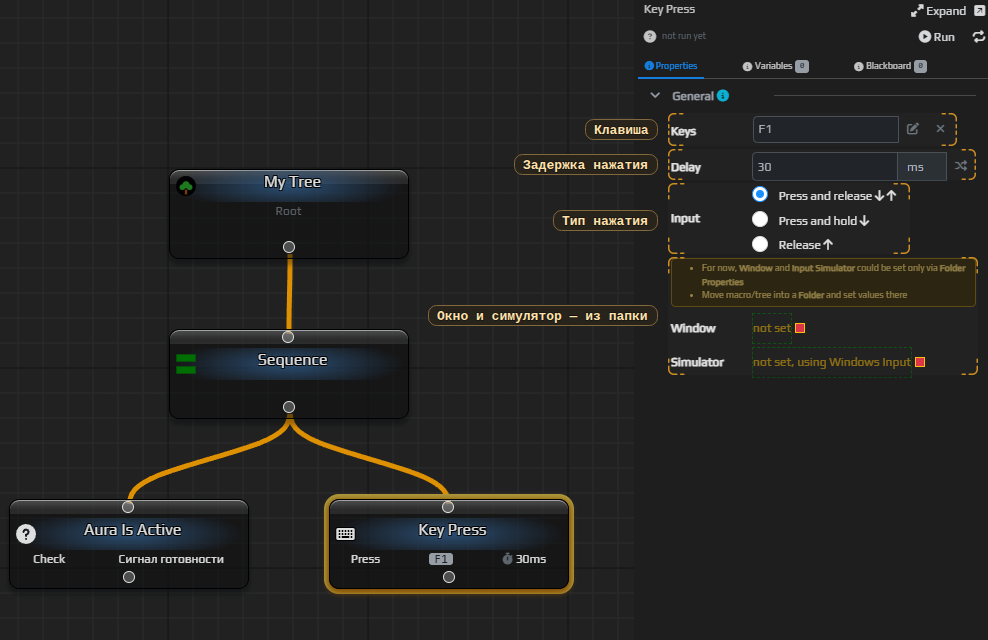
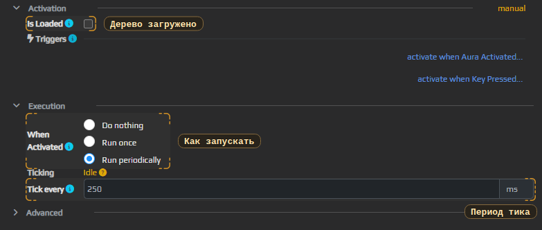
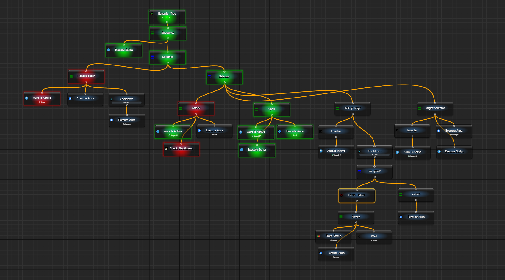
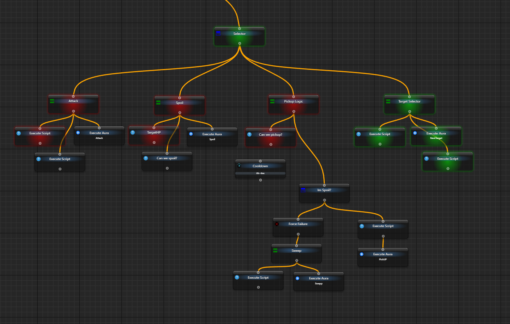

# Первое дерево поведения

Дерево поведения выполняет шаги по порядку и останавливается, если условие не выполнено. Узлы проверяют условия и делают работу, а связи между ними задают, куда идти дальше. В первом примере ничего не нажимается: вы просто увидите порядок шагов, ожидание и итоговый статус.

## Собрать и выполнить один проход

Нужен EyeAuras с редактором деревьев. Создайте отдельное дерево — макрос для этого примера не подходит.

1. В дереве аур откройте меню создания и выберите `New Behavior Tree`. Откройте новый элемент. В центре графа будет вход `My Tree`.
2. Выберите вход. Включите `Activation → Is Loaded`, а в `Execution → When Activated` выберите `Do nothing`. Теперь дерево само не запускается, но его можно тикнуть вручную.
3. Нажмите кнопку с подсказкой `Add new Node` и добавьте `Sequence`, два `Fixed Status` и `Wait`. Узлы можно и перетащить из палитры на граф.

   

   Новые узлы пока не выполняются — их нужно соединить. Соедините выход входа с входом `Sequence`, затем выход `Sequence` с тремя детьми. Расставьте детей слева направо, как на схеме ниже.

   

4. У обоих `Fixed Status` выберите `General → Status → Success`. У `Wait` задайте `General → Delay = 1500 ms`. Если включён случайный разброс, выключите его кнопкой со значком перемешивания.

```text
My Tree
└─ Sequence
   ├─ Fixed Status: Success
   ├─ Wait: 1500 ms
   └─ Fixed Status: Success
```

5. Нажмите вверху `Tick BT Once` — это один тик выбранного дерева. Первый `Fixed Status` выполнится, `Wait` и `Sequence` вернут `Running`, а до последнего узла дело ещё не дойдёт.
6. Подождите хотя бы две секунды и нажмите **ту же** `Tick BT Once` ещё раз. Дерево продолжит с `Wait`, дойдёт до последнего узла и вернёт `Success`.

Внизу редактора видны результат и время последнего тика. В [Event Viewer](/ru/features/event-viewer) появится сообщение о ручном выполнении. Следующее нажатие после завершения начинает новый проход. При новом тике цвет уже пройденного узла может сброситься — это не значит, что узел выполнился снова.

| Что вы увидели | Что это значит |
| --- | --- |
| Success | Узел успешно закончил свою задачу |
| Failure | Условие не выполнено или узел закончил задачу с таким результатом |
| Running | Узел ещё работает. Чтобы он закончил, может понадобиться следующий тик |
| not run yet | Результата пока нет. Это не Unknown триггера |

Ошибки и отмена — отдельные события. Красный цвет не всегда значит, что условие не выполнено: читайте сообщение об ошибке и смотрите, как запускалось дерево. Как родители используют результаты детей, описано в [справочнике узлов](/ru/behavior-trees/nodes).

## Как читать дерево

Дети выполняются слева направо. Положение по вертикали на порядок не влияет. В сохранённых конфигурациях со списком та же вложенность показана строками. `Sequence` проходит все успешные шаги, [Selector](/ru/behavior-trees/nodes/selector) выбирает первый успешный вариант, а [IfThenElse](/ru/behavior-trees/nodes/ifthenelse) явно разделяет условие и две ветки.


Анимация взята из [статьи об устройстве деревьев](https://habr.com/ru/companies/cloud_mts/articles/306214/) и показывает переход между узлами. Цвета в ней — не цвета EyeAuras.

Дереву не нужны `On Enter`, `While Active` и `On Exit` ваших аур: порядок вызова узлов оно задаёт само. Если нужны действия уже настроенной ауры, вызовите их узлом `Execute Aura`. Так запутанную сеть связей можно заменить одной понятной последовательностью. Существующие связи по-прежнему удобно смотреть в [графе зависимостей](/ru/overlays/dependencies-viewer).

<details>
<summary>Как подключить реальное условие и действие</summary>

Когда порядок понятен, замените первый `Fixed Status` на `Aura Is Active` со ссылкой на свою проверенную ауру, а последний — на нужную реакцию. Привычный пример: аура `HP is low` служит условием, а **Key Press** с клавишей F1 — реакцией. Проверку делает сама аура: например, ищет цвет индикатора через [Color Search](/ru/triggers/images/color-search) или объект через [AI Search](/ru/triggers/images/ai-search-trigger). Дерево значение HP из приложения не получает.

На снимке **Aura Is Active** проверяет, активна ли связанная аура `Примеры\Сигнал готовности`.



Чтобы выбрать ауру, откройте **Aura Is Active → General → Links → Edit**. Ниже в окне выбора выделена учебная аура `BT signal` с триггером **Fixed Value → Is NOT Active**. Она же появилась в списке связей.


После проверки ауры идёт реакция — например, **Key Press** с клавишей F1. Перед запуском такого узла задайте окно и симулятор ввода в свойствах папки.



Чтобы дерево запускалось само, настройте у входа группы `Activation` и `Execution` — например, период 250 ms. Активацию можно связать с аурой [Hotkey Is Active](/ru/triggers/hotkey-is-active).

На снимке задан период 250 мс, но флажок **Is Loaded** снят, поэтому дерево простаивает.



А это настройки учебного примера с ручным запуском: **Is Loaded** включён, в **When Activated** выбран **Do nothing**. Видны группы **Activation** и **Execution**, кнопка **Tick BT Once** — вверху.


Если условие выполнено, дерево переходит к действию. Если нет — ветка останавливается.

В учебном примере у **Sequence** два ребёнка: **Aura Is Active** со ссылкой на `BT signal` (ожидается Active) и **Fixed Status: Success**. У сигнала выбран **Fixed Value → Is Active**, аура стала Active. Один **Tick BT Once** дошёл до последнего ребёнка и вернул Success.


Теперь такое же дерево, собранное заново, без прежних результатов. У `BT signal` выбран **Is NOT Active**. После одного **Tick BT Once** дерево, Sequence и условие вернули Failure, а последний ребёнок остался в **not run yet**. Его **General → Status → Success** — это настройка, а не результат выполнения.


Чтобы реакция срабатывала не слишком часто, поставьте перед ней [Cooldown](/ru/behavior-trees/nodes/cooldown) — например, не чаще раза в 10 секунд.

На снимке **Fixed Status child** стоит под **Cooldown**. У декоратора видны **General → Cooldown = 10000 ms** и **Child = Fixed Status child**.


Для всего этого нужно отдельно настроить источник условия и способ ввода. В первом примере выше они не нужны. Автоматический запуск MainTree и выбор окна описаны на странице [Root](/ru/behavior-trees/nodes/root).

</details>

<details>
<summary>Как выглядит большая конфигурация</summary>

Старая схема для Lineage 2 объединяла проверки аур и вызовы действий. Она показывает, насколько большим может быть дерево. Встроенной связи с данными игры в ней нет.



В другом варианте часть работы вынесена в `Execute Script`. Для этого нужны [основы C#-скриптов](/ru/scripting/getting-started) и свои проверки в коде.



</details>
