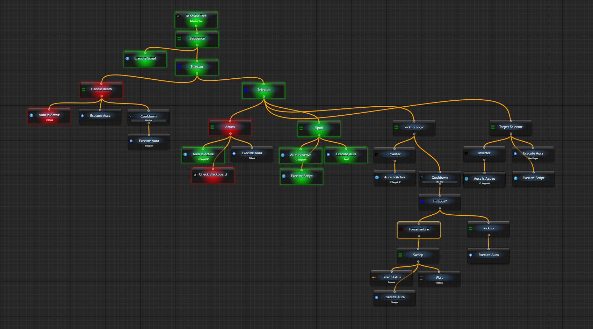
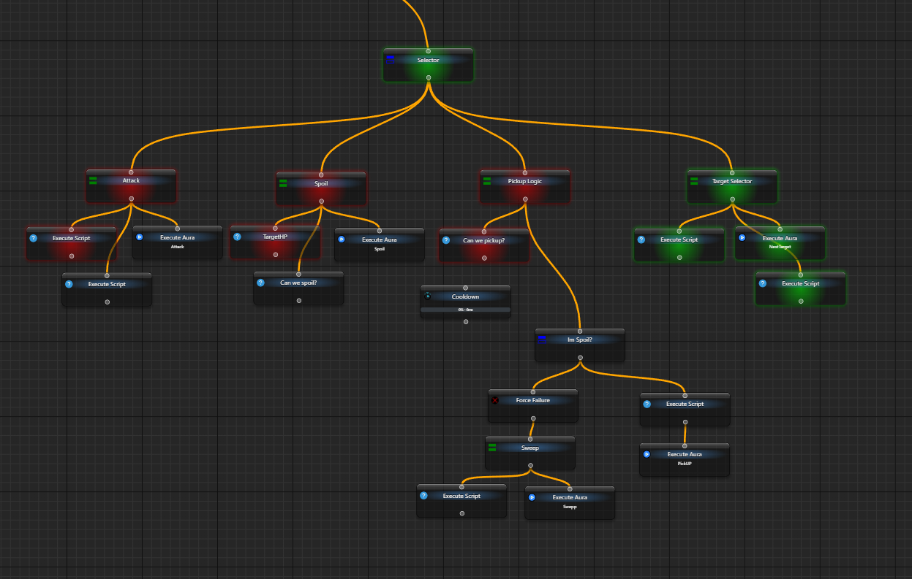

# Первое дерево поведения

Чтобы выполнить несколько шагов в нужном порядке и остановиться на невыполненном условии, соберите дерево поведения. Узлы проверяют условия и выполняют работу, а связи определяют, куда идти дальше. Для первого опыта достаточно увидеть последовательность, ожидание и итоговый статус — без нажатий в другом приложении.

## Собрать и выполнить один проход

Нужен EyeAuras с доступным редактором деревьев. Создавайте своё отдельное дерево; макрос для этого примера не подходит.

1. В дереве аур откройте меню создания и выберите `New Behavior Tree`. Откройте новый элемент. В центре графа будет вход `My Tree`.
2. Выберите вход. В его настройках установите `Activation → Is Loaded`, а в `Execution → When Activated` выберите `Do nothing`. Автоматический запуск выключен, но ручной тик загруженного дерева доступен.
3. Через кнопку с подсказкой `Add new Node` добавьте `Sequence`, два `Fixed Status` и `Wait`. Новые карточки графа ещё не включены в выполнение: соедините выход входного узла с входом `Sequence`, затем выход `Sequence` с тремя детьми. Расположите детей слева направо по схеме ниже.
4. У обоих `Fixed Status` выберите `General → Status → Success`. У `Wait` задайте `General → Delay = 1500 ms`, случайный разброс выключите кнопкой со значком перемешивания, если он включён.

```text
My Tree
└─ Sequence
   ├─ Fixed Status: Success
   ├─ Wait: 1500 ms
   └─ Fixed Status: Success
```

5. Нажмите верхнюю кнопку `Tick BT Once`. Это один тик выбранного дерева. Первый `Fixed Status` выполнится, `Wait` и `Sequence` вернут `Running`, последний ребёнок ещё не будет выполнен.
6. Подождите не меньше двух секунд и снова нажмите **ту же** `Tick BT Once`. Выполнение продолжится с `Wait`, затем дойдёт до последнего ребёнка; результат дерева будет `Success`.

Внизу редактора видны результат и время последнего тика, а в [Event Viewer](/ru/features/event-viewer) — сообщение о ручном выполнении. Это и есть результат первого опыта. После завершения ещё одно нажатие начинает новый проход. Цвет ранее пройденного узла может очиститься при следующем тике: очистка отображения не означает повтор его действия.

| Что вы увидели | Что это значит |
| --- | --- |
| Success | Узел закончил свою задачу успешно |
| Failure | Условие не выполнено или узел закончил задачу с таким результатом |
| Running | Работа сохраняется для продолжения; следующий тик может понадобиться для её завершения |
| not run yet | Для текущего отображения ещё нет результата. Это не Unknown триггера |

Ошибки и отмена — отдельные события. Не считайте любое красное состояние доказательством невыполненного условия: смотрите сообщение об ошибке и контекст запуска. [Справочник узлов](/ru/behavior-trees/nodes) объясняет, как родители используют результаты детей.

## Как читать дерево

В графе дети выполняются в порядке слева направо; вертикальное положение само по себе порядок не задаёт. В сохранённых конфигурациях со списком та же вложенность показана строками. `Sequence` проходит все успешные шаги, [Selector](/ru/behavior-trees/nodes/selector) выбирает первый успешный вариант, а [IfThenElse](/ru/behavior-trees/nodes/ifthenelse) явно разделяет условие и две ветки.


Анимация из [статьи об устройстве деревьев](https://habr.com/ru/companies/cloud_mts/articles/306214/) иллюстрирует переход между узлами. Её собственная легенда цветов не является легендой EyeAuras.

Дерево не обязано связывать уже существующие `On Enter`, `While Active` и `On Exit`. Оно само задаёт порядок вызова узлов; узел `Execute Aura` позволяет отдельно воспользоваться действиями своей ауры. Это помогает заменить сложную сеть связей понятной последовательностью, хотя [граф зависимостей](/ru/overlays/dependencies-viewer) по-прежнему полезен для просмотра существующих связей.

<details>
<summary>Как подключить реальное условие и действие</summary>

Когда порядок понятен, вместо первого `Fixed Status` можно использовать `Aura Is Active` со ссылкой на свою проверенную ауру, а вместо последнего — нужную реакцию. Например, собственная аура может искать цвет индикатора через [Color Search](/ru/triggers/images/color-search) или объект через [AI Search](/ru/triggers/images/ai-search-trigger). Само дерево не получает значение HP из приложения.

В прежнем учебном примере аура `HP is low` уже существовала и возвращала готовое условие. Сначала её связывали с `Aura Is Active`:


Затем после условия ставили `Key Press` с `F1`. Это отдельный ввод в выбранное окно, не часть проверки самого условия:


Для автоматического запуска использовали активацию дерева и период 250 ms; текущие группы называются `Activation` и `Execution`. Можно связать активацию с аурой [Hotkey Is Active](/ru/triggers/hotkey-is-active).


Успех условия допускал действие, а неуспех останавливал эту ветку:


[Cooldown](/ru/behavior-trees/nodes/cooldown) перед реакцией ограничивал частоту, например одним выполнением за 10 секунд:


Всё это требует отдельно настроенных источника условия и способа ввода. Для первого опыта выше они не нужны. Автоматический запуск MainTree и выбор адресата разбирает [Root](/ru/behavior-trees/nodes/root).

</details>

<details>
<summary>Как выглядит большая конфигурация</summary>

Старая схема для Lineage 2 объединяла проверки аур и вызовы действий: она показывает размер возможной логики, но не содержит встроенной интеграции с игровыми данными.



В другом варианте часть работы была вынесена в `Execute Script`. Для такого пути нужны [контекст и основы C# Script](/ru/scripting/getting-started), а также собственная реализация проверок.



</details>
