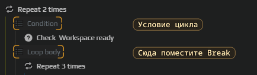

# Break — выйти из цикла или блока макроса

`Break` досрочно выходит из цикла или блока в макросе. Поставьте его в Loop body, когда нужный результат уже получен и остальные итерации не нужны. После выхода из Repeat макрос переходит к следующему шагу. Если Break стоит в отдельно вложенном Block, он выходит только из этого блока.

## Завершить Repeat на первой итерации

Создайте свой [макрос](/ru/macros/getting-started) с `Activation → Is Loaded`, `Execution → When Activated → Do nothing`. В примере только проверки и паузы, ничего не нажимается.

1. В исходный блок добавьте `Repeat`, а после него — `Fixed Status`. У этого Fixed Status задайте `General → Status → Success`.
2. У Repeat выберите `General → When Activated → Run N times`, `Repeat = 5`, `Delay = 0 ms` без разброса. Внутри Repeat уже есть блоки `Condition` и `Loop body`.
3. Добавьте Fixed Status с Success и перетащите его в Condition. В Loop body поставьте по порядку: `Wait` с `Delay = 500 ms`, `Break`, затем Fixed Status с Failure. Перед запуском проверьте, что узлы лежат в нужных блоках.

   

   На снимке — макрос Daily routine: в Condition у Repeat стоит Workspace ready, а в Loop body — вложенный Repeat. В своём примере положите в Loop body Wait и Break.

```text
My Macro
└─ Block
   ├─ Repeat: 5 times
   │  ├─ Condition
   │  │  └─ Fixed Status: Success
   │  └─ Loop body
   │     ├─ Wait: 500 ms
   │     ├─ Break
   │     └─ Fixed Status: Failure
   └─ Fixed Status: Success
```

4. Нажмите вверху `Run Macro Once`. Пройдёт одна пауза, затем Break завершит Repeat, не дожидаясь следующей итерации. Fixed Status после Break не выполнится, а последний Fixed Status **после Repeat** выполнится. Итог макроса — Success.
Repeat возвращает Success, когда штатно завершился. Это не сводка неудач внутри тела цикла.

| Место или настройка | Что происходит |
| --- | --- |
| Категория Macro | Break доступен в макросе. Это не декоратор обычного BT |
| Loop body → Break | Остаток тела и следующие итерации пропускаются. Выполнение продолжается после Repeat |
| IfThenElse внутри Loop body | Break в выбранной ветке проходит через служебный блок ветки до Repeat |
| Отдельный вложенный Block → Break | Пропускается остаток этого Block. Окружающий цикл или внешний блок может работать дальше |
| Настройки Break | Статус выбрать нельзя. Обычный выход Break возвращает Success |
| Дети Break | Не выполняются как продолжение. Шаг после выхода ставьте соседом за нужным Block или Repeat |

Чтобы выходить по условию, добавьте в Loop body макросный IfThenElse: проверку положите в Condition, Break — в If matched, then. Условием может быть [Aura Is Active](/ru/behavior-trees/nodes/aura-is-active) со ссылкой на вашу ауру. Для условия «объект найден» эта аура должна действительно выполнять поиск.

<details>
<summary>Граница выхода и завершение работы</summary>

Не ставьте Break в Condition у Repeat — цикл он так не остановит. У блока проверки своя граница, и успешный выход из него может разрешить очередную итерацию. Ставьте Break в Loop body. Block, который вы вложили сами, тоже перехватит выход раньше внешнего Repeat.

Break срабатывает, только когда выполнение до него дошло. Он не прервёт зависший предыдущий шаг, не откатит действия и не отпустит удерживаемые клавиши. Ошибки и отмена — отдельные события. Смотрите на завершение макроса и шаг после Repeat, а не только на цвет прерванной ветки.

Чтобы закончить весь текущий макрос, используйте [Return](/ru/behavior-trees/nodes/Return). Если макрос вызван из другой схемы, Break действует только внутри него и вызывающие деревья не отменяет.

</details>
