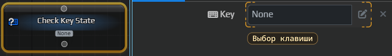

# Check Key State — проверить удерживаемую клавишу

`Check Key State` проверяет, нажата ли клавиша прямо сейчас. Берите его, когда ветка должна выполняться только при зажатой клавише. Узел читает текущее низкоуровневое состояние клавиатуры. Он не назначает глобальную горячую клавишу, не перехватывает ввод и не запоминает короткое нажатие между тиками.

## Проверить клавишу без внешнего действия

Создайте своё [дерево](/ru/behavior-trees/gettings-started) с `Activation → Is Loaded` и `Execution → When Activated → Do nothing`. Для примера подойдёт F8, если в вашем окне на неё ничего не назначено. Само дерево ничего не нажимает.

1. Через `Add new Node` добавьте `Sequence`, `Check Key State` и `Fixed Status`. Соедините их по схеме слева направо.
2. У проверки в `General → Key` выберите `F8`. У Fixed Status задайте `General → Status → Success`.

```text
My Tree
└─ Sequence
   ├─ Check Key State: F8
   └─ Fixed Status: Success
```

3. Отпустите F8 и нажмите вверху `Tick BT Once`. Проверка и Sequence вернут `Failure`, последний узел не выполнится.
4. Зажмите F8 и мышью нажмите ту же кнопку. Проверка вернёт `Success`, и Sequence дойдёт до Fixed Status. После этого отпустите клавишу.

Клавиша выбирается в поле `Key` (раньше оно называлось Hotkey). На снимке она ещё не выбрана — для примера выберите F8.



| Настройка или состояние | Что проверяется |
| --- | --- |
| Key | Основная клавиша клавиатуры. Мышь и колесо здесь выбрать нельзя |
| Клавиша нажата | Success, если у узла нет ребёнка |
| Клавиша отпущена или не выбрана | Failure |
| Комбинация с Ctrl, Alt или Shift | Проверяется только основная клавиша, а не вся комбинация с модификаторами |

Узел читает состояние через стандартный механизм клавиатуры. Target Window и Input Simulator дерева на него не влияют. Узел не знает, обработало ли приложение клавишу. Если нужно полноценное сочетание с режимами удержания и переключения, сделайте отдельную ауру [Hotkey Is Active](/ru/triggers/hotkey-is-active) и проверяйте её через [Aura Is Active](/ru/behavior-trees/nodes/aura-is-active).

<details>
<summary>Продолжение и макросы</summary>

К проверке можно подключить ребёнка. Он вызывается после Success, и результат узла становится его результатом. Если ребёнок вернул Running, следующий тик продолжит его и клавишу заново не проверит. Поэтому отпускание клавиши работу само не остановит — для этого нужен отдельный механизм прерывания.

Шаблон общий для BT и Macro. В дереве Sequence остановится, когда проверка вернёт Failure. В макросе обычный Block может выполнить следующих соседей и после Failure. Чтобы работа зависела от условия, положите её в дочернюю ветку проверки или в подходящий управляющий узел макроса.

</details>
