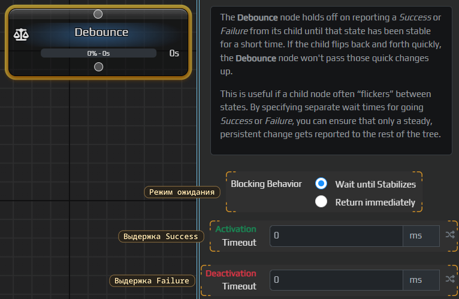

# Debounce — отфильтровать краткое изменение условия

`Debounce` сглаживает проверку, которая быстро скачет между `Success` и `Failure`. Он передаёт результат ребёнка дальше, только когда тот продержался заданное время. Для Success и Failure время задаётся отдельно. Что видит родитель, пока идёт ожидание, зависит от режима Behavior.

## Увидеть задержку в обе стороны

Создайте своё дерево с `Activation → Is Loaded`, `Execution → When Activated → Do nothing`. Подключите к Debounce один Fixed Status — им вы будете переключать условие вручную, без внешнего датчика.

1. Добавьте `Debounce` и `Fixed Status`, соедините вход дерева → Debounce → Fixed Status.
2. У ребёнка выберите `General → Status → Success`. У Debounce в `General → Behavior` оставьте `Wait until Stabilizes`, задайте `Activation Timeout = 2000 ms` и `Deactivation Timeout = 3000 ms`. У обоих интервалов выключите случайный разброс.
3. Нажмите вверху `Tick BT Once`. Ребёнок вернёт Success, Debounce — `Running`. Подождите не меньше трёх секунд и повторите тик: Debounce вернёт `Success`.
4. У ребёнка выберите `Failure` и выполните тик: Debounce снова вернёт Running. Подождите не меньше четырёх секунд и повторите: результат станет `Failure`.

На снимке группа ещё называется `Blocking Behavior` — сейчас это `Behavior`.

| Настройка | Что задаёт |
| --- | --- |
| Behavior — Wait until Stabilizes | Пока время для текущего Success или Failure не вышло, узел возвращает Running. Ждёт только эта ветка, ауры не останавливаются |
| Behavior — Return immediately | Пока время не вышло, узел возвращает противоположный результат. Потом — текущий результат ребёнка |
| Activation Timeout | Выдержка для Success, в миллисекундах |
| Deactivation Timeout | Выдержка для Failure, в миллисекундах |
| Случайный диапазон Min / Max | Значение выбирается один раз, в начале интервала, а не на каждом тике |
| Child | Один проверяемый ребёнок |

Чтобы сгладить состояние уже настроенного индикатора, подключите ребёнком [Aura Is Active](/ru/behavior-trees/nodes/aura-is-active) со ссылкой на его ауру. Если нужна обычная пауза перед следующим шагом, берите [Wait](/ru/behavior-trees/nodes/wait). Если нужен перерыв после успешной работы — [Cooldown](/ru/behavior-trees/nodes/cooldown).

## Что означает Return immediately

В этом режиме родитель получает ответ сразу и может идти дальше. «Последнее подтверждённое состояние» узел при этом не хранит:

| Наблюдаемый результат ребёнка | Результат Debounce в Return immediately |
| --- | --- |
| Success, срок Activation ещё идёт | Failure |
| Success, срок Activation истёк | Success |
| Failure, срок Deactivation ещё идёт | Success |
| Failure, срок Deactivation истёк | Failure |
| Running | Running в обоих режимах |

Как отсчитывается стабильность

Первый Success запускает отсчёт Activation и сбрасывает Deactivation. Первый Failure — наоборот. Если результат повторяется, уже начатый отсчёт продолжается. При нулевой выдержке результат проходит сразу.

Между тиками Debounce за ребёнком не следит. Короткое переключение, которое не попало ни в один тик, он не заметит. Running передаётся сразу и начатый отсчёт не сбрасывает: время продолжает идти.

Если поменять срок во время отсчёта, текущий интервал не пересчитается. Новое значение сработает, когда отсчёт начнётся в следующий раз. Структурный сброс очищает оба таймера, а очистка цвета и последнего статуса — нет. Без ребёнка узел работает так, будто получил Success.

