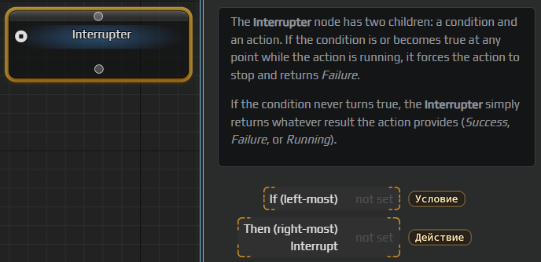

# Interrupter — прервать участок по условию

`Interrupter` останавливает ветку, когда отдельная проверка вернула `Success`. Сначала он проверяет условие и, если оно не сработало, пускает действие. При прерывании он ждёт, пока текущая работа завершится, сбрасывает состояние своего действия и возвращает `Failure`.

## Прервать ожидание и начать его заново

Нужно своё дерево с `Activation → Is Loaded`, `Execution → When Activated → Do nothing`. В примере только Fixed Status и Wait — без скриптов и ввода.

1. Добавьте `Interrupter`, `Fixed Status` и `Wait`. Соедините вход дерева с Interrupter, затем подключите двух детей: Fixed Status **слева**, Wait **справа**.
2. У Fixed Status выберите `General → Status → Failure`, у Wait задайте `General → Delay = 5000 ms` без случайного разброса. В настройках Interrupter проверьте поля `If` и `Action`: в первом должен быть Fixed Status, во втором — Wait.

```text
My Tree
└─ Interrupter
   ├─ If: Fixed Status — Failure
   └─ Action: Wait — 5000 ms
```

На снимке из прежнего редактора поля If и Then Interrupt ещё пустые. Подключите условие и действие, как на схеме выше.



3. Нажмите вверху `Tick BT Once`. Условие вернёт Failure и пропустит Wait, а тот вернёт `Running`. Interrupter тоже вернёт Running.
4. Поменяйте у условия Status на `Success` и сделайте следующий тик. Interrupter вернёт `Failure`, не станет продолжать Wait и сбросит его отсчёт.
5. Верните условию `Failure` и сделайте тик: Wait заново начнёт **полные пять секунд** и вернёт Running. Когда этот новый срок выйдет, следующий тик завершится с Success.

В этом примере ожидание прерывается **на следующем тике**. Wait сразу возвращает Running, поэтому между ручными тиками условие никто не проверяет.

| Поле или ситуация | Поведение |
| --- | --- |
| If | Первый включённый ребёнок — условие прерывания |
| Action | Второй включённый ребёнок — участок, который можно прервать. Для нескольких шагов подключите Sequence |
| Начальная проверка Success | Action не вызывается, его состояние сбрасывается, Interrupter возвращает Failure |
| Начальная проверка Running | Action не вызывается. Результат — Running, без прерывания и сброса |
| Начальная проверка Failure | Action выполняется |
| Action закончил тик без прерывания | Возвращается его Success, Failure или Running |

Для настоящего сигнала остановки поставьте в **If** узел [Aura Is Active](/ru/behavior-trees/nodes/aura-is-active), свяжите его с аурой-условием и выберите ожидаемое состояние Active. Готовую цепочку действий можно подключить как **Action** через [Run Aura](/ru/behavior-trees/nodes/execute-aura). У условия, которое проверяется много раз, не должно быть дочерних действий.

## Когда сам вызов действия ещё выполняется

Если Action ждёт асинхронную работу, Interrupter продолжает проверять If — по очереди, с паузой 100 ms между завершёнными проверками. Success запрашивает отмену Action. При Failure и Running действие продолжает выполняться. Условие должно быть коротким: его побочные эффекты повторяются при каждой проверке.

Interrupter дожидается и действия, и уже начатой проверки. Если Success получен, пока наблюдение ещё шло, это прерывание. Результат, который пришёл позже, итог действия не меняет. После прерывания состояние Action сбрасывается, и узел возвращает Failure. Отмена кооперативная: код, который её не учитывает, мгновенно не остановить. Уже выполненные действия не откатываются.

<details>
<summary>Сброс, ошибки и связи с другими деревьями</summary>

Сброс проходит по всем детям Action, включая отключённых. Он очищает текущий шаг составных узлов, таймеры и сохранённые итераторы скрипта (с Dispose/finally). Граф, проект скрипта, Blackboard и сессия остаются. После обычного Running без прерывания состояние сохраняется, чтобы работу можно было продолжить.

Дерево, на которое ссылается SubTree, не становится собственностью Interrupter только из-за ссылки. Для него нужен отдельный контракт владения. То же касается состояния сторонних узлов. Очистка цвета не доказывает, что ресурсы освобождены.

Ошибка действия, проверки или освобождения остаётся ошибкой. После ошибки сброса остальные дети могут не успеть очиститься. Отмена вызывающего дерева — тоже не обычный Failure по условию. Если Action не подключён, Interrupter возвращает результат If напрямую. Для нормальной работы нужны оба ребёнка. Если отключить одного, их позиции изменятся.

</details>
