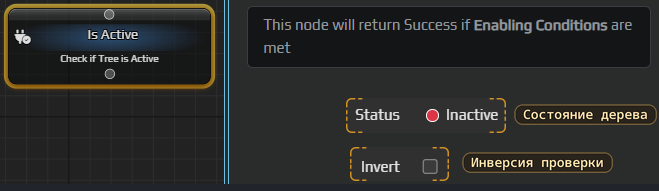

# Is Active — проверить активацию своего дерева

`Is Active` проверяет, активно ли сейчас дерево или макрос, в котором он стоит. Он смотрит на состояние корня **этого** дерева. Чтобы проверить другую ауру, берите [Aura Is Active](/ru/behavior-trees/nodes/aura-is-active).

## Пропустить шаг по своему переключателю

Создайте загруженную ауру `BT enabled` с одним [Fixed Value](/ru/triggers/fixed-value), без действий. Поставьте `Is NOT Active`. В отдельном дереве оставьте `Activation → Is Loaded`, `Execution → When Activated → Do nothing`.

1. У входа дерева в `Activation` нажмите `activate when Aura Activated...`, затем в `Enabling Condition → Links` выберите `BT enabled`. Ожидаемое состояние связи — Active.
2. Добавьте `Sequence`, `Is Active` и `Fixed Status`, соедините по схеме. У Fixed Status задайте `General → Status → Success`, у Is Active оставьте `General → Invert` выключенным.

```text
My Tree
└─ Sequence
   ├─ Is Active
   └─ Fixed Status: Success
```

3. Нажмите вверху `Tick BT Once`. Загруженное дерево можно тикнуть вручную, даже когда условие активации не выполнено. Is Active вернёт `Failure`, последний шаг не выполнится.
4. В своей ауре выберите `Is Active`. Подождите, пока состояние связи обновится, и вернитесь к дереву. Поле `General → Status` у узла покажет Active. Новый тик дойдёт до последнего Fixed Status и вернёт `Success`.
5. Включите `Invert` — результат проверки станет обратным. Корень всё ещё активен, поэтому следующий тик вернёт Failure.



| Поле или ситуация | Результат проверки без ребёнка |
| --- | --- |
| Invert выключен, корень активен | Success |
| Invert выключен, корень неактивен | Failure |
| Invert включён, корень активен | Failure |
| Invert включён, корень неактивен | Success |
| Status | Состояние проверки уже с учётом Invert. Это не последний NodeStatus выполнения |

`Is Loaded`, активность и автоматические тики — разные вещи. У корня без условий и триггеров состояние `manual`: для этой проверки он неактивен, хотя тикнуть его вручную можно. `Do nothing` отключает автоматический запуск, но выполненное условие активации ложным не делает. На состояние корня влияют также пауза и условия загрузки — подробнее на странице [Root](/ru/behavior-trees/nodes/root).

## Где проверка действительно останавливает работу

В Sequence проверка срабатывает, только когда выполнение **дошло до неё**. Если более поздний ребёнок Sequence вернул Running, следующий тик продолжит с него, а Is Active заново не выполнится.

У самой Is Active тоже может быть ребёнок. Он выполняется, если проверка успешна. Пока он возвращает Running, активность заново не сравнивается. Так что мгновенного прерывания при деактивации не будет.

<details>
<summary>Общий шаблон для деревьев и макросов</summary>

Шаблон `Is Active` есть и в деревьях, и в макросах, но окружение у него разное. В макросе Failure в обычном Block не обязательно пропускает следующих соседей. Чтобы завершить весь макрос, нужна его собственная управляющая конструкция, а не только Is Active в списке шагов. Если узел не связан с корректным корнем и состояние неизвестно, проверка возвращает Failure. Invert не превращает неизвестное состояние в подтверждённую неактивность.

</details>
