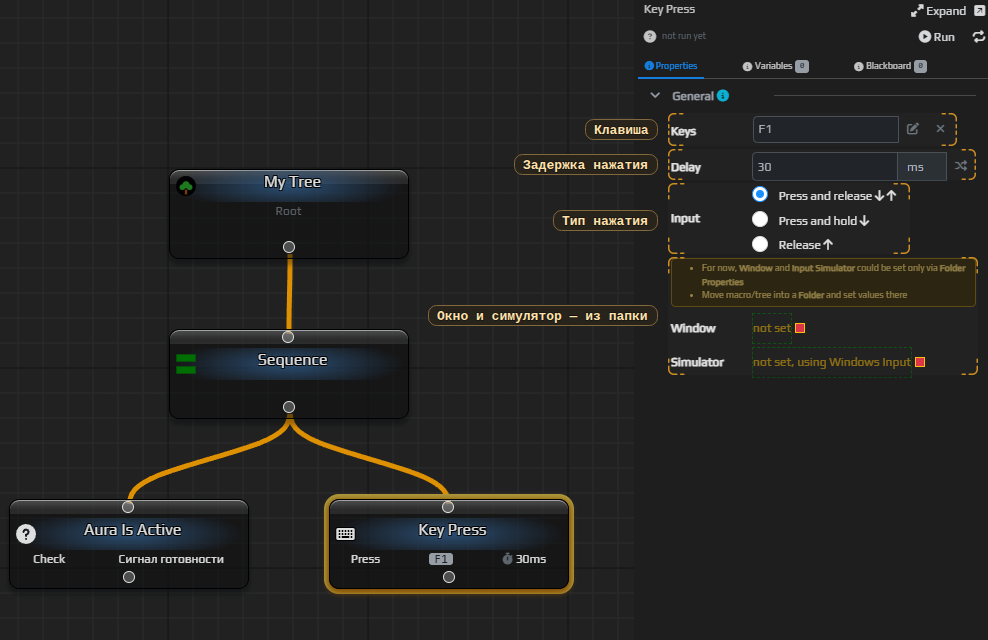

# Key Press — выполнить одно сочетание в своём окне

`Key Press` отправляет клавишу, сочетание с модификаторами, кнопку мыши или поддерживаемое событие колеса. В примере ниже он выделяет текст одним сочетанием.

## Выделить текст в собственном черновике

Откройте локальный текстовый редактор в отдельном окне, с черновиком без секретов. Введите две строки и щёлкните в текст, чтобы там стояла каретка. Не берите для примера чаты, формы отправки и командную строку.

1. Создайте отдельную папку и положите в неё своё дерево. В свойствах папки, в `Triggers/Actions/Overlays Defaults`, включите `Target Window` и выберите именно окно черновика. Через `show more...` включите `Input Simulator` и выберите `Windows Input`.
2. У входа дерева оставьте `Activation → Is Loaded`, `Execution → When Activated → Do nothing`. Проверьте [значения по умолчанию](/ru/features/default-properties): локальные `Settings` дерева не должны задавать другое окно или механизм ввода.
3. Добавьте `Key Press` и соедините со входом. В `General → Keys` выберите `Ctrl+A`, `Delay = 30 ms` без случайного разброса, `Input → Press and release`.
4. Внизу этой же группы проверьте `Window` — там должно быть окно черновика — и `Simulator → Windows Input`. Не запускайте пример, если там `not set`, `not found` или другое окно.
5. Один раз нажмите вверху `Tick BT Once`. Windows Input выведет выбранное окно на передний план и отправит сочетание. В редакторе выделится текст, узел завершится с Success. Перед повтором убедитесь, что окно осталось тем же.

| Настройка | Что делает |
| --- | --- |
| Keys | Одна основная клавиша и модификаторы Ctrl, Alt, Shift. Можно выбрать и кнопку мыши или колесо. Длинную последовательность сюда не вписать |
| Delay | Пауза после каждого отправленного события клавиатуры; у обычного Press их два — Down и Up. Это не период повтора всего узла |
| Случайный диапазон Min / Max | Паузы выбираются случайно между двумя границами вместо одного значения |
| Input — Press and release | Нажать и отпустить основную клавишу. Выбранные модификаторы тоже нажимаются и отпускаются |
| Input — Press and hold | Отправить Down и оставить клавишу и модификаторы нажатыми |
| Input — Release | Отправить Up для основной клавиши и модификаторов |
| Window / Simulator | Показывают унаследованные окно и механизм ввода. В самом узле они не редактируются |

Для колеса группа Input скрыта: узел отправляет прокрутку в выбранную сторону. Мышь и колесо поддерживает не каждый механизм ввода — например, Windows Message API не умеет прокручивать. Выбранный Target Window не значит, что ввод всегда уйдёт в фоновое окно: способы ввода работают по-разному, подробности — в [общих настройках ввода](/ru/actions/sendinput/options).

Удержание, отмена и несколько шагов

Чтобы удерживать клавишу заданное время, нужны три шага с одинаковыми Keys, окном и механизмом: `Press and hold → Wait → Release`. Delay внутри Key Press длительность удержания не задаёт. Если обход остановится до Release, этот шаг не выполнится. Stop, отмена или освобождение объекта сами клавиши не отпустят — предусмотрите отпускание в своей схеме. Даже если Press прервался между событиями, часть событий уже отправлена.

Длинную последовательность соберите из нескольких Key Press в [Sequence](/ru/behavior-trees/nodes/sequence). Другой способ — [Run Aura](/ru/behavior-trees/nodes/execute-aura) с готовым действием [Send Sequence](/ru/actions/sendinput/send-sequence). Вставить текст прямо из узла умеет [Send Text](/ru/behavior-trees/nodes/SendText).

После успешного нажатия Key Press может выполнить подключённого ребёнка и вернуть его результат. Если ребёнок вернул Running, следующий тик продолжит его и клавишу снова не нажмёт. В Macro шаблон тот же, но порядок следующих шагов задаёт макрос, а не BT Sequence. Success значит только, что ввод отправлен. Сработал ли он, смотрите в целевом окне.

