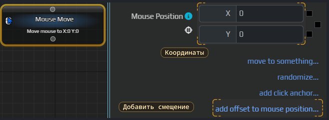
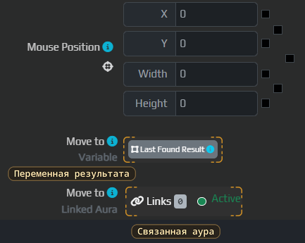
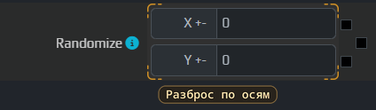
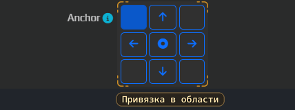
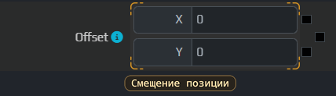

# Mouse Move — перейти к заданной точке

`Mouse Move` ставит указатель в заданную точку. «Абсолютное» здесь значит «в конкретную точку», а не «на столько-то от текущего положения». От чего отсчитываются координаты, зависит от окна и механизма ввода. Узел только двигает указатель и ничего не нажимает.

## Перейти к точке своего окна без клика

Откройте своё окно текстового редактора. Сделайте его достаточно большим: точка X=200, Y=150 от верхнего левого угла видимой рамки должна попадать внутрь окна.

1. Положите отдельное дерево в свою папку. В `Triggers/Actions/Overlays Defaults` папки включите `Target Window` и выберите своё окно. Через `show more...` включите `Input Simulator → Windows Input`. В Settings дерева не задавайте другое окно.
2. У входа дерева оставьте `Activation → Is Loaded`, `Execution → When Activated → Do nothing`. Добавьте `Mouse Move` и соедините со входом.
3. В `General → Mouse Position` задайте `X = 200`, `Y = 150`. Возьмите новый узел без связей, с нулевыми разбросом и смещением. Внизу группы проверьте `Window` и `Simulator` — там должны быть ваше окно и Windows Input.
4. Один раз нажмите вверху `Tick BT Once`. Окно выйдет на передний план, указатель встанет в заданную точку внутри него. Клика не будет. Если всё прошло штатно, узел вернёт Success.

| Настройка | Что задаёт |
| --- | --- |
| Mouse Position — X / Y | Исходную точку. Если задана область, появляются ещё Width / Height |
| Значок прицела | Выбрать точку прямо на экране, с учётом текущего окна |
| Window / Simulator | Унаследованные окно и механизм ввода. Проверьте их до запуска |
| Input Smoother | Если задан в общих свойствах, движение идёт по выбранному алгоритму [сглаживания](/ru/actions/sendinput/mouseinputsmoothing) |

В примере Windows Input прибавляет к X/Y положение рамки окна на экране (`DwmFrameBounds`). Это рамка окна, **не начало его клиентской области**. Без окна координаты были бы экранными. Точка X=0, Y=0 здесь считается пустой, и указатель не двигается. Windows Message API работает иначе: он отправляет окну сообщения с координатами клиентской области и не двигает настоящий системный указатель так, как Windows Input. Не переносите числа из одного способа в другой, не проверив [систему координат](/ru/features/coordinate-system).

Перейти к найденной области или связанному источнику

Нажмите `move to something...` — откроются область X/Y/Width/Height и источники:

| Выбор | Откуда берётся положение |
| --- | --- |
| Move to — Variable → Last Found Result | Из переменной с последней найденной областью в контексте дерева. Сначала должен выполниться нужный поиск |
| Move to — Linked Aura → Links | Из области, которую даёт связанная аура с настроенным источником, например Image Search |
| Индикатор привязки у свойства | Из собственной [привязки](/ru/features/bindings) координаты или области |
| Unlink / Unbind | Убирает текущую связь. Сделайте это, прежде чем вернуться к фиксированным координатам |

Для **Linked Aura** сначала настройте и проверьте свою ауру [Image Search](/ru/triggers/images/image-search). В [Sequence](/ru/behavior-trees/nodes/sequence) перед Mouse Move поставьте [Aura Is Active](/ru/behavior-trees/nodes/aura-is-active) со ссылкой на ту же ауру и ожидаемым состоянием Active. Тогда указатель сдвинется, только если условие поиска выполнено.

Область поиска должна относиться к тому же окну и к той же системе координат. Сначала проверьте найденную рамку, область захвата и масштаб обработки, и только потом подключайте движение. Не прибавляйте положение окна к координатам, которые уже экранные.

Разброс, якорь и смещение

| Группа | Что меняется |
| --- | --- |
| randomize... → Randomize — X ± / Y ± | Итоговая точка случайно смещается в пределах разброса по каждой оси. Нули выключают разброс |
| add click anchor... → Anchor | Точка внутри исходной области: центр, угол или край. Несмотря на название кнопки, клик не добавляется |
| add offset to mouse position... → Offset | Дополнительные X/Y к рассчитанному положению. В режиме области есть ещё размеры смещения |

Точка сначала считается из области, якоря и Offset, потом к ней добавляется Randomize. После успешного перемещения может выполниться подключённый ребёнок. Если он вернул Running, следующий тик продолжит его и указатель заново не сдвинет. Чтобы двигать от текущего положения, берите [Mouse Move Rel.](/ru/behavior-trees/nodes/MouseMoveRel).

