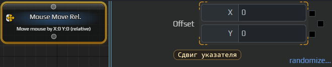
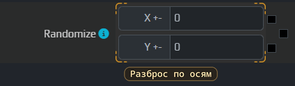

# Mouse Move Rel. — сдвинуть указатель от текущего положения

`Mouse Move Rel.` сдвигает указатель на заданное расстояние от текущего места. Каждый новый вызов сдвигает указатель ещё раз. Абсолютный [Mouse Move](/ru/behavior-trees/nodes/MouseMoveAbs), наоборот, каждый раз задаёт точку заново.

## Сначала задать начало, затем сдвинуть вправо

Откройте своё окно текстового редактора, в котором достаточно свободного места. Положите дерево в папку, где в `Triggers/Actions/Overlays Defaults` включены `Target Window` с этим окном и, через `show more...`, `Input Simulator → Windows Input`. Проверьте, что в Settings дерева не задано другое окно.

1. У входа задайте `Activation → Is Loaded`, `Execution → When Activated → Do nothing`. Добавьте `Sequence`, `Mouse Move` и `Mouse Move Rel.`, соедините детей Sequence слева направо.
2. У Mouse Move задайте `General → Mouse Position → X = 200`, `Y = 150`. Эта точка отсчитывается от видимой рамки и должна попадать внутрь вашего окна. У Mouse Move Rel. задайте `General → Offset → X = 40`, `Y = 0`. У обоих оставьте Randomize нулевым.
3. В обоих узлах проверьте `Window` и `Simulator`: одно и то же ваше окно и Windows Input. Узлов, которые что-то нажимают, в схеме быть не должно.

```text
My Tree
└─ Sequence
   ├─ Mouse Move: X=200, Y=150
   └─ Mouse Move Rel.: X=40, Y=0
```

4. Один раз нажмите вверху `Tick BT Once`. Окно выйдет на передний план. Указатель сначала встанет в заданную точку, затем получит команду сдвига вправо. Клика не будет. В [Event Viewer](/ru/features/event-viewer) видны запросы перемещения `To` и `By`, а Sequence после штатного завершения вернёт Success.

Реальная длина сдвига зависит от механизма ввода и системных настроек мыши, так что это не обязательно ровно 40 физических пикселей.



| Настройка | Что делает |
| --- | --- |
| Offset — X | Сдвиг по горизонтали: положительный — вправо, отрицательный — влево |
| Offset — Y | Сдвиг по вертикали: положительный — вниз, отрицательный — вверх |
| randomize... → Randomize — X ± / Y ± | Добавляет к сдвигу случайную часть. При нулях сдвиг всегда одинаковый |
| Window / Simulator | Унаследованные окно и механизм ввода. У Windows Input сдвигается системный указатель |



У Windows Message API относительное движение считается от последней позиции, отправленной **этому окну** этим же механизмом, а не от системного указателя. Поэтому сначала сделайте абсолютное движение тем же механизмом в то же окно. Оно отправляет оконное сообщение, и приложение должно его поддерживать.

Алгоритм сглаживания в этом узле не выбирается. Если нужна настраиваемая траектория, берите абсолютный Mouse Move. После успешного сдвига узел может выполнить своего ребёнка и вернуть его результат. Если ребёнок вернул Running, следующий тик продолжит его без нового сдвига. Шаблон общий для BT и Macro.
