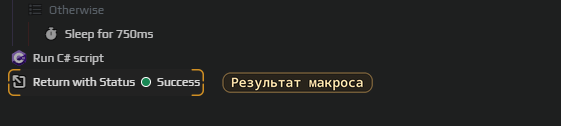

# Return — закончить макрос с выбранным результатом

`Return` завершает текущий макрос и пропускает оставшиеся шаги. Тому, кто вызвал макрос, он возвращает Success или Failure. В отличие от [Break](/ru/behavior-trees/nodes/Break), он выходит из всего макроса, а не только из вложенного Block или Repeat.

## Закончить свой макрос до последней паузы

Создайте отдельный [макрос](/ru/macros/getting-started) с `Activation → Is Loaded`, `Execution → When Activated → Do nothing`.

1. В исходный Block добавьте по порядку `Wait`, `Return`, ещё один `Wait` и `Fixed Status`.
2. Первому Wait задайте `General → Delay = 500 ms`, второму — `5000 ms`, случайный разброс выключите. У Fixed Status выберите Failure. У Return в `General → Return` выберите `Success`.

   

   На снимке — макрос Daily routine, там Return стоит в конце. В своём примере поставьте его между двумя паузами — так будет видно, что вторая пропускается.

```text
My Macro
└─ Block
   ├─ Wait: 500 ms
   ├─ Return: Success
   ├─ Wait: 5000 ms
   └─ Fixed Status: Failure
```

3. Нажмите вверху `Run Macro Once`. Пройдёт первая пауза, и макрос завершится с Success. Пятисекундная пауза и последний Fixed Status не выполнятся.
4. Выберите у Return `Failure` и запустите ещё раз. Пропустятся те же шаги, но итог макроса теперь Failure. Это результат, который вы выбрали сами, а не ошибка приложения.

| Настройка или граница | Что означает |
| --- | --- |
| General → Return → Success | Завершить макрос успешно |
| General → Return → Failure | Завершить макрос с неуспехом |
| Категория Macro | Узел есть в макросах. Это не обычный BT-узел |
| Внутри Block, ветки IfThenElse или Repeat | Выход проходит сквозь эти конструкции до границы макроса |
| Макрос вызван через Run Macro | Завершается вызванный макрос. Вызывающий получает его результат и действует по своим правилам |
| Дочерние узлы Return | После выхода не выполняются. Продолжение вызывающей схемы ставьте после её узла Run Macro |

Например, если вызванный макрос вернул Success, BT Sequence перейдёт к следующему шагу, а при Failure остановится. А вот обычный Block вызывающего макроса может выполнить следующих соседей даже после Failure. Return не останавливает всю EyeAuras или все деревья.

## Условный выход

Чтобы выходить только по условию, используйте макросный IfThenElse. В Condition поставьте свою проверку, в If matched, then — Return с нужным результатом. Например, [Aura Is Active](/ru/behavior-trees/nodes/aura-is-active) может читать вашу ауру с Fixed Value. Узел проверяет только состояние ауры — количество маны или другой игровой параметр он сам не знает.

Return срабатывает, только когда выполнение до него дошло. Уже сделанное не откатывается, отдельно запущенная работа не отменяется, удерживаемая клавиша сама не отпускается. Токен отмены и освобождение ресурсов должен обрабатывать код самой работы — Return состояние не чистит. Чтобы выйти только из цикла или отдельного блока, берите Break.
