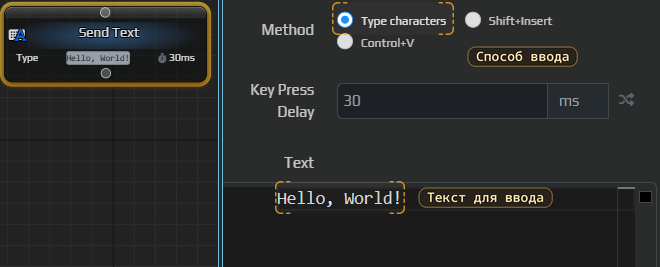

# Send Text — вписать строку в свой черновик

`Send Text` вводит строку в окно. Он либо набирает её по клавишам, либо кладёт в буфер обмена и отправляет сочетание вставки.

## Напечатать строку без вставки из буфера

Откройте локальный текстовый редактор в отдельном окне, с пустым черновиком без секретов. Щёлкните в текст и убедитесь, что видна каретка. Для строки `alpha beta` нужна установленная английская раскладка.

1. Положите отдельное дерево в папку. В `Triggers/Actions/Overlays Defaults` включите `Target Window` с окном черновика, а через `show more...` — `Input Simulator → Windows Input`. В Settings дерева не должно быть задано другое окно.
2. У входа оставьте `Activation → Is Loaded`, `Execution → When Activated → Do nothing`. Добавьте `Send Text` и соедините со входом.
3. В `General → Method` выберите `Type characters`, в `Text` введите `alpha beta` без кавычек, в `Delay` задайте `30 ms` без случайного разброса.
4. Проверьте `Window` и `Simulator`. Один раз нажмите вверху `Tick BT Once`. Windows Input активирует выбранное окно, и в черновике появится строка `alpha beta`. Если всё прошло штатно, узел вернёт Success.

На снимке поле `Delay` ещё называется `Key Press Delay`:

[Полная панель узла Send Text](https://s3.eyeauras.net/media/2025/08/EyeAuras_ea1jBx1plw.png).

| Настройка | Что делает |
| --- | --- |
| Text | Строка для ввода. Это обычный текст, а не C#-строка: кавычки и обратная косая черта с n так и останутся текстом |
| Method — Type characters | Набирает символы клавишами, раскладка определяется автоматически. Неподдерживаемые символы или смесь раскладок могут не набраться |
| Method — Shift+Insert | Кладёт Text в буфер и ставит вставку через Shift+Insert в очередь. Ctrl к сочетанию не добавляется |
| Method — Control+V | Кладёт Text в буфер и ставит Ctrl+V в очередь |
| Delay | Пауза после каждого клавиатурного события. Это не интервал между целыми символами и не время до появления всей строки |
| Случайный диапазон Min / Max | Случайные паузы в заданных границах вместо одного значения |
| Window / Simulator | Унаследованные окно и механизм ввода. Windows Input активирует выбранное окно |

Чтобы перейти на новую строку, вставьте в поле Text настоящий перевод строки. В режиме Type characters он превратится в нажатие клавиши перевода строки. В другом приложении эта клавиша может запустить команду, поэтому сначала пробуйте в своём текстовом черновике.

## Когда нужна вставка целой строки

Если текст не набрать в одной раскладке, выберите Control+V или Shift+Insert — если ваш редактор поддерживает это сочетание. Вставка идёт через общий системный буфер, и его прежнее содержимое само не восстанавливается.

В этих двух режимах Success значит, что текст положен в буфер и вставка поставлена в очередь. Узел не ждёт, пока редактор её обработает, поэтому следующий узел может запуститься раньше. Проверяйте результат по тексту в окне.

Для другого способа доставки выберите поддерживаемый [механизм ввода](/ru/actions/sendinput/options) и проверьте его на своём окне. После успешной отправки Send Text может выполнить подключённого ребёнка. Если тот вернул Running, следующий тик продолжит его и строку заново не отправит. Шаблон есть в BT и Macro.
