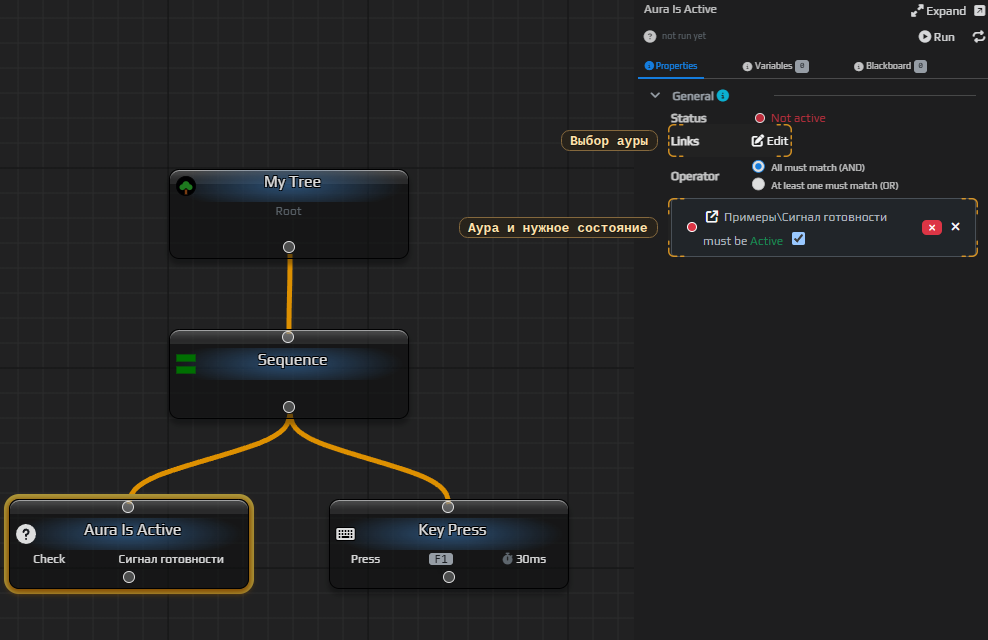

# Aura Is Active — использовать состояние своей ауры

`Aura Is Active` проверяет состояние уже настроенной ауры. Свяжите узел с аурой — и ветка дерева будет выполняться только при нужном состоянии. Само условие остаётся в ауре: это может быть Fixed Value для пробы или поиск изображения, цвета, текста, объекта.

## Разрешить ветку своим переключателем

Создайте загруженную ауру `BT signal` с одним [Fixed Value](/ru/triggers/fixed-value), без действий. Выберите `Is NOT Active`. Создайте отдельное дерево с `Activation → Is Loaded`, `Execution → When Activated → Do nothing`.

1. Через `Add new Node` добавьте `Aura Is Active` и соедините его со входом дерева. Ребёнка пока не добавляйте: сначала посмотрим на результат самой проверки.
2. В настройках узла откройте `General → Links → Edit`. Выберите свою ауру `BT signal` и подтвердите выбор. В списке должна появиться именно она.
3. Оставьте для неё `must be Active` и выберите `Operator → All must match (AND)`. Нажмите вверху `Tick BT Once`. Аура неактивна, ожидание не совпало — узел вернёт `Failure`.
4. В ауре переключите Fixed Value на `Is Active`. Дождитесь, пока аура станет Active, и вернитесь к дереву. Поле `General → Status` покажет Active, а новый ручной тик завершится с `Success`.
5. Чтобы проверять обратное, снимите флажок ожидаемого состояния в строке связи — появится `must be Not Active`. Теперь Success будет, когда аура точно неактивна.

| Настройка | Что делает |
| --- | --- |
| Links → Edit | Выбрать одну или несколько существующих аур. Кнопка перехода в строке открывает ауру, крестик убирает связь |
| must be Active / Not Active | Сравнить известное состояние этой ауры с ожидаемым |
| All must match (AND) | Совпасть должны все связи. Если состояние хотя бы одной неизвестно, общий результат — Unknown |
| At least one must match (OR) | Достаточно одной совпавшей связи. Если в непустом списке таких нет, общий результат — Not active |
| Status | Текущий общий результат связей: Active, Not active или Unknown. Это не последний статус выполнения узла |

Если у узла нет ребёнка, Active превращается в `Success`, а Not active — в `Failure`. Общий Unknown — это ошибка проверки, а не обычный Failure: проверьте, загружены ли ауры, и прочитайте сообщение об ошибке.

## Подключить продолжение

К Aura Is Active можно присоединить один `Wait` или целую [Sequence](/ru/behavior-trees/nodes/sequence). Ребёнок вызывается, когда условие вернуло Success, и результат узла становится его результатом. Например, с Wait на 2000 ms первый успешный тик вернёт Running, а следующий тик после задержки — Success.

Если ребёнок уже вернул Running, следующий тик сначала продолжит **его** и ауру заново не проверит. Поэтому изменение ауры в этот момент работу не прервёт. Чтобы прерывать по отдельному условию, берите [Interrupter](/ru/behavior-trees/nodes/Interrupter).

Неопределённые связи и пустой список

В режиме AND одна связь с Unknown делает общий результат неопределённым, даже если другая связь уже не совпала. Если в непустом списке совпадений нет, результат отрицательный — даже когда состояние части связей неизвестно.

Если у сохранённой связи ожидаемое значение не задано, редактор может показывать `must be Undefined`. Такая связь передаёт исходное состояние ауры, а не проверяет «равно Unknown». Для обычной работы задайте Active или Not Active явно. Пустой список ничего не проверяет и может пропустить ветку — всегда проверяйте, что нужная связь на месте.

