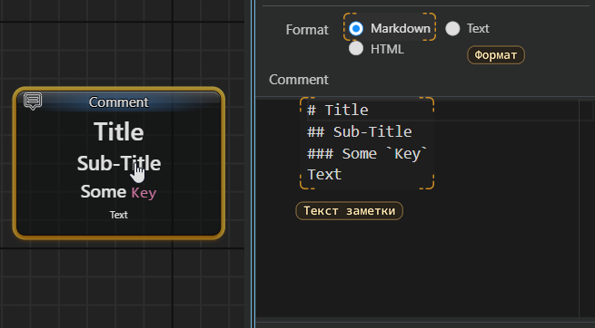

# Comment — подписать участок дерева

`Comment` — это карточка с заметкой рядом с веткой. Она ничего не нажимает, не проверяет и не запускает. Нужна, чтобы через месяц вспомнить, зачем эта ветка.

## Подписать паузу в своём дереве

Возьмите отдельное дерево: `Activation → Is Loaded`, `Execution → When Activated → Do nothing`. Ко входу подключите один `Wait` с `General → Delay = 1500 ms` без случайного разброса.

1. Через `Add new Node` добавьте `Comment` и поставьте рядом с Wait. Соединять не нужно: у карточки нет входа и выхода.
2. В `General → Format` выберите `Markdown`. В `Comment` введите текст:

```text
**Учебная пауза**
Первый тик начинает отсчёт, следующий после задержки завершает Wait.
```

3. На карточке появится заметка, первая строка выделена. Если выбрать Format → Text, звёздочки останутся обычными символами. Так удобно записывать точные выражения без форматирования.
4. Нажмите верхнюю `Tick BT Once`: Wait вернёт Running. Через две секунды нажмите ещё раз — Wait вернёт Success. Заметка не повлияла ни на длительность, ни на маршрут ветки.



На снимке прежний редактор: строки `# Title` и `## Sub-Title` справа стали на карточке заголовками двух уровней.

В текущем редакторе текст и формат задаются в General:

| Настройка | Как отображается |
| --- | --- |
| Comment | Текст заметки. Сохраняется вместе с деревом |
| Format — Markdown | Разметка Markdown: выделение, ссылки, списки и другие поддерживаемые элементы |
| Format — Text | Обычный текст. Символы HTML не превращаются в разметку |
| Format — HTML | Текст показывается как HTML. Для обычной заметки хватит Markdown или Text |
| Пустой текст | Надпись No comments |

Comment есть в BT и в Macro. То, что карточка стоит рядом с узлом, не создаёт связь и не задаёт порядок: обход дерева через неё не проходит. Если запустить сам Comment вручную, он вернёт Success и ничего не сделает. Это не проверка текста заметки. В отличие от действий и условий, дочернего продолжения у него нет.
