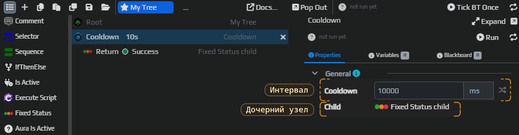

# Cooldown — ограничить частоту успешного участка

`Cooldown` не даёт дочернему узлу выполняться чаще заданного интервала. Отсчёт начинается **после Success ребёнка**. Пока время не вышло, Cooldown возвращает `Failure` и ребёнка не вызывает.

## Разрешить свою проверку раз в пять секунд

Возьмите отдельное дерево с ручным запуском: `Activation → Is Loaded`, `Execution → When Activated → Do nothing`.

1. Через `Add new Node` добавьте `Cooldown` и `Fixed Status`. Соедините вход дерева с Cooldown, а его выход — с Fixed Status.
2. У Fixed Status выберите `General → Status → Success`. У Cooldown задайте `General → Cooldown = 5000 ms` и выключите случайный разброс кнопкой со значком перемешивания. Проверьте имя ребёнка в `Child`.

```text
My Tree
└─ Cooldown: 5000 ms
   └─ Fixed Status: Success
```

3. Нажмите верхнюю `Tick BT Once`. Ребёнок выполнится, результат — `Success`, пошёл отсчёт.
4. Нажмите ещё раз, пока пять секунд не прошли. Cooldown вернёт `Failure` и ребёнка не вызовет. На узле видно, сколько осталось.
5. Когда отсчёт закончится, нажмите снова. Ребёнок выполнится с Success и запустит новый интервал.

| Настройка или исход | Что происходит |
| --- | --- |
| Cooldown | Интервал после успеха ребёнка, в миллисекундах |
| Случайный диапазон Min / Max | Новый интервал выбирается при каждом Success ребёнка, например от 4000 до 6000 ms |
| Child | Участок, который ограничиваете. Несколько шагов объедините дочерним Sequence |
| Ребёнок вернул Success | Cooldown возвращает Success и запускает отсчёт |
| Ребёнок вернул Failure | Cooldown возвращает Failure, отсчёт очищается |
| Ребёнок вернул Running | Cooldown возвращает Running, новый отсчёт не начинается |
| Вызов до окончания отсчёта | Failure, ребёнок не выполняется |



Если изменить значение Cooldown, текущий отсчёт сбросится. Очистка показанных статусов отсчёт не отменяет. Структурный сброс очищает и таймер, и состояние детей.

<details>
<summary>Где поставить Cooldown в большой схеме</summary>

Если ветка с Cooldown стоит внутри [Selector](/ru/behavior-trees/nodes/selector), то на время задержки она возвращает Failure, и Selector берёт запасную ветку. Так можно развести редкую и обычную реакцию по двум детям Selector.

Cooldown, поставленный **соседом перед действием** в Sequence, работает иначе. Без своего ребёнка он сразу получает Success и начинает отсчёт ещё до следующего шага. Неудача этого шага интервал уже не отменит. Чтобы считать именно успех действия, сделайте действие ребёнком Cooldown. [Wait](/ru/behavior-trees/nodes/wait) решает другую задачу: держит паузу в текущем проходе и возвращает Running.

</details>
