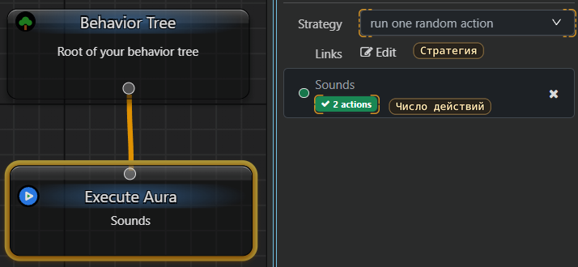

# Run Aura — вызвать готовые действия своей ауры

`Run Aura` выполняет в дереве действия, которые уже настроены в ауре. В прежнем редакторе узел назывался `Execute Aura`. На триггеры аур он не смотрит: действия выполнятся, даже если аура неактивна. Если нужна проверка активности, поставьте отдельно [Aura Is Active](/ru/behavior-trees/nodes/aura-is-active).

## Вызвать две паузы из одной неактивной ауры

Нужна своя загруженная аура `Reusable pause` без ввода, звука и других внешних действий. Добавьте ей [Fixed Value](/ru/triggers/fixed-value) и оставьте `Is NOT Active`. Тогда сама аура не запустит эти действия параллельно с деревом.

1. В ауре добавьте [Delay](/ru/actions/delay) в `On Enter`: `Delay, ms = 1000`, случайный разброс выключен. В `On Exit` добавьте второй Delay на `2000` ms. `While Active` оставьте пустым. Других действий в ауре быть не должно.
2. Создайте отдельное дерево: `Activation → Is Loaded`, `Execution → When Activated → Do nothing`. Через `Add new Node` добавьте `Run Aura` и соедините его со входом дерева.
3. У узла откройте `General → Auras → Links`, выберите только `Reusable pause` и подтвердите. В строке связи должно быть два действия, а не `NO ACTIONS`.

   

   На снимке прежний редактор: у ауры Sounds два действия и выбран случайный порядок. Для упражнения нужен другой режим.
4. В `General → Strategy` выберите `run 1-by-1 in order of addition`. Нажмите верхнюю `Tick BT Once` и дождитесь завершения.

Узел по очереди выполнит оба Delay: сначала из On Enter, потом из On Exit. Это займёт около трёх секунд плюс немного на само выполнение. Время последнего тика видно в редакторе. Run Aura вернёт `Success`, хотя аура всё это время была неактивна. Узел выполняет списки действий, а не переводит ауру в Active и обратно.

В текущем списке шаблонов узел называется `Run Aura`, а связи настраиваются в `Auras → Links`:

| Настройка или источник | Что выполняется |
| --- | --- |
| Auras → Links | Действия одной или нескольких связанных аур. Триггеры этих аур не запускаются |
| Strategy — run 1-by-1 in order of addition | Все собранные действия по очереди. Узел ждёт окончания каждого |
| Strategy — run one random action | Одно случайное действие из общего списка всех связанных аур, а не все действия случайной ауры |
| On Enter → While Active → On Exit | В таком порядке собираются три списка действий каждой ауры. While Active выполняется один раз за проход, а не в цикле до деактивации |
| Счётчик действий / NO ACTIONS | Показывает, есть ли в выбранной ауре действия. Ссылка на ауру ещё не значит, что есть что выполнять |

Если несколько аур должны идти в строгом порядке, поставьте отдельные Run Aura в [Sequence](/ru/behavior-trees/nodes/sequence). На порядок связей внутри одного узла не полагайтесь.

Контекст, завершение и ограничения

Действия выполняются с контекстом и настройками своей ауры. Окно, переменные и способ ввода из дерева в них сами не подставляются. Адресата каждого реального действия настройте в исходной ауре. Отключённое действие может не пропуститься молча, а прервать вызов ошибкой.

Узел передаёт отмену вызванным действиям и ждёт, пока они завершатся по своим правилам. Ошибка — это не обычный неуспех условия. То, что уже выполнено, не откатывается. Success значит, что вызовы завершились, а не что во внешнем приложении всё получилось.

В последовательном режиме пустой список может вернуть Success без работы. Поэтому в примере проверяйте счётчик: должно быть два действия. Случайному режиму нужен непустой список. Если к Run Aura подключён дочерний узел, он выполняется после успешных вызовов, и общий результат может стать его Running, Failure или Success.

