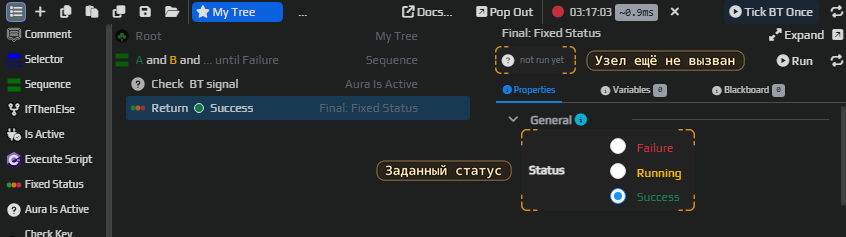

# Fixed Status — задать исход проверки

`Fixed Status` возвращает результат, который вы выбрали сами: `Success`, `Failure` или `Running`. За окном, клавишами и приложением он не следит. Поставьте его на время, чтобы проверить маршрут дерева, пока настоящее условие не готово.

## Увидеть, какой участок будет выполнен

Возьмите своё загруженное дерево с `When Activated → Do nothing`. Соедините вход с `Sequence`, а её выход — с двумя `Fixed Status` слева направо.

1. У первого выберите `General → Status → Failure`, у второго — `Success`. Детей к Fixed Status пока не подключайте.
2. Нажмите верхнюю `Tick BT Once`. Первый узел и Sequence вернут Failure, второй не выполнится.
3. Переключите `Status` первого на `Success` и повторите тик. Выполнятся оба ребёнка, Sequence вернёт Success.
4. Можно выбрать у первого `Running` и сделать ещё тик. Sequence остановится на нём с Running. Верните Success и нажмите ту же кнопку — Sequence пойдёт дальше.

Получился переключатель маршрута без внешних действий. `Status` задаёт будущий ответ. Смена значения сама дерево не запускает и показанный результат прошлого тика не меняет.



| Status без дочернего узла | Что вернёт Fixed Status |
| --- | --- |
| Success | Успех. Sequence перейдёт к следующему ребёнку |
| Failure | Неуспех. Sequence завершит этот проход |
| Running | Running при каждом вызове. Со временем сам не меняется |

## Если подключён ребёнок

Fixed Status работает по общим правилам условия. При `Success` он выполняет своего единственного включённого ребёнка и возвращает **его** результат. Поэтому в Status может стоять Success, а итог будет Failure или Running.

```text
Fixed Status: Success
└─ Wait: 1500 ms
```

Здесь первый тик вернёт Running от Wait. Следующий тик продолжит ребёнка. Если в это время поменять Status родителя, ребёнок не обязательно прервётся. Для нескольких шагов подключайте [Sequence](/ru/behavior-trees/nodes/sequence).

С `Running` будьте внимательны: [Selector](/ru/behavior-trees/nodes/selector) и Sequence запоминают этот участок и пока не идут дальше — ни к следующим вариантам, ни к следующим шагам. Другие деревья и ауры от этого не останавливаются.

Когда маршрут проверен, замените Fixed Status настоящим условием, например [Aura Is Active](/ru/behavior-trees/nodes/aura-is-active). Фиксированный ответ не заменяет наблюдение за приложением.
