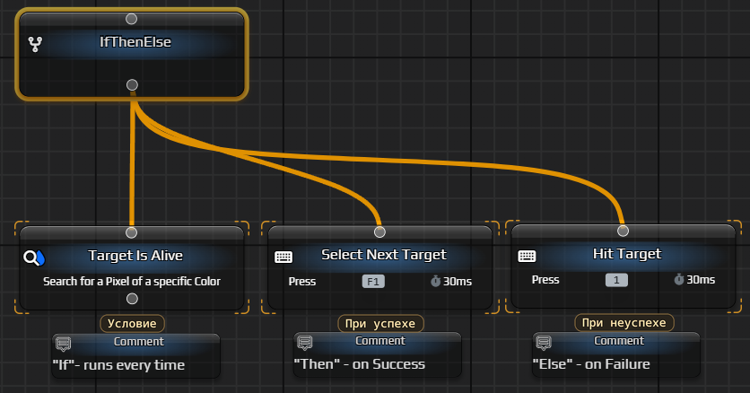

# IfThenElse — выбрать одну из двух веток

`IfThenElse` один раз проверяет условие и выполняет одну из двух веток. Первый ребёнок — условие, второй — ветка при успехе, третий — ветка при неуспехе. If, Then и Else — это роли детей, а не поля для C#-выражений.

## Проверить маршрут до подключения действий

В своём загруженном дереве выключите автоматическое выполнение: `When Activated → Do nothing`. Добавьте IfThenElse и подключите к нему три `Fixed Status` слева направо:

```text
My Tree
└─ IfThenElse
   ├─ Fixed Status: Success    ← If
   ├─ Fixed Status: Failure    ← Then
   └─ Fixed Status: Success    ← Else
```

1. Каждому ребёнку задайте `General → Status` как на схеме. В панели IfThenElse проверьте `General → If`, `Then`, `Else`: там должны быть ваши узлы, а не `not set`.
2. Нажмите верхнюю `Tick BT Once`. Условие вернёт `Success`, выполнится Then и вернёт `Failure`. Else не вызывается. Итог IfThenElse — `Failure`: это результат ветки, а не условия.
3. Поставьте первому ребёнку `Failure` и снова нажмите `Tick BT Once`. Теперь выполнится Else, итог — `Success`.

Обе ветки проверены без клавиатуры и внешнего приложения. Теперь замените условие настоящей проверкой, а ветки — нужными действиями или Sequence.

| Роль или результат | Что происходит |
| --- | --- |
| If / Condition | Первый включённый ребёнок. По нему выбирается ветка |
| Then | Второй включённый ребёнок. Выполняется после Success условия |
| Else | Третий включённый ребёнок. Выполняется после Failure условия |
| Condition вернул Running | IfThenElse возвращает Running, ни одна ветка ещё не запускается |
| Выбранная ветка вернула Running | На следующем тике продолжается эта ветка, Condition заново не проверяется |
| Выбранная ветка завершилась | Её Success или Failure становится итогом IfThenElse. Следующий проход снова начнётся с условия |
| Выбранной ветки нет | Failure. Например, ложное условие без Else не становится Success |

Подключайте нужные роли явно. Если отключить ребёнка, он пропадёт из списка, и роли следующих узлов могут сдвинуться. Задать условию `Failure` таким способом нельзя. Без условия узлу нечего проверять: исправьте структуру по панели `If / Then / Else`. Ошибка редактора — это не обычный результат узла.

Если условие уже проверяет аура, поставьте [Aura Is Active](/ru/behavior-trees/nodes/aura-is-active) в роль **If** и свяжите его с этой аурой. Готовые действия вызывайте через [Run Aura](/ru/behavior-trees/nodes/execute-aura) в **Then** или **Else**: в **Auras → Links** выберите ауру, где они настроены.

## Почему не всегда подходит Selector

На прежнем снимке условие и обе реакции видны отдельно:



Связка `Selector → Sequence(условие, Then), Else` похожа, но работает иначе, если Then вернёт Failure: Selector может перейти к Else. IfThenElse после выбранной Then другую ветку не пробует.


Условие в EyeAuras после Success может само передать выполнение своему единственному ребёнку. Поэтому старый пример можно записать короче:


На этих снимках старые пользовательские имена и реакции ввода. EyeAuras сам не определяет тип цели или опасность: такие условия дают ваши триггеры, а действия настраиваются отдельно.

[Sequence](/ru/behavior-trees/nodes/sequence) — когда обязательны все шаги, [Selector](/ru/behavior-trees/nodes/selector) — когда надо перебрать варианты, IfThenElse — когда решение одно и явное. В макросах есть другой узел с похожим именем, а эта страница про BT.
