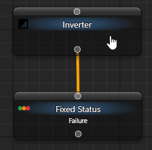

# Inverter — проверить противоположное условие

`Inverter` переворачивает результат дочернего узла: Failure становится Success и наоборот. Он нужен, когда следующий шаг должен идти при неуспехе проверки — например, когда условие вашей ауры не выполнено. Состояние самой ауры Inverter не меняет.

## Проверить инверсию без внешних действий

Возьмите отдельное загруженное дерево с `When Activated → Do nothing` из [первого примера](/ru/behavior-trees/gettings-started). Добавьте и соедините узлы:

```text
My Tree
└─ Inverter
   └─ Fixed Status: Failure
```

1. У Fixed Status выберите `General → Status → Failure`. У Inverter в `General → Child` проверьте, что подключён именно этот ребёнок.
2. Нажмите верхнюю `Tick BT Once`. Ребёнок вернёт Failure, а Inverter и дерево — Success.
3. Поставьте ребёнку Success и повторите тик: Inverter вернёт Failure.
4. Поставьте Running и повторите тик: Running остаётся Running. Чтобы закончить, верните ребёнку Success или Failure и нажмите ту же кнопку.

На старой анимации первый вариант — красный ребёнок и зелёный родитель:



| Ответ ребёнка | Ответ Inverter |
| --- | --- |
| Success | Failure |
| Failure | Success |
| Running | Running |

У Inverter должен быть один включённый ребёнок. Без него редактор покажет ошибку выполнения, а не какой-то из результатов таблицы. Исключения и отмену Inverter в успех не превращает.

## Подключить своё условие

Если нужно отрицание результата своей ауры, замените Fixed Status на [Aura Is Active](/ru/behavior-trees/nodes/aura-is-active) со ссылкой на неё. Например, аура может проверять наличие окна через Window Exists. Inverter переворачивает **результат узла**, поэтому сначала посмотрите, что выбранный узел возвращает при Unknown и ошибках источника.

Внутри [Sequence](/ru/behavior-trees/nodes/sequence) такой Inverter пропускает к следующим шагам только после Failure ребёнка. Если у ребёнка есть своя цепочка, перевернётся её итог, а не только первая проверка. Если хотите просто прочитать условие, не ставьте под Inverter действие с побочными эффектами.
