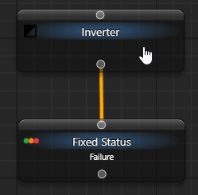

# Inverter — проверить противоположное условие

Если следующий шаг нужен при неуспехе проверки, оберните её в `Inverter`. Например, реакция может требоваться, когда условие собственной ауры не выполнено. Инвертор меняет только результат дочернего узла, а не состояние самой ауры.

## Проверить инверсию без внешних действий

Используйте отдельное загруженное дерево с `When Activated → Do nothing` из [первого примера](/ru/behavior-trees/gettings-started). Добавьте и соедините узлы:

```text
My Tree
└─ Inverter
   └─ Fixed Status: Failure
```

1. У Fixed Status выберите `General → Status → Failure`. У Inverter в `General → Child` проверьте, что подключён именно этот ребёнок.
2. Нажмите верхнюю `Tick BT Once`. Ребёнок вернёт Failure, а Inverter и дерево — Success.
3. У ребёнка выберите Success и повторите тик: результат Inverter станет Failure.
4. Выберите Running и повторите тик: Running останется Running. Для завершения этого опыта верните ребёнку терминальный статус и нажмите ту же кнопку.

Старая анимация показывает первый вариант — красный ребёнок и зелёный родитель:



| Ответ ребёнка | Ответ Inverter |
| --- | --- |
| Success | Failure |
| Failure | Success |
| Running | Running |

У Inverter должен быть один включённый ребёнок. Без него редактор покажет ошибку выполнения; это не дополнительный вариант таблицы. Инвертор не превращает исключения и отмену в успешную проверку.

## Подключить своё условие

Замените Fixed Status на [Aura Is Active](/ru/behavior-trees/nodes/aura-is-active) со ссылкой на свою ауру, если действительно нужно отрицание её результата. Например, аура может определять наличие окна через Window Exists. Это отрицание **результата узла**, поэтому сначала проверьте, как выбранный узел обрабатывает Unknown и ошибки источника.

Внутри [Sequence](/ru/behavior-trees/nodes/sequence) такой Inverter допускает следующие шаги только после Failure ребёнка. Если у ребёнка есть собственная цепочка, будет инвертирован её итог, а не только начальная проверка. Не подключайте к отрицанию действие с побочными эффектами, если хотите лишь прочитать условие.
