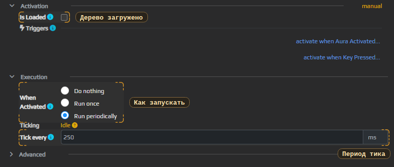

# Root — загрузка и запуск дерева

`Root` — это контейнер дерева. В нём общие настройки: загружено ли дерево, по какому условию и как часто оно запускается. Удалить его как обычный дочерний узел нельзя. В одном Root может быть несколько деревьев. `My Tree` на графе — это вход одного дерева, а не весь контейнер.

| Объект | Что выбирается |
| --- | --- |
| Контейнер Root | Загрузка, условия активации, период, общие настройки и набор деревьев |
| Выбранное дерево | Дерево, которое вы сейчас редактируете и запускаете верхней кнопкой Tick BT Once |
| MainTree | Дерево со звёздочкой. Оно запускается автоматически. Если открыть другую вкладку, MainTree не поменяется |

## Включить периодическую проверку своей схемы

Сначала соберите отдельное дерево из [первого примера](/ru/behavior-trees/gettings-started) и доведите ручной проход до `Success`. Ещё нужна своя аура `BT enabled` с одним [Fixed Value](/ru/triggers/fixed-value) и без действий. Для начала оставьте её в `Is NOT Active`.

1. Откройте нужное дерево в переключателе сверху. Выберите его вход `My Tree` — появятся общие настройки.
2. В `General → Is Main` должна быть надпись `This Tree is the Main one`. Если её нет, нажмите `Make this Tree the Main one`. Звёздочка в переключателе отмечает дерево, которое запускается автоматически.
3. В `Activation` включите `Is Loaded`. Нажмите `activate when Aura Activated...`, затем в `Enabling Condition → Links` выберите свою ауру `BT enabled`.
4. В `Execution → When Activated` выберите `Run periodically`, в `Tick Every` задайте `250 ms`.

   На снимке интервал уже задан, но **Is Loaded** ещё выключен, и в строке **Ticking** стоит **Idle**.

   

5. Переведите свою ауру в `Is Active`. Если активация и общая пауза разрешают работу, строка `Ticking` покажет `Ticking...`: дерево получает тики и продолжает ожидание. Чтобы остановить автоматические тики, верните ауру в `Is NOT Active`.

Теперь MainTree выполняется, пока условие активно, и показывает `Idle`, когда запуск запрещён. Если в настройках окна EyeAuras выбран `Pause Everything if Active`, автоматическая работа встаёт на паузу, пока активно главное окно. Уберите фокус с EyeAuras и смотрите, как ведёт себя ваша схема. Настройки других работающих конфигураций менять не нужно.

На старом снимке группы называются `Activation Conditions` и `Activation Settings`. Сейчас это `Activation` и `Execution`. Пауза при активном окне не безусловная: она зависит от общей настройки.

## Что меняет запуск

| Настройка | Поведение |
| --- | --- |
| Is Loaded | Разрешает запуск. При выгрузке новые вызовы запрещены, текущим отправляется отмена, после их завершения состояние выполнения сбрасывается. Схема и сохранённые данные остаются |
| Enabling Condition | Связанные ауры разрешают автоматический запуск. Если нет ни аур, ни триггеров, режим будет manual, а не «разрешено всегда» |
| activate when Key Pressed... | Добавляет триггер Hotkey Is Active прямо к контейнеру. Комбинацию и режим настройте в его редакторе |
| Do nothing | Автоматических вызовов нет. Ручной тик загруженного выбранного дерева работает |
| Run once | Один тик, когда IsActive меняется с false на true. Это не цикл до завершения Running |
| Run periodically | Тики MainTree повторяются, пока выполнены условия |
| Tick Every | Пауза после обработки периодического тика, а не гарантия FPS. В реальный интервал входит и время работы узлов |
| Ticking / Idle | Идут ли сейчас периодические тики и почему нет. Это не результат последнего узла |

На запуск влияют ещё встроенная пауза, условия папки и загрузка. При `Idle` читайте пояснение: например, `manual`, `paused`, `no main tree` или `no nodes to run`. Пустое дерево автоматически ничего полезного не делает.

Ручной тик, остановка и сброс

Верхняя `Tick BT Once` один раз запускает **выбранное** дерево. `Run` внизу панели узла запускает **выбранный узел**. Ручной вызов может обойти условия автоматической активации, поэтому пробуйте на отдельной схеме без ввода. `Is Loaded` нужен и здесь.

Соседняя кнопка со значком повтора делает ручные тики, пока их не остановят. `Stop` отменяет вызов, запущенный из этой панели, а не все деревья. Не смешивайте ручной и автоматический запуск незавершённой схемы: другой вход может получить `Failure`, пока прежний ещё хранит продолжение.

`Reset node status` очищает показанный результат, но не таймеры и не маршрут. Остановка автоматических тиков — тоже не полный сброс всех узлов. Выгрузка запрашивает полную очистку после завершения текущей работы. Действие, которое не поддерживает отмену, может её задержать.

Общие свойства, ссылки и дополнительные деревья

| Группа или поле | Для чего нужно |
| --- | --- |
| Settings → Target Window | Общее окно для узлов захвата и ввода, которые его используют. Это выражение для выбора окна, а не разрешение на фоновый ввод |
| Settings → show more... | Дополнительные общие свойства из подключённых модулей, например Input Simulator. Про наследование и привязки — в [свойствах по умолчанию](/ru/features/default-properties) |
| Advanced → Is Shared | Выбранное дерево можно использовать повторно как отдельный узел |
| Advanced → References → Links | Общие классы и другие объявления из связанных проектов. Объявления вне Script.csx могут быть общими. Локальные значения Script.csx не становятся глобальными переменными другого дерева |
| New Behavior Tree в переключателе | Добавляет в контейнер ещё одно дерево. Чтобы оно запускалось автоматически, отдельно назначьте его Main |

Схема показывается графом или вложенным списком — как сохранено в конфигурации. На MainTree и правила запуска это не влияет. Переключать режим для этой страницы не нужно.

