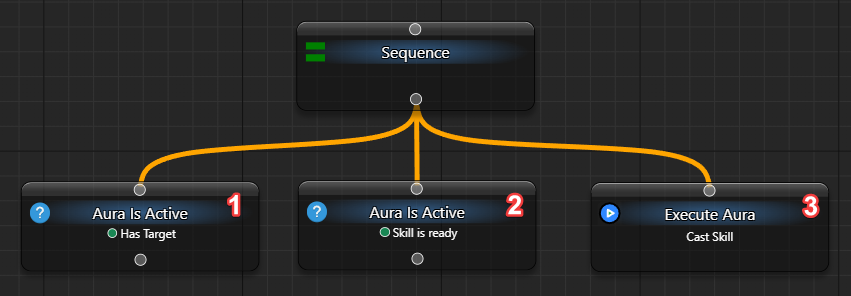
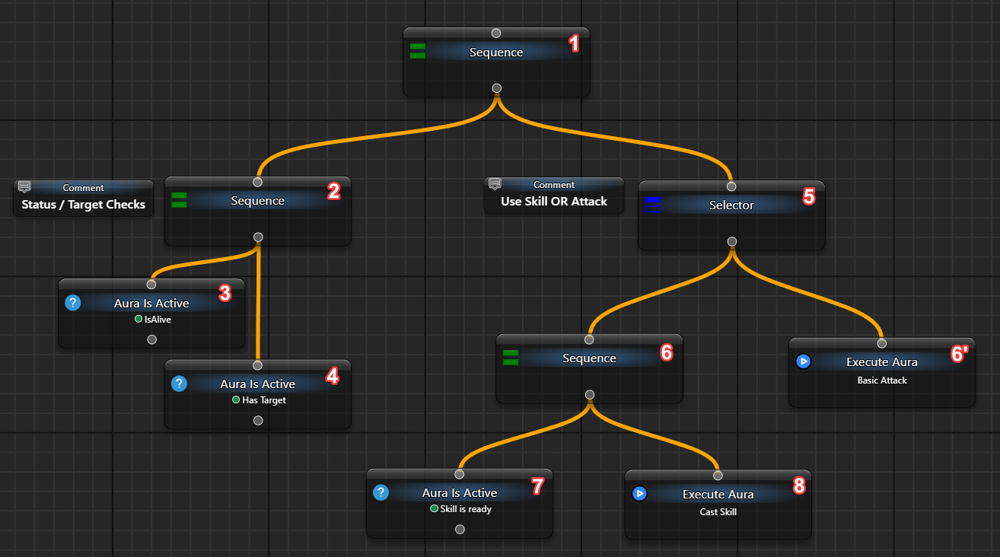

# Sequence — выполнить шаги по порядку

Чтобы следующий шаг выполнялся только после успеха предыдущего, соедините их через `Sequence`. Например, сначала проверьте разрешение, затем выдержите паузу и только потом переходите к следующей работе.

## Увидеть остановку и продолжение

Используйте своё загруженное дерево с `When Activated → Do nothing`, как в [первом примере](/ru/behavior-trees/gettings-started). Добавьте узлы через `Add new Node`, соедините их и разместите детей `Sequence` слева направо:

```text
My Tree
└─ Sequence
   ├─ Fixed Status: Failure
   ├─ Wait: 1500 ms
   └─ Fixed Status: Success
```

1. У первого `Fixed Status` выберите `General → Status → Failure`, у последнего — `Success`. Для `Wait` задайте фиксированный `Delay = 1500 ms`.
2. Нажмите верхнюю `Tick BT Once`. Sequence остановится на первом ребёнке с `Failure`; Wait и последний узел не выполнятся.
3. Измените **параметр** первого ребёнка на `Success` и снова нажмите `Tick BT Once`. Теперь выполнение дойдёт до Wait и вернёт `Running`.
4. Подождите две секунды и нажмите ту же кнопку ещё раз. Sequence продолжится с Wait, выполнит последнего ребёнка и вернёт `Success`.

Наблюдаемый результат — разные маршруты одной схемы без внешних действий. Успешно пройденный первый ребёнок при возобновлении не проверяется заново. Новое нажатие после завершения начинает последовательность сначала.

## Правила последовательности

| Ситуация | Результат Sequence |
| --- | --- |
| Ребёнок вернул Success | В том же тике переходит к следующему ребёнку |
| Ребёнок вернул Failure | Немедленно возвращает Failure; следующие дети не выполняются |
| Ребёнок вернул Running | Возвращает Running и запоминает ребёнка для следующего тика |
| Все доступные дети успешны | Success; следующий проход начнётся с первого |
| Нет включённых детей | Success, но работы не выполнено |
| Ребёнок отключён | Исключается из списка выполнения, а не считается Failure |

В графе порядок определяется горизонтальным расположением детей: слева направо. Перестановка по вертикали сама по себе его не меняет. Во вложенном списке используйте показанный порядок строк и вложенность.

**Важная граница:** обычная Sequence не проверяет предыдущие условия заново, пока продолжает ребёнка с Running. Если разрешение может исчезнуть во время долгой работы, отдельно проектируйте её прерывание; одна проверка в начале не является постоянным наблюдением.

<details>
<summary>Условия аур и исторические схемы</summary>

Вместо `Fixed Status` можно поставить `Aura Is Active` со ссылкой на свою ауру. На старой схеме две уже подготовленные ауры проверяют наличие цели и готовность действия, а `Execute Aura` вызывается только после их успеха.



Это примеры настроенных аур, а не встроенное чтение состояния игры. Их источником может быть реальный поиск по пикселям или другой поддерживаемый триггер.

Вертикально расположенная схема сохраняет тот же смысл лишь при сохранённом горизонтальном порядке:


Большую задачу удобно разделить: первая Sequence объединяет общие разрешения, затем [Selector](/ru/behavior-trees/nodes/selector) выбирает приоритетное действие или запасной вариант.



В этом примере проверки `Is Alive` и `Has Target` уже принадлежат своим аурам. Готовая ветка вызывает `Execute Aura`, внутри которой может быть [Send Sequence](/ru/actions/sendinput/send-sequence); другая ветка служит запасной. Сами узлы не создают источники этих данных.

Ещё одна старая иллюстрация показывает несколько последовательных проверок перед реакцией:


</details>

Для выбора первой успешной альтернативы нужен Selector. Для явного выбора по одному условию используйте [IfThenElse](/ru/behavior-trees/nodes/ifthenelse), а не повторяйте одно условие в нескольких ветках без необходимости.
