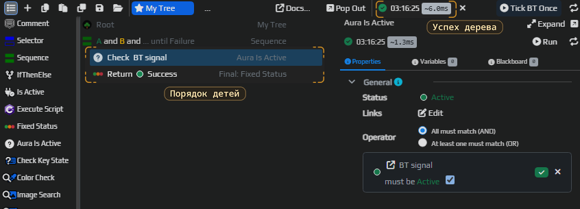
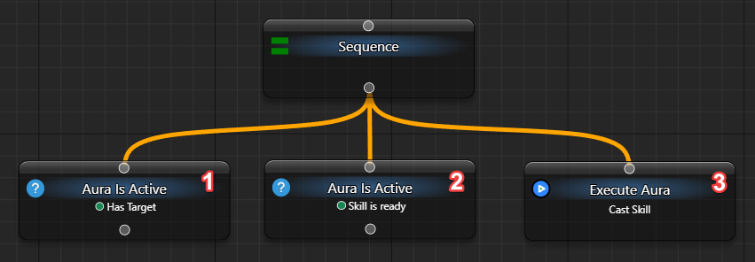
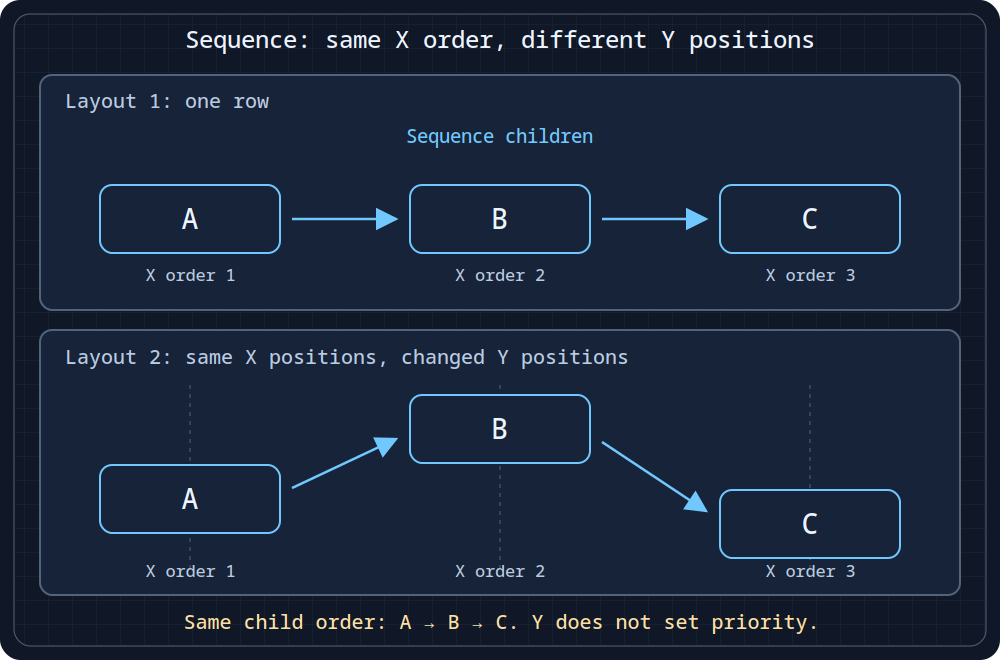
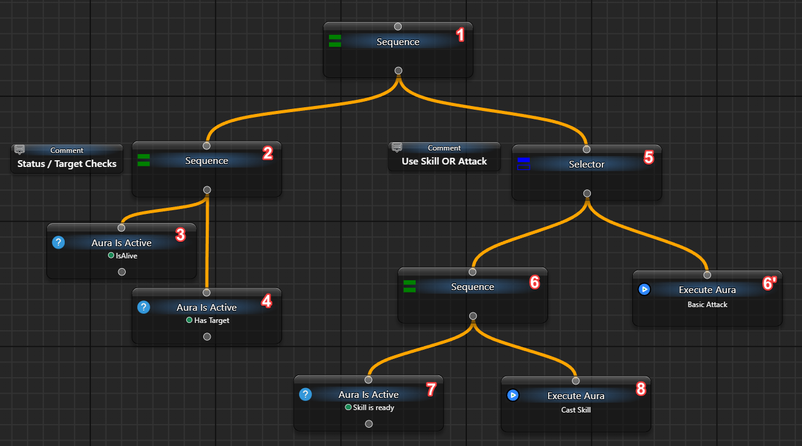
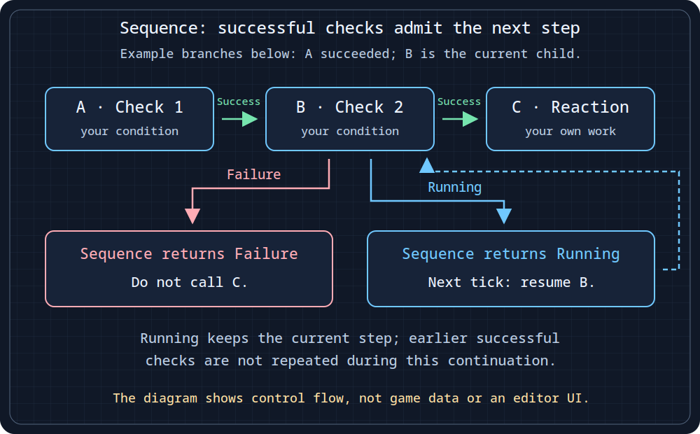

# Sequence — выполнить шаги по порядку

`Sequence` выполняет детей по очереди: следующий шаг начинается только после успеха предыдущего. Например, сначала проверить разрешение, потом выдержать паузу и только затем идти дальше.

## Увидеть остановку и продолжение

Возьмите своё загруженное дерево с `When Activated → Do nothing`, как в [первом примере](/ru/behavior-trees/gettings-started). Добавьте узлы через `Add new Node`, соедините их и поставьте детей `Sequence` слева направо:

```text
My Tree
└─ Sequence
   ├─ Fixed Status: Failure
   ├─ Wait: 1500 ms
   └─ Fixed Status: Success
```

1. У первого `Fixed Status` выберите `General → Status → Failure`, у последнего — `Success`. Для `Wait` задайте фиксированный `Delay = 1500 ms`.
2. Нажмите верхнюю `Tick BT Once`. Sequence остановится на первом ребёнке с `Failure`. Wait и последний узел не выполнятся.
3. Поменяйте **параметр** первого ребёнка на `Success` и снова нажмите `Tick BT Once`. Теперь выполнение дойдёт до Wait и вернёт `Running`.
4. Подождите две секунды и нажмите ту же кнопку ещё раз. Sequence продолжит с Wait, выполнит последнего ребёнка и вернёт `Success`.

Успешно пройденный первый ребёнок при продолжении заново не проверяется. Нажатие после завершения начинает последовательность сначала.

## Правила последовательности

| Ситуация | Результат Sequence |
| --- | --- |
| Ребёнок вернул Success | В том же тике переходит к следующему ребёнку |
| Ребёнок вернул Failure | Сразу возвращает Failure. Следующие дети не выполняются |
| Ребёнок вернул Running | Возвращает Running и запоминает ребёнка для следующего тика |
| Все доступные дети успешны | Success. Следующий проход начнётся с первого |
| Нет включённых детей | Success, но ничего не сделано |
| Ребёнок отключён | Убирается из списка выполнения, а не считается Failure |

В графе порядок детей задаётся положением по горизонтали: слева направо. Перестановка по вертикали его не меняет. Во вложенном списке порядок такой, как идут строки и вложенность.



**Важно:** пока Sequence продолжает ребёнка с Running, предыдущие условия она заново не проверяет. Если разрешение может пропасть во время долгой работы, прерывание нужно строить отдельно.

<details>
<summary>Условия аур и исторические схемы</summary>

Вместо `Fixed Status` можно поставить `Aura Is Active` со ссылкой на свою ауру.



Схема, расположенная вертикально, работает так же, только если порядок по горизонтали сохранён:



[Схема SVG](/assets/wiki-media/m051-concept.svg).

Большую задачу удобно разделить: первая Sequence собирает общие разрешения, затем [Selector](/ru/behavior-trees/nodes/selector) выбирает приоритетное действие или запасной вариант.



Здесь проверки `Is Alive` и `Has Target` уже настроены в своих аурах. Готовая ветка вызывает `Execute Aura`, внутри которой может быть [Send Sequence](/ru/actions/sendinput/send-sequence). Другая ветка — запасная.

Как работают последовательные проверки перед реакцией:



[Схема SVG](/assets/wiki-media/m052-concept.svg).

</details>

Чтобы выбрать первую успешную альтернативу, нужен Selector. Для явного выбора по одному условию берите [IfThenElse](/ru/behavior-trees/nodes/ifthenelse), а не повторяйте одно условие в нескольких ветках.
