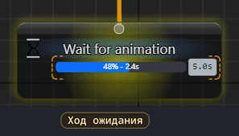
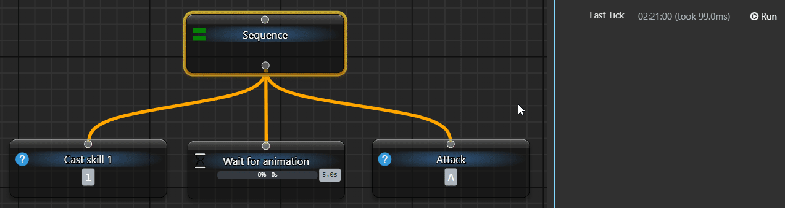

# Wait — выдержать паузу перед следующим шагом

`Wait` — это пауза в последовательности. Он засекает время с первого вызова и возвращает Running, пока интервал не закончится. Wait ждёт только время: появилась ли картинка и завершилась ли операция в другом приложении, он не проверяет.

## Дождаться следующего шага вручную

В отдельном загруженном дереве выберите `When Activated → Do nothing`, чтобы автоматические тики не мешали. Добавьте Sequence, Wait и Fixed Status и соедините:

```text
My Tree
└─ Sequence
   ├─ Wait: 2000 ms
   └─ Fixed Status: Success
```

1. В `Wait → General → Delay` введите `2000` в поле с единицей `ms`. Если видны Min и Max, выключите случайный разброс кнопкой со значком перемешивания.
2. У Fixed Status задайте `General → Status → Success`.
3. Нажмите верхнюю `Tick BT Once`. Wait и Sequence вернут Running, второй ребёнок не выполнится. Кнопка снова станет доступна: ожидание не блокирует приложение.

   

4. Подождите больше двух секунд и снова нажмите `Tick BT Once`. Wait вернёт Success, выполнится Fixed Status, и весь проход завершится успешно.
5. Ещё одно нажатие после завершения начнёт новый интервал: Wait опять вернёт Running.

При ручной работе время само следующий шаг не запускает: нужен новый тик. При периодическом запуске этот тик даст контейнер [Root](/ru/behavior-trees/nodes/root).

## Настройки времени

| Поле или режим | Как работает |
| --- | --- |
| Delay, ms | Фиксированная пауза в миллисекундах. 2000 ms — две секунды |
| Кнопка со значком перемешивания | Включает случайную паузу и показывает Min и Max |
| Min / Max | Границы случайного интервала. Значение выбирается один раз в начале ожидания, а не на каждом тике |
| Изменение Delay | Сбрасывает текущий отсчёт. Следующий вызов начнёт ожидание с новой настройкой |
| Delay = 0 | Wait может сразу вернуть Success, паузы не будет |

Wait не «спит» всё это время, а сверяет срок с часами приложения. Продолжение зависит от следующего тика, поэтому Wait не сработает точно в заданную миллисекунду.

Если продолжать нужно по состоянию вашего индикатора, берите [Until Success](/ru/behavior-trees/nodes/until-success) с [Aura Is Active](/ru/behavior-trees/nodes/aura-is-active), связанным с его аурой. В этой проверке выберите ожидаемое состояние.

## Что именно ждёт

Пока Wait возвращает Running, следующие дети Sequence не выполняются. Другие ауры, деревья и независимые задачи работают как обычно. Родитель продолжает с того же места и не обязательно перепроверяет все предыдущие условия.



Если нужно только ограничить частоту повторов, посмотрите [Cooldown](/ru/behavior-trees/nodes/cooldown): он решает другую задачу.

<details>
<summary>Продолжение, остановка и очистка</summary>

У Wait может быть один ребёнок. Он начинает выполняться после паузы, по общим правилам действия. Если ребёнок вернул Running, следующий тик продолжит ребёнка, а не начнёт паузу заново.

`Reset node status` очищает показанный результат, а не срок Wait. Остановка периодических тиков тоже не гарантирует новый отсчёт при следующем входе. Чтобы начать опыт заново, завершите текущий проход, измените Delay либо выгрузите и снова загрузите дерево, дождавшись очистки.

Выгрузка запрещает новые тики и запрашивает отмену текущей работы. Когда вызовы завершатся, полный сброс очистит и таймер. Кнопка Stop в панели отменяет только вызов, запущенный из этой панели.

</details>
