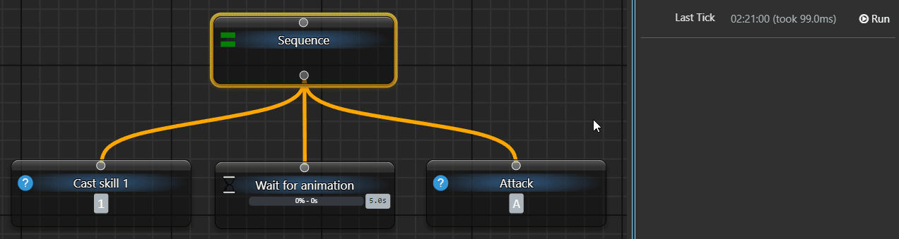

# Wait — выдержать паузу перед следующим шагом

Чтобы дать времени пройти перед продолжением своей последовательности, добавьте `Wait`. Он измеряет интервал с первого вызова и возвращает Running до его окончания. Ожидание времени не проверяет, появилась ли картинка или завершилась ли операция в другом приложении.

## Дождаться следующего шага вручную

В отдельном загруженном дереве выберите `When Activated → Do nothing`, чтобы автоматические тики не мешали наблюдению. Добавьте Sequence, Wait и Fixed Status, затем соедините:

```text
My Tree
└─ Sequence
   ├─ Wait: 2000 ms
   └─ Fixed Status: Success
```

1. В `Wait → General → Delay` введите `2000` в поле с единицей `ms`. Если видны Min и Max, выключите случайный разброс кнопкой со значком перемешивания.
2. У Fixed Status задайте `General → Status → Success`.
3. Нажмите верхнюю `Tick BT Once`. Wait и Sequence вернут Running; второй ребёнок не выполнится. Кнопка снова станет доступна: приложение не заблокировано ожиданием.
4. Подождите больше двух секунд и снова нажмите `Tick BT Once`. Wait вернёт Success, выполнится Fixed Status и весь проход завершится успешно.
5. Повторное нажатие после завершения начнёт новый интервал: Wait опять вернёт Running.

Итог — видимая пауза между достижением Wait и разрешением следующего узла. При ручной работе само истечение времени не запускает следующий шаг: нужен новый тик. При периодическом запуске этот тик даст контейнер [Root](/ru/behavior-trees/nodes/root).

## Настройки времени

| Поле или режим | Как работает |
| --- | --- |
| Delay, ms | Фиксированная продолжительность в миллисекундах; 2000 ms — две секунды |
| Кнопка со значком перемешивания | Включает случайную продолжительность и показывает Min и Max |
| Min / Max | Границы нового случайного интервала. Значение выбирается один раз при начале ожидания, а не на каждом тике |
| Изменение Delay | Сбрасывает текущий отсчёт. Следующий вызов начнёт ожидание с новой настройкой |
| Delay = 0 | Ожидание сразу может вернуть Success, дополнительная пауза не появляется |

Wait сравнивает срок с часами приложения, не выполняя блокирующий сон на всё время. До истечения возвращает Running; после истечения — Success и очищает начало интервала. Реальное продолжение зависит от следующего тика, поэтому задержка не является точным планировщиком срабатывания в заданную миллисекунду.

## Что именно ждёт

В Sequence следующие дети не выполняются, пока Wait возвращает Running. Другие ауры, деревья и независимые задачи продолжают работать. Родитель возобновляет тот же участок, а не обязательно заново проверяет все предшествующие условия.

На старой анимации между двумя действиями стоит Wait на пять секунд. Она показывает порядок и паузу, но не проверку окончания игровой анимации:



Если нужно ждать реального изменения состояния, используйте соответствующую проверку. Если требуется лишь ограничить частоту повторов, сравните с [Cooldown](/ru/behavior-trees/nodes/cooldown): он решает другую задачу.

<details>
<summary>Продолжение, остановка и очистка</summary>

У Wait может быть один ребёнок: после окончания паузы его выполнение начинается по общему контракту действия. Если ребёнок вернул Running, следующий тик продолжает ребёнка, не начинает задержку заново.

`Reset node status` очищает отображаемый результат, а не срок Wait. Прекращение периодических тиков тоже не гарантирует новый отсчёт при следующем входе. Для нового опыта завершите текущий проход, измените Delay либо выгрузите и заново загрузите своё дерево, дождавшись очистки.

Выгрузка запрещает новые тики и запрашивает отмену выполняющейся работы; после завершения вызовов полный сброс очищает и таймер. Кнопка Stop в панели отменяет только выданный этой панелью вызов. Это не обещание мгновенно прервать любой дочерний код и не команда остановки всех аур.

</details>
