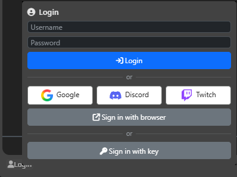
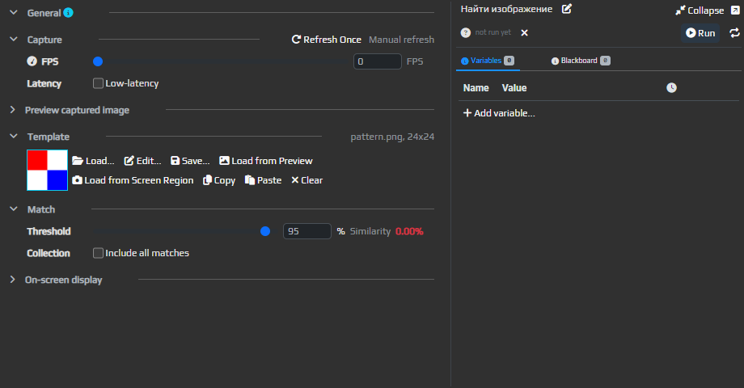
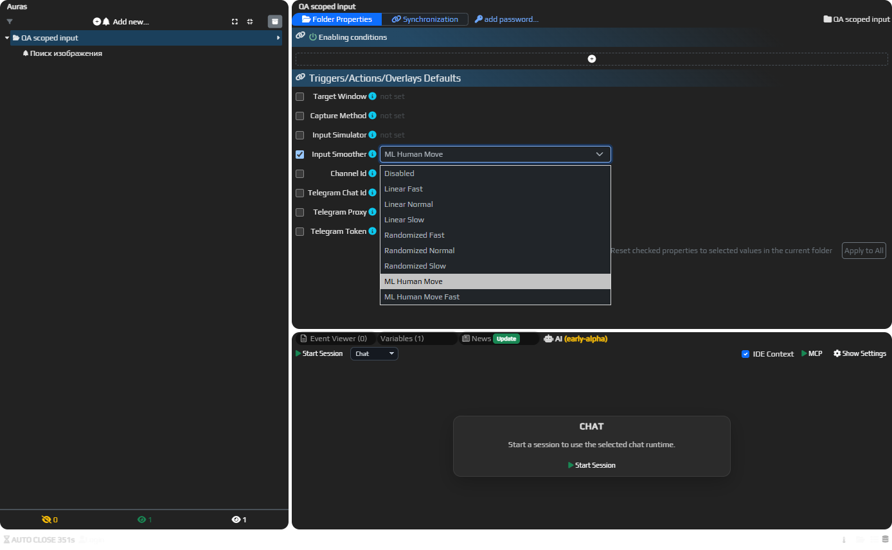

# Новый релиз — 1.10.10117 [RU](/ru/changelogs/10117)/[EN](/en/changelogs/10117)

## Интерфейс

Окончательно убрал старую оболочку и переключатель между ней и новой. Больше не нужно поддерживать два интерфейса и учитывать ограничения старого UI.

Объединил **Web UI Overlay** с **C# Overlay**. Добавил автоматический перенос старых настроек. Перед обновлением рекомендую сохранить копию профиля и проверить работу оверлеев после перехода.

## Вход через Google, Twitch и Discord

Добавил вход через **Google**, **Twitch** и **Discord**. Новым пользователям больше не нужно отдельно регистрироваться и придумывать пароль для EyeAuras: нажали кнопку знакомого сервиса, подтвердили вход в браузере — и можно начинать.

По умолчанию вход сохраняется между запусками, в том числе по имени и паролю. Доступны сервисы, включённые на сайте.

**Чтобы сохранить аккаунт с лицензиями и историей, сначала войдите в него на сайте и привяжите сервис в [Profile](https://eyeauras.net/my).**

Вход по лицензионному ключу тоже остаётся.

[Подробнее про вход и привязку аккаунта…](https://wiki.eyeauras.net/ru/features/external-providers)

## Деревья поведения и макросы

**Timeout** и **Interrupter** теперь передают отмену ожидающему действию, если оно её поддерживает, и дожидаются его завершения. При переключении общего **SubTree** между вызывающими деревьями старое выполнение тоже завершается перед новым.

В макросах поправил выбор ветки в **IfThenElse**, выход из **Repeat** через **Break** и загрузку профилей, в которых есть только макросы.

Поправил поиск связанных деревьев и макросов при экспорте, обновление их названий после переименования и имя файла при экспорте набора без аур.

Редактор узла теперь можно развернуть или вынести в отдельное окно. Вернул выбор области экрана в редакторах CV-узлов, поправил потерю фокуса при переименовании и отображение места вставки узлов.

## Движение мыши — ML Human Move

В настройках сглаживания **Send Input** появились **ML Human Move** и **ML Human Move Fast**. Обученная модель строит траекторию мыши и выбирает длительность движения; Fast — более быстрый вариант. Модель входит в программу.

*Режимы сглаживания в свойствах папки.*

## AI Assistant — своя версия Codex

EyeAuras теперь по умолчанию сама выбирает версию [встроенного Codex](https://wiki.eyeauras.net/ru/features/ai-codex-coding-assistant) и скачивает её при необходимости.

Установки Codex из редакторов и npm больше не подхватываются автоматически.

## EyePad — файлы и папки

В [EyePad](https://wiki.eyeauras.net/ru/features/eyepad) появился **Explorer** — дерево рабочей папки рядом с редактором. Можно открывать, создавать, переименовывать и удалять файлы и папки.

В [Live Import](https://wiki.eyeauras.net/ru/scripting/ide-integration) поправил загрузку решений с несколькими проектами, пробелами в именах и путях, а также распознавание проектов SDK-формата.

В самом редакторе поправил синхронизацию текста при быстром вводе, переименование файлов, положение подсказок, меню вкладок и восстановление открытых файлов при запуске.

Во вкладках только для чтения работают подсветка и подсказки; автодополнение доступно в редактируемых вкладках.

## Исправления / улучшения

* **[Мини-приложения]** Исправил зависание при запуске скомпилированных мини-приложений. Экран загрузки теперь закрывается, когда мини-приложение готово к работе.
* **[Защита паков]** Исправил защиту паков со скомпилированными скриптами, уже сохранёнными в хранилище.
* **[Подключение]** Поправил переключение на другой сервер после ошибок соединения.
* **[Отчёты об ошибках]** Добавил больше сведений о программе и запущенном мини-приложении.
* **[Target Window]** Значения вроде `PathOfExile.exe#2` больше не должны самопроизвольно заменяться описанием окна. Поправил выбор между несколькими окнами с суффиксами `#1` и `#2`.
* **[Bindings]** Вернул биндинги для Target Window в поисковых триггерах и других редакторах, работающих с окном, а также для позиции, размера и других настроек оверлеев.
* **[Overlays]** Поправил изменение размера, в том числе с сохранением пропорций: оверлей следует за той стороной, которую вы тянете.
* **[Replica]** Доработал выбор области и восстановление после скрытия оверлея.
* **[C# Overlay]** Исправил повторное открытие оверлея после закрытия его окна.
* **[Image Search]** Поисковые рамки больше не должны оставаться на экране после выгрузки ауры.
* **[Behavior Tree]** Исправил зависание загрузки узлов при переключении между аурами, деревьями и макросами, а также повторный запуск после выгрузки дерева.
* **[Input Simulator]** Добавил установку и удаление драйвера прямо в настройках папки. Рядом отображается текущий статус.
* **[Изображения]** Исправил потерю прозрачности при копировании PNG и ошибки предпросмотра видео при смене кадров.
* **[Горячие клавиши]** F8 и F12 теперь можно назначать в редакторе сочетаний клавиш.
* **[Telegram]** Подключение восстанавливается после исправления настроек прокси.
* **[Окна]** Поправил исчезновение содержимого после сворачивания, перемещение окна после отпускания мыши, подтверждения за главным окном и ошибки при закрытии окон и переименовании аур.
* **[Экспорт]** После экспорта набора или C#-проекта Проводник теперь открывается только по кнопке **Open in Explorer**.
* **[Wiki]** Доработал навигацию, списки страниц и просмотр изображений.

**Пожалуйста, сообщайте о проблемах!**
