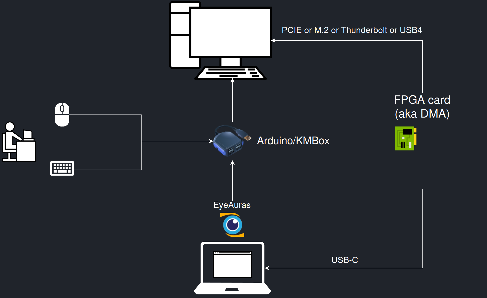
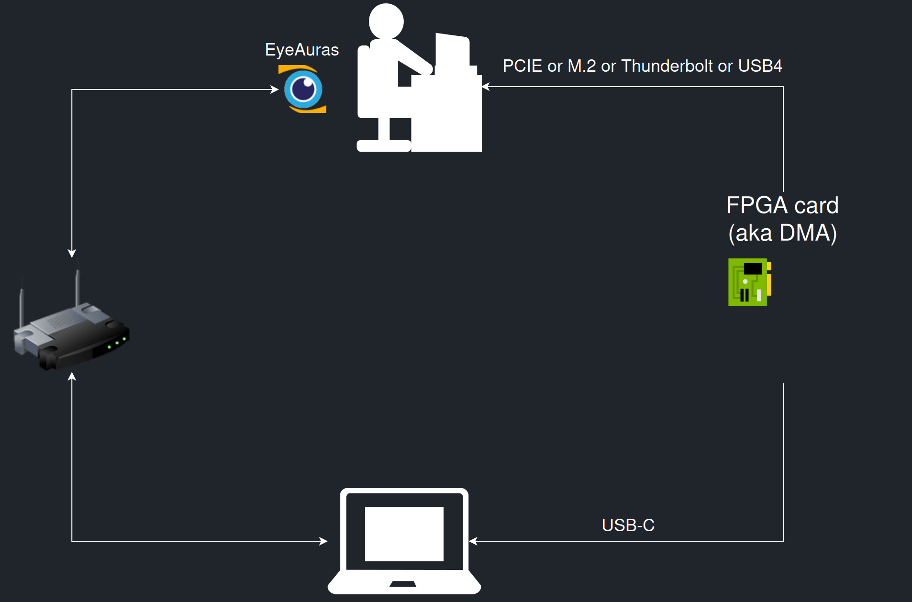

# Подготовить EyeAuras к источнику DMA

Для работы через FPGA сначала нужны два независимых условия: подготовленный источник памяти и поставка EyeAuras с модулем **EyeAuras.Memory.MPFS**. Наличие обычного Memory API или одной платы ещё не означает, что приложение может открыть этот источник.

Здесь цель — определить роли компьютеров и проверить загрузку модуля. Первое чтение списка процессов описано в [статье DMA](/ru/features/dma); настройка игры, её индикаторов и действий из подключения платы не возникает.

## Проверить подготовленное окружение

1. Определите **целевой компьютер**, чью память вы исследуете, и компьютер, на котором работает программа чтения памяти. Для первого опыта используйте собственное подготовленное окружение с известным тестовым процессом.
2. Получите совместимую поставку с **EyeAuras.Memory.MPFS**, её нативными библиотеками MemProcFS/LeechCore и подходящей поддержкой вашего устройства. Состав поставки должен включать каталог модуля с **x64/bin-mpfs**, в том числе `vmm.dll` и `leechcore.dll`. Не собирайте его из случайных версий DLL.
3. Запустите эту поставку EyeAuras. В строке состояния откройте значок с подсказкой **Open module monitor**, затем вкладку **Modules**. Найдите **MpfsMemoryModule** и проверьте сведения о загрузке и ошибках. Во вкладке **Assemblies** можно отдельно проверить присутствие сборки **EyeAuras.Memory.MPFS**; одна загруженная сборка ещё не подтверждает готовность оборудования.
4. Сопоставьте схему подключения со схемами ниже. Для локально подключённого к анализирующему ПК устройства путь скрипта начинается с **LCProcess.FPGA()**. Сетевое получение памяти требует отдельно подготовленного удалённого источника; одного IP-адреса целевого ПК недостаточно.
5. Перейдите к [первому запросу списка процессов](/ru/features/dma), когда модуль и источник готовы. Ошибка загрузки модуля требует сначала исправить состав совместимой поставки, а не менять адреса памяти в скрипте.

Наблюдаемый результат подготовки — найденный модуль и понятные роли устройств. Это ещё не успешное чтение памяти и не проверка записи.

| Что подготовить | Зачем |
|---|---|
| Windows и разрядность поставки | Нативный комплект этого модуля размещён в `x64/bin-mpfs`; он должен соответствовать приложению. |
| FPGA и соединения | Устройство и его интерфейсы должны поддерживаться используемым LeechCore и окружением. Названия PCIe, M.2, Thunderbolt и USB4 на схеме не делают любой адаптер совместимым. |
| USB-драйвер устройства | Для FT601 в Windows требуется подходящий драйвер FTDI; наличие `FTD3XX.dll` в комплекте не подтверждает установленный драйвер устройства. Уточните требования у автора используемого LeechCore. |
| MemProcFS / LeechCore | Получение памяти и восстановление представления процессов; это не встроенный API данных конкретной игры. |
| Модуль MPFS | Инициализирует нативное окружение и добавляет сборку в ссылки скриптов. Ссылка SDK или `using` сами модуль не загружают. |
| PID тестового процесса | Должен относиться к целевой системе, а не случайно совпавшему процессу на другом ПК. |

## EyeAuras на отдельном компьютере

На первой схеме EyeAuras расположен рядом с компьютером анализа. Один путь ведёт к данным через FPGA, другой — к отдельному устройству ввода. **Arduin…** на старой схеме обозначает отдельный узел этой конфигурации; DMA само по себе не отправляет клавиатуру или мышь.

Два отдельных пути — получение памяти через FPGA и ввод через Arduino/KMBox. [Исходная схема SVG](/assets/wiki-media/m070-original.svg).

## EyeAuras на основном компьютере

На второй схеме EyeAuras расположен на основном ПК, а соединения с другим компьютером показаны отдельно. Для такого размещения нужен согласованный путь передачи данных между узлами. Из картинки не следует, что локальный `LCProcess.FPGA()` автоматически найдёт устройство, подключённое к другому компьютеру.

Размещение EyeAuras на основном ПК; соединения с другим компьютером показаны отдельно. [Исходная схема SVG](/assets/wiki-media/m071-original.svg).

Общее описание источников и подготовка оборудования находятся у [автора LeechCore](https://github.com/ufrisk/LeechCore). Если нужна только работа со своим обычным локальным процессом, начните с [чтения известного значения](/ru/scripting/examples/advanced/memory/rpm-read): оно не требует DMA.
