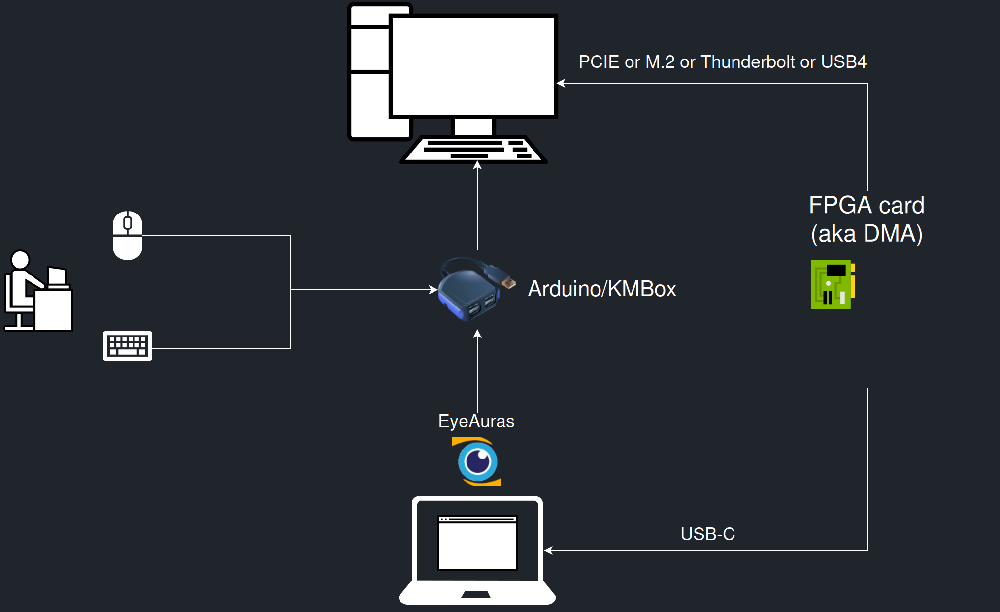
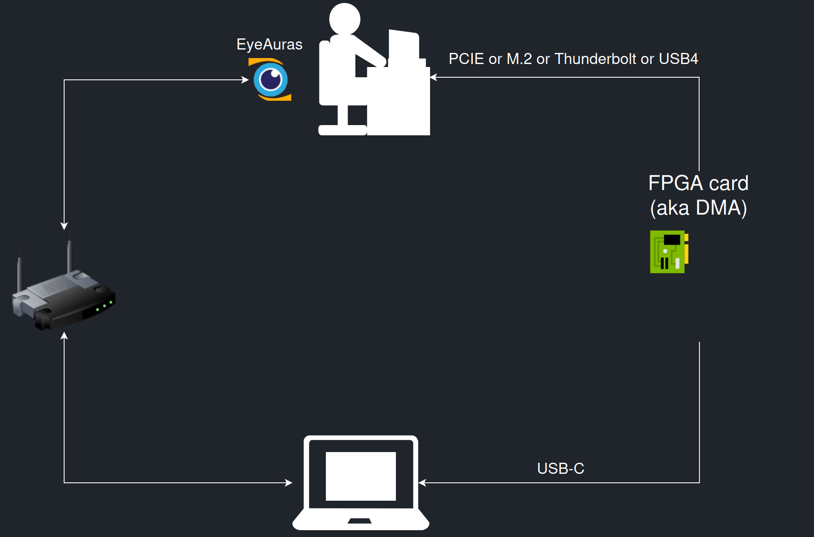

# Подготовить EyeAuras к источнику DMA

Чтобы читать память через FPGA, нужны две вещи: подготовленный источник памяти и поставка EyeAuras с модулем **EyeAuras.Memory.MPFS**. Обычного Memory API или одной платы для этого мало.

На этой странице вы определите роли компьютеров и проверите, что модуль загрузился. Как впервые получить список процессов, написано в [статье про DMA](/ru/features/dma). Сама плата не настраивает ни игру, ни её индикаторы, ни действия.

## Проверить подготовленное окружение

1. Решите, где **целевой компьютер** (его память вы исследуете), а где компьютер с программой чтения памяти. Для первого раза возьмите своё подготовленное окружение и известный тестовый процесс.
2. Возьмите совместимую поставку с **EyeAuras.Memory.MPFS**, нативными библиотеками MemProcFS/LeechCore и поддержкой вашего устройства. В ней должен быть каталог модуля с **x64/bin-mpfs**, а в нём — `vmm.dll` и `leechcore.dll`. Не собирайте его из DLL случайных версий.
3. Запустите эту поставку EyeAuras. В строке состояния нажмите значок с подсказкой **Open module monitor** и откройте вкладку **Modules**. Найдите **MpfsMemoryModule** и посмотрите, загрузился ли он и нет ли ошибок. На вкладке **Assemblies** можно отдельно проверить, есть ли сборка **EyeAuras.Memory.MPFS**. Загруженная сборка ещё не значит, что оборудование готово.
4. Сравните своё подключение со схемами ниже. Если устройство подключено прямо к анализирующему ПК, скрипт начинается с **LCProcess.FPGA()**. Чтобы получать память по сети, нужен отдельно подготовленный удалённый источник. Одного IP-адреса целевого ПК недостаточно.
5. Когда модуль и источник готовы, переходите к [первому запросу списка процессов](/ru/features/dma). Если модуль не загрузился, сначала исправьте состав поставки. Менять адреса памяти в скрипте в этом случае бесполезно.

Это только подготовка: модуль найден, роли устройств понятны. Память вы ещё не читали, запись не проверяли.

| Что подготовить | Зачем |
|---|---|
| Windows и разрядность поставки | Нативные файлы модуля лежат в `x64/bin-mpfs` и должны соответствовать приложению. |
| FPGA и соединения | Устройство и его интерфейсы должны поддерживаться вашим LeechCore и окружением. Надписи PCIe, M.2, Thunderbolt и USB4 на схеме не значат, что подойдёт любой адаптер. |
| USB-драйвер устройства | Для FT601 в Windows нужен подходящий драйвер FTDI. Файл `FTD3XX.dll` в комплекте не значит, что драйвер устройства установлен. Требования уточните у автора вашего LeechCore. |
| MemProcFS / LeechCore | Получают память и восстанавливают картину процессов. Это не готовый API данных конкретной игры. |
| Модуль MPFS | Инициализирует нативное окружение и добавляет сборку в ссылки скриптов. Ссылка на SDK или `using` модуль не загружают. |
| PID тестового процесса | Должен быть от процесса на целевой системе, а не от случайно совпавшего процесса на другом ПК. |

## EyeAuras на отдельном компьютере

На первой схеме EyeAuras стоит на компьютере анализа. Один путь идёт к данным через FPGA, другой — к отдельному устройству ввода. **Arduin…** на старой схеме — это отдельный узел такой конфигурации. Сам DMA клавиатуру и мышь не нажимает.

Здесь два отдельных пути: память через FPGA и ввод через Arduino/KMBox. [Исходная схема SVG](/assets/wiki-media/m070-original.svg).

## EyeAuras на основном компьютере

На второй схеме EyeAuras стоит на основном ПК, а соединения с другим компьютером показаны отдельно. В таком варианте данные между компьютерами нужно как-то передавать, и этот путь надо настроить. Локальный `LCProcess.FPGA()` сам не найдёт устройство, подключённое к другому компьютеру.

[Исходная схема SVG](/assets/wiki-media/m071-original.svg).

Об источниках памяти и подготовке оборудования читайте у [автора LeechCore](https://github.com/ufrisk/LeechCore). Если вам нужен только обычный процесс на своём компьютере, начните с [чтения известного значения](/ru/scripting/examples/advanced/memory/rpm-read): DMA для этого не нужен.
