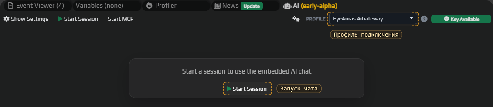
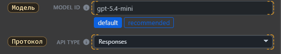
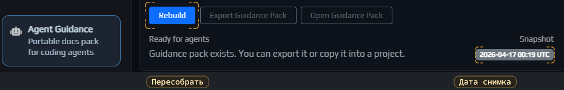

# AI Assistant

AI Assistant — это чат во вкладке AI. Его можно спросить, как настроить EyeAuras, попросить найти статью или разобрать пример скрипта. Чтобы чат заработал, нужно выбрать профиль подключения к модели.

Функция ещё развивается. В ответах и коде бывают ошибки — проверяйте их перед использованием.

## Как начать

1. Откройте вкладку AI и выберите профиль. От него зависят модель, адрес сервера и способ входа.
2. Если нужен свой ключ, откройте Manage Profiles и впишите его в API Key. Можно указать переменную окружения, например `%OPENAI_API_KEY%`.
3. Нажмите Start Session.
4. Задайте конкретный вопрос, например: «Как запускать ауру только при активном окне игры?» Если разбираете ошибку, приложите её текст и укажите версию EyeAuras.

Ответ на вопрос об активном окне сверьте со статьями [Window Is Active](/ru/triggers/window-is-active) и [условия включения](/ru/features/enabling-conditions). Обычный триггер проверяет условие ауры, а условие включения решает, должна ли она вообще работать. Проверяя ответ, сначала выведите на экран оверлей [Text](/ru/overlays/text), а ввод добавляйте потом.

На снимке интерфейс за апрель 2026 года. Выбранный профиль виден справа вверху, чат открывается кнопкой Start Session.

## Какой профиль выбрать

| Профиль | Подключение |
| --- | --- |
| OpenAI | Свой API-ключ. Берите профиль из шаблона. Расходы зависят от вашего аккаунта у провайдера. |
| EyeAuras Gateway | Сервер EyeAuras. API Key — `%EYEAURAS_TOKEN%`, Endpoint — `https://eu.openai.eyeauras.net`. Доступность и лимиты зависят от условий сервиса. |
| Ollama | Модель на вашем компьютере. Запустите Ollama, укажите Endpoint `http://localhost:11434/v1` и имя установленной модели в Model Id. |

Для другого совместимого сервера нужны его адрес, имя модели и ключ доступа, если сервер его требует.

## Настройки профиля

Окно Manage Profiles:

| Настройка | Что делает |
| --- | --- |
| Name | Имя профиля в списке. Например: OpenAI или Ollama. |
| API Key | Ключ доступа или переменная окружения, например `%OPENAI_API_KEY%`. |
| Endpoint | Адрес API. Для OpenAI оставьте шаблонный, для другого сервера укажите его адрес. |
| Model Id | Имя модели у провайдера. Начните со значения из шаблона. |
| API Type | Responses или ChatCompletions — смотря что поддерживает сервер. |
| Reasoning Effort | Насколько долго модель обдумывает ответ. Для начала оставьте значение из шаблона. |
| Max Context Tokens | Размер контекста. Нужен, чтобы показывать, насколько он заполнен. Лимит самой модели не меняет. |
| Function Calling | Даёт модели инструменты EyeAuras, в том числе поиск по документации. Обычно лучше оставить включённым. |

На снимке пример Gateway за апрель 2026 года: gpt-5.4-mini и Responses. Выберите модель, которая доступна для вашего подключения.

## Если чат не запускается

**Unavailable / ключ недоступен:** проверьте API Key и значение переменной окружения, если указали её. Для Gateway нужен доступный токен EyeAuras.

**Нет соединения:** проверьте Endpoint. Для Ollama убедитесь, что локальный сервер запущен.

**Ошибка модели или API:** сверьте Model Id и API Type с настройками вашего провайдера. Полный текст ошибки полезнее, чем «не работает».

Дополнительные настройки — Show Settings

Для обычного чата их обычно менять не нужно.

| Настройка | Что делает |
| --- | --- |
| Docs Knowledge Base | Подключает базу документации к AI-чату и MCP. |
| Docs Repository / Docs Path | Репозиторий документации и папка её локального кэша. |
| Artifact Store | Разрешает сохранять артефакты, если сервер это поддерживает. |
| MCP Port / Enable MCP On Startup | Порт MCP-сервера и его автоматический запуск. |
| Enable Browser Automation / Browser Debug Port | Включает инструменты для работы с браузером и задаёт порт отладки. После изменения Browser Automation перезапустите EyeAuras. |

## Для внешнего AI-агента

В Show Settings → Agent Guidance можно собрать документацию и сведения об EyeAuras в одну папку — для Codex, Claude Code или другого агента:

1. Нажмите Rebuild.
2. Откройте результат через Open Guidance Pack или сохраните через Export Guidance Pack.
3. Чтобы добавить его к проекту, нажмите Add to C# Project или Add to Solution. Агенту укажите папку `generated/ai`.

При повторном добавлении эта папка заменяется целиком, поэтому свои файлы храните отдельно. Существующий AGENTS.md проекта не переписывается.

Если агенту нужны запросы к работающему EyeAuras, включите MCP. После включения или выключения MCP снова нажмите Rebuild, чтобы обновить сведения в пакете.

Связанные статьи: [AI Codex Coding Assistant](/ru/features/ai-codex-coding-assistant), [бот в Discord](/ru/features/discord-bot), [примеры и рекомендации по скриптам](/ru/scripting/best-practices).
