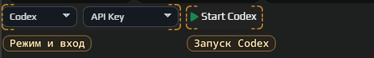
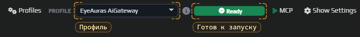
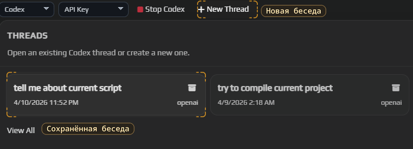

# Разобрать свой скрипт с Codex в EyePad

Codex — это режим AI-помощника для работы с кодом. Он видит проект, открытый в EyePad, и может пользоваться инструментами EyeAuras. Попросите его объяснить, как устроен ваш скрипт, или внести небольшую правку. Если вопрос про кнопку или настройку, обычно хватает обычного [AI Assistant](/ru/features/ai-assistant).

Что нужно:

- сборка с вкладкой `AI` и режимом `Codex`;
- совместимый профиль **OpenAI** с доступом по **API Key**. Подходит прямой OpenAI или совместимый `EyeAuras Gateway / AiGateway`;
- модель, доступная для этого подключения.

В адресе endpoint не должно быть параметров после `?`. Codex работает через API Responses, поэтому произвольный адрес Chat Completions сам по себе не подойдёт. Профили Azure, Anthropic и Ollama в этом режиме не поддерживаются, даже если они работают в обычном чате.

## Начать с объяснения собственного проекта

1. Откройте в [EyePad](/ru/features/eyepad) свой небольшой `Script.csx`. Для первого раза возьмите копию проекта, которую не жалко менять.
2. Откройте `AI`, переключите `Chat` на `Codex`, выберите профиль и `API Key`. Если нужно, задайте `Endpoint` и ключ в `Show Settings` — как это сделать, описано в [AI Assistant](/ru/features/ai-assistant).

   
3. Убедитесь, что статус — `Ready`, и нажмите `Start Codex`. Запустится отдельная среда Codex. Дождитесь списка моделей и разговоров.
4. Нажмите `New Thread` и выберите модель из списка. Напишите: «Объясни, что делает Script.csx в текущем проекте EyePad. Назови файлы и зависимости, на которые опираешься. Пока не меняй код».
5. Сверьте ответ с открытыми файлами. В этом же разговоре можно попросить конкретную небольшую правку и проверить изменённый код.
6. Когда закончите, нажмите `Stop Codex`. Возврат к списку разговоров работу не останавливает.

| Настройка | Для чего нужна |
|---|---|
| Профиль OpenAI и `API Key` | Задают endpoint и доступ к модели. |
| Модель | Выбирается из моделей подключения. |
| `reasoning` | Уровень рассуждения, доступный для выбранной модели. |
| `Docs Knowledge Base` | Даёт помощнику документацию EyeAuras, чтобы он искал в ней точные сведения об API. |
| Контекст IDE / EyePad | Передаёт рабочий проект и инструменты, которыми его можно смотреть и менять. |
| `Start Codex` / `Stop Codex` | Запускают и останавливают среду, в которой работает помощник. |

Режим `ChatGPT Login` в обычной сборке пока показывает `Unavailable`. Рабочий способ — `API Key`. К входу в аккаунт EyeAuras через [внешний сервис](/ru/features/external-providers) этот режим не относится.

## Разговоры и рабочие файлы

`Thread` — это отдельная задача со своей историей, состоянием, моделью и уровнем `reasoning`. В списке разговор можно открыть снова или отправить в архив, а также показать остальные и архивные записи. Удобно вести разбор ошибки и новую функцию в разных разговорах.

Если переключиться на другой разговор, задача в прежнем продолжит выполняться. Чтобы её остановить, нажмите остановку сами. История обычного `Chat` в Codex не переносится.

В EyePad агент получает текущую рабочую среду. Перед каждым запросом контекст и набор инструментов обновляются. Подключённая папка проекта может быть доступна агенту для записи. Файл, прикреплённый к сообщению для чтения, — другое дело: это не разрешение менять всю его папку. Не ждите, что агент спросит подтверждение на каждую правку: внутри разрешённой рабочей области он может менять файлы сам. Потом просмотрите результат и сохраните нужные изменения проекта как обычно.

Иногда Codex запрашивает отдельное разрешение — выполнить команду или изменить файлы сверх уже доступного. Такие запросы интеграция сейчас отклоняет, диалога с выбором нет. Запись ограничена настроенными рабочими областями. Про чтение этого сказать нельзя: не считайте, что агент читает только эти папки. Если рядом лежат чувствительные файлы, заранее подумайте, какой проект и контекст вы открываете.

Agent Guidance и внешняя IDE

В `Show Settings` есть [Agent Guidance](/ru/features/ai-assistant#agent-guidance). Для внешнего агента нажмите `Rebuild`, затем `Add to C# Project` или `Add to Solution`. Появится папка `generated/ai/` с инструкциями, снимком документации и метаданными. Её `AGENTS.md` — точка входа в этот пакет. Корневой файл инструкций вашего проекта он не заменяет.

Встроенный Codex получает документацию и так. Для внешней IDE пригодятся статьи про [подключение IDE](/ru/scripting/ide-integration) и [практики скриптов](/ru/scripting/best-practices). MCP даёт подключённому клиенту инструменты для работы с контекстом EyeAuras.

С процессом Codex EyeAuras общается через [официальный App Server](https://developers.openai.com/codex/app-server). Возможности его новых версий появятся только с новой сборкой EyeAuras. Если нужна короткая подсказка без локального проекта, есть [Discord Bot](/ru/features/discord-bot).

