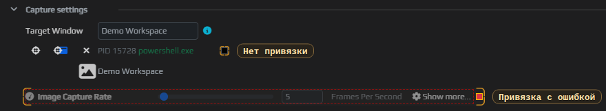
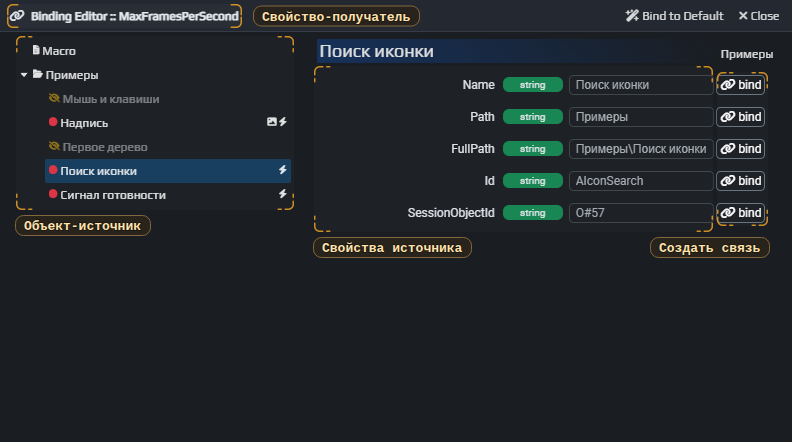

# Привязки — менять связанное значение в одном месте

Привязка (Binding) связывает одно свойство с другим. Например, одна и та же памятка нужна в двух местах экрана. Свяжите текст двух оверлеев: меняете первый — второй обновляется сам. Привязка передаёт только значение свойства. Условия видимости у каждой ауры остаются свои.

## Один текст в двух оверлеях

1. Создайте две ауры — «Исходная памятка» и «Копия памятки». В каждую добавьте [Fixed Value](/ru/triggers/fixed-value) со значением Is Active и один оверлей [Text](/ru/overlays/text).
2. В первом оверлее в **Content** напишите «Перед записью проверьте микрофон». Расставьте оверлеи по разным местам экрана, чтобы видеть оба.
3. Во втором оверлее нажмите маленький индикатор привязки у **Content**. Откроется **Binding editor**.
4. В дереве слева выберите «Исходная памятка». Справа раскройте **Overlays → Text**, найдите свойство **Content** и нажмите **bind** в его строке.
5. Измените Content первого оверлея на «Проверка завершена».

Оба оверлея покажут новый текст. Полем второго теперь управляет привязка, поэтому текст меняйте в первом. Связь работает в одну сторону: от первого Content ко второму.

Чтобы вернуть второму оверлею свой текст, откройте контекстное меню его индикатора, выберите **Un-bind** и введите значение вручную.

## Как читать и менять привязку

| Элемент | Что означает или делает |
| --- | --- |
| Чёрный индикатор | Свойство не привязано. Щелчок открывает Binding editor. В старом интерфейсе индикатор стоит справа от поля. |
| Строка свойства и bind | Выбирает, откуда брать значение. Редактор показывает совместимые типы и доступные преобразования. |
| Variables в редакторе | Берёт значение из переменной, а не из свойства компонента. |
| Bind to Default | Подключает подходящее [значение по умолчанию](/ru/features/default-properties). |
| Un-bind | Убирает привязку у выбранного свойства. |
| Красный индикатор или сообщение об ошибке | Привязка не работает. Откройте редактор и прочитайте причину: например, источник пропал или значение не удаётся преобразовать. |

Свойство может брать значение у другого триггера, действия или оверлея, у переменной или из настроек по умолчанию. Если нужно просто одно окно на всю папку, начните со значений по умолчанию. Отдельная привязка нужна, когда один компонент должен повторять другой.

## Передать найденные координаты действию

Ещё один пример — место клика в [Send Sequence](/ru/actions/sendinput/send-sequence) берётся из результата [Image Search](/ru/triggers/images/image-search). Сначала настройте поиск и убедитесь, что он находит нужную картинку.

На следующем снимке старого редактора у координат действия открыт Binding editor. Источником выбран **BoundsScreen** — область найденной картинки в экранных координатах. BoundsWindow — это та же область, но относительно окна. Подставлять одно вместо другого, не согласовав систему координат, нельзя.

Привязка координат сама не кликает и не решает, когда запустится действие. Действие нужно отдельно поставить в подходящую группу, например в On Enter ауры с поиском, и проверить систему координат в его настройках. Подробнее — в статье про [блок координат](/ru/features/coordinate-system).

Привязки работают внутри одного экземпляра EyeAuras. При экспорте и импорте они сохраняются вместе с конфигурацией, но не забудьте перенести и объекты-источники. Привязка обновляет значение, когда меняется источник. Нагрузка всей настройки зависит ещё и от того, что делают сами компоненты.
