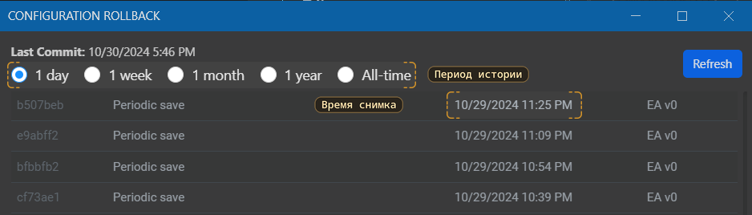
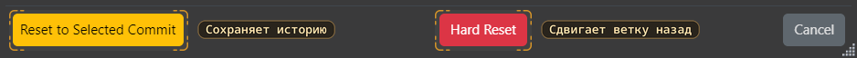

# Вернуть конфигурацию к сохранённому состоянию

EyeAuras время от времени сохраняет снимки конфигурации профиля. Если после ваших правок что-то сломалось, в окне **Version history** можно вернуться к более раннему снимку. Например, вернуть прежнее имя папки — вместе со всеми остальными настройками на тот момент. Восстанавливается вся конфигурация целиком, после чего EyeAuras перезапускается.

Потренируйтесь на своём тестовом профиле, где нет чужих или важных несохранённых изменений. Должны быть включены сохранение конфигурации в файлы и **File system version control**. Сначала сделайте [локальный экспорт](/ru/features/export-import) нужных аур: история лежит на том же диске и отдельную копию не заменяет.

## Сделать своё изменение и вернуть его

1. Назовите тестовую папку `История — исходная`. Закройте EyeAuras обычным способом и снова откройте тот же профиль. При выходе исходное состояние попадёт в историю.
2. Откройте **Version history** — это кнопка с такой подсказкой в главном окне. Найдите снимок исходного состояния, запомните его **Commit ID** и время. Закройте окно кнопкой **Cancel**.
3. Переименуйте папку в `История — изменено`. Снова закройте и откройте EyeAuras. Если новые изменения тоже нужны, экспортируйте их до восстановления.
4. Откройте **Version history**. Если снимка не видно, выберите **All-time** и нажмите **Refresh**. Выберите снимок, который запомнили, а не последний с новым именем.
5. Нажмите **Reset to Selected Commit**, проверьте дату в окне подтверждения и подтвердите. EyeAuras запишет текущие данные на диск, восстановит файлы выбранного снимка и перезапустится.
6. После перезапуска папка снова должна называться `История — исходная`. Более поздние коммиты останутся в истории, и появится новая запись о восстановлении. Этим такой способ отличается от **Hard Reset**.

На снимке за октябрь 2024 года выбран период в один день. Чтобы увидеть более ранние снимки, выберите All-time и сравните время записей.

В нижней части [полного окна истории](https://s3.eyeauras.net/media/2024/10/EyeAuras_Y3P3cw9Pi1E0WkMc.png) видны Commit ID, описание и дата выбранного снимка.

## Выбрать способ восстановления

| Команда | Что меняется |
| --- | --- |
| Reset to Selected Commit | Возвращает файлы из выбранного снимка. Прежняя история сохраняется, сверху добавляется новый коммит восстановления. Может удалить неотслеживаемые файлы в каталоге конфигурации, так что новые файлы могут не уцелеть. |
| Hard Reset | Переносит вершину истории на выбранный коммит и сбрасывает отслеживаемые файлы. Более поздние состояния пропадают из обычного списка этой ветки. Не рассчитывайте, что это окно позволит отменить сброс. |
| Refresh | Перечитывает список коммитов. Снимок текущих правок не создаёт. |
| 1 day / 1 week / 1 month / 1 year / All-time | Ограничивает период, за который показаны коммиты. Если коммит скрыт фильтром, это не значит, что он удалён. |
| Cancel | Закрывает окно без восстановления. Пока окно открыто, ауры не выполняются. |

Reset to Selected Commit сохраняет более позднюю историю. Hard Reset возвращает ветку к выбранному снимку.

В старых описаниях первый способ назывался **Soft Reset**. Это не то же самое, что команда Git `reset --soft`: EyeAuras восстанавливает файлы и создаёт новый коммит. [Git](https://git-scm.com/) здесь просто хранит снимки, знать его команды не нужно.

На старом снимке ниже — подтверждение первого способа. Смотрите на нажатую кнопку и описание операции: в заголовке подтверждения может стоять Hard-reset даже у **Reset to Selected Commit**.

Когда нужен Hard Reset

Выбирайте его, только если хотите отбросить всё, что было после снимка, а не просто вернуть старые значения. Перед подтверждением отдельно сохраните новые ауры и настройки, которые ещё нужны.

1. Выберите нужный коммит в **Version history**.
2. Нажмите **Hard Reset** и проверьте время, описание и предупреждение о потере более поздних изменений.
3. Подтвердите. После перезапуска проверьте конфигурацию и список истории.

Сбрасываются отслеживаемые файлы. Это не значит, что из папки удалятся все посторонние файлы. Учётную запись, публикации на сайте и файлы ваших внешних программ сброс тоже не трогает.

## Что сохраняется автоматически

История ведётся для каталога `config` текущего профиля. В нём лежат файлы конфигурации — не вся установка Windows и не все внешние ресурсы. Изменения записываются примерно раз в `15 минут` и при обычном выходе. Коммит появляется, только если что-то изменилось. Отдельной строки на каждое движение ползунка может и не быть.

Перед восстановлением накопленные изменения записываются на диск. Но отдельный снимок каждой несохранённой правки при этом не обещан. Старое состояние заменяет текущие значения, поэтому нужные изменения сохраните заранее. Чтобы восстановление сработало, файлы профиля и его истории должны быть на месте.

| Расположение обычного профиля release | Где искать config |
| --- | --- |
| Standalone | Обычно `%appdata%\EyeAuras\release\config`. |
| Portable / Pack | Обычно `data\release\config` рядом с комплектом программы. |
| Другой профиль или заданный каталог данных | У него свой каталог. Путь обычного release подходит не всем. |

У скриптов и других отслеживаемых объектов есть отдельное окно **Local History**. Оно устроено иначе. В нём есть **Commit**, **Apply** и сравнение с текущим текстом. Восстанавливаются только объекты, переданные этому окну, и может учитываться ещё не сохранённый документ. **Version history** работает по-другому: восстанавливает конфигурацию профиля и перезапускает EyeAuras.
