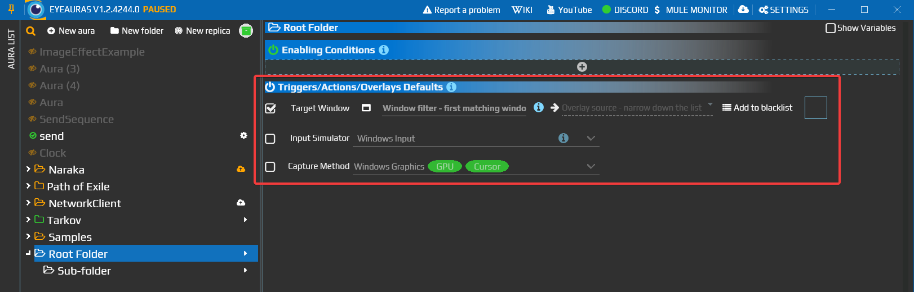
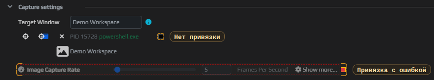
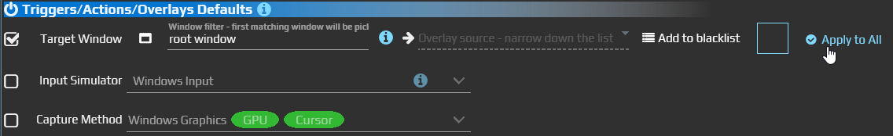

# Свойства по умолчанию — выбрать окно для всей папки

Если несколько аур следят за одним приложением, его окно удобнее выбрать один раз — в папке. Триггеры и действия, привязанные к этому значению по умолчанию, получат новое окно, как только вы его поменяете.

Настройка находится в папке, в разделе **Triggers/Actions/Overlays Defaults**. Список свойств зависит от подключённых возможностей EyeAuras. Начните с Target Window.

Флажок слева разрешает папке задавать это значение.

## Одно окно для двух проверок

1. Откройте приложение, за которым хотите следить, и создайте для его аур отдельную папку. Добавьте в неё две ауры: одну с [Window Exists](/ru/triggers/window-exists), другую с [Window Is Active](/ru/triggers/window-is-active).
2. Выберите папку. В **Triggers/Actions/Overlays Defaults** включите флажок **Target Window** и выберите окно приложения из списка. Проверьте, что показано нужное окно.
3. В каждом из двух триггеров откройте контекстное меню маленького индикатора привязки у Target Window и выберите **Bind to Default**.

   До привязки индикатор у Target Window чёрный.

   

4. Вернитесь к папке и выберите в Target Window другое открытое окно.

Оба триггера должны получить новое окно: Window Exists проверяет, существует ли оно, а Window Is Active — на переднем ли оно плане.

Левый щелчок по индикатору открывает редактор привязок, правый — меню.

## Подключить существующие ауры

Новым компонентам EyeAuras сам назначает поддерживаемые привязки по умолчанию при создании. У уже существующего свойства может быть своё значение или другая привязка. Такую настройку изменение в папке не заменит.

| Способ | Когда использовать |
| --- | --- |
| Bind to Default у отдельного свойства | Подключить один триггер, действие или оверлей к значению папки. |
| Bind to Default в прежнем окне редактора привязок | То же самое, но кнопкой в заголовке. В новом интерфейсе используйте контекстное меню индикатора. |
| Apply to All в папке | Разом перевести подходящие свойства дочерних аур и подпапок на значения по умолчанию. В новом редакторе применяются все отмеченные свойства, в прежнем кнопка была у каждой строки. |

**Apply to All заменяет индивидуальные привязки подходящих свойств.** Перед нажатием оставьте отмеченными только те свойства, которые действительно хотите сделать общими. Если у ауры своя цель, привязывайте её свойства по одному, а не через Apply to All.

Во вложенной папке можно задать своё значение. Если его нет, привязка берёт значение у папки выше. Для постоянной работы подберите [выражение окна](/ru/features/window-matching-expressions), которое сработает и после повторного открытия окна. У окна, выбранного из списка, дескриптор временный и может измениться.

Другие связи между свойствами описаны в [Bindings](/ru/features/bindings). Про значения в скриптах и их наследование есть отдельное [описание API](/ru/scripting/api/scripting/variables).
