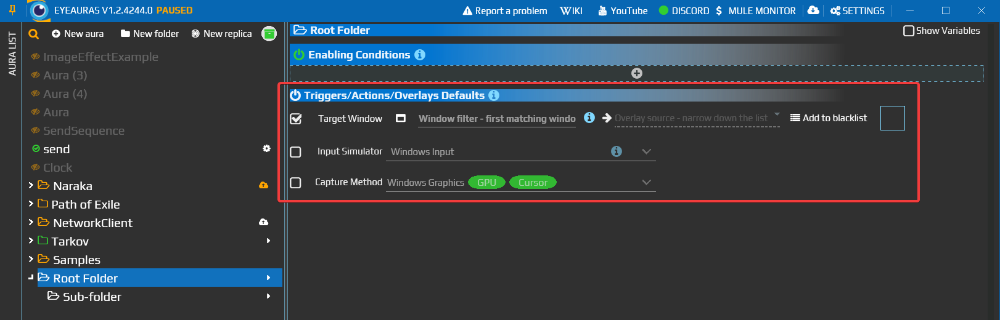
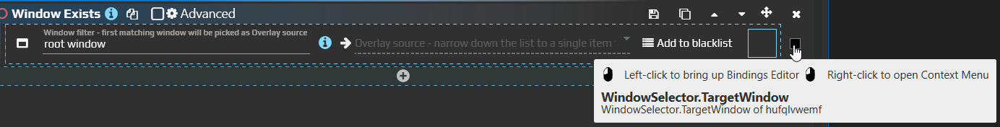
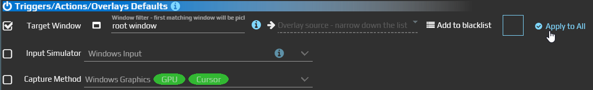

# Свойства по умолчанию — выбрать окно для всей папки

Если несколько аур следят за одним приложением, удобнее выбрать его окно один раз на уровне папки. Триггеры и действия, привязанные к этому значению по умолчанию, будут получать новое окно при его изменении.

Настройка находится в папке, в разделе **Triggers/Actions/Overlays Defaults**. Набор доступных свойств зависит от подключённых возможностей EyeAuras; начните с Target Window.

Флажок слева разрешает папке задавать это значение. На иллюстрации включён Target Window, а другие свойства оставлены без локальной настройки.

## Одно окно для двух проверок

1. Откройте приложение, за которым хотите следить, и создайте для его аур отдельную папку. Добавьте внутрь две ауры: одну с [Window Exists](/ru/triggers/window-exists), другую с [Window Is Active](/ru/triggers/window-is-active).
2. Выберите папку. В **Triggers/Actions/Overlays Defaults** включите флажок **Target Window** и выберите окно приложения из списка. Проверьте отображаемую цель.
3. В каждом из двух триггеров откройте контекстное меню маленького индикатора привязки у Target Window и выберите **Bind to Default**. Так вы явно подключите оба свойства к значению папки.
4. Вернитесь к папке и выберите другое открытое окно в Target Window.

Обе проверки должны получить новую цель: Window Exists проверяет её наличие, а Window Is Active — положение на переднем плане. Менять выражение в каждом триггере отдельно больше не нужно.

Левый щелчок по индикатору открывает редактор привязок, правый — меню. В старом интерфейсе привязка по умолчанию могла называться Reset to Default или Bind to Default.

## Подключить существующие ауры

Новым компонентам EyeAuras назначает поддерживаемые привязки по умолчанию при создании. У существующего свойства может уже быть собственное значение или другая связь. Само изменение папки не заменяет такую настройку.

| Способ | Когда использовать |
| --- | --- |
| Bind to Default у отдельного свойства | Подключить один триггер, действие или оверлей к соответствующему значению папки. |
| Bind to Default в прежнем окне редактора привязок | Сделать то же кнопкой в заголовке. В новом интерфейсе используйте контекстное меню индикатора свойства. |
| Apply to All в папке | Перевести подходящие свойства дочерних аур и подпапок на значения по умолчанию сразу. В новом редакторе применяются все отмеченные свойства; в прежнем кнопка была у каждой строки. |

**Apply to All заменяет индивидуальные привязки подходящих свойств.** Перед нажатием оставьте отмеченными только те свойства, которые действительно хотите унифицировать. Для аур с отдельной целью используйте точечную привязку, а не массовое применение.

Во вложенной папке можно задать своё значение. Если локальная настройка отсутствует, привязка ищет значение выше по иерархии. Для постоянной работы подберите [выражение окна](/ru/features/window-matching-expressions), которое переживёт его повторное открытие: выбранный из списка временный дескриптор может измениться.

Другие связи между свойствами описаны в [Bindings](/ru/features/bindings). Скриптовые значения и их наследование имеют отдельный [API-контракт](/ru/scripting/api/scripting/variables).
