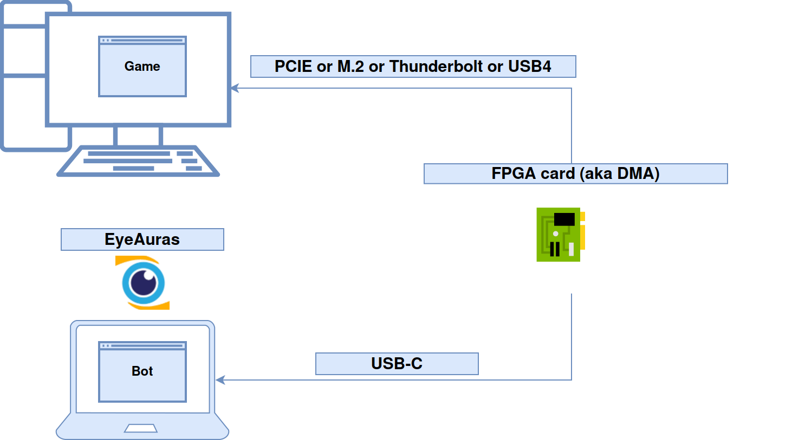
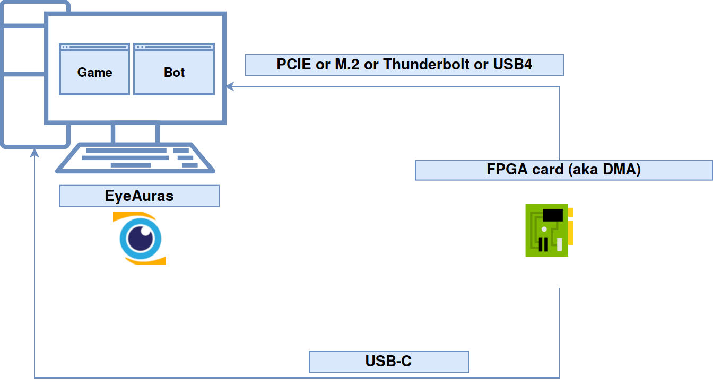

# Получить список процессов через подготовленный источник FPGA

EyeAuras может работать с памятью через **MemProcFS/LeechCore** и модуль **EyeAuras.Memory.MPFS**. Для первого опыта достаточно перечислить процессы, видимые источнику: это проверяет путь получения данных, прежде чем вы будете читать известное значение собственного тестового приложения.

Нужны совместимая Windows-поставка с загруженным MPFS и нативными библиотеками, подготовленная FPGA и собственная целевая система. [Подготовка и роли компьютеров](/ru/dma/getting-started) описаны отдельно. Это не обычная возможность любого ПК и не гарантия доступа ко всем процессам.

## Выполнить один запрос

1. Проверьте, что модуль MPFS загружен, а источник памяти подготовлен для вашей платы и системы. Устройство должно быть подключено к тому компьютеру, на котором этот вызов открывает источник.
2. Создайте **C# Script** в [EyePad](/ru/features/eyepad). Вставьте программу в `Script.csx`:

```csharp
using EyeAuras.Memory;
using EyeAuras.Memory.MPFS;

{
    cancellationToken.ThrowIfCancellationRequested();
    var processes = LCProcess.FPGA().GetProcesses();
    Log.Info($"Видимых процессов: {processes.Count}");
    foreach (var process in processes)
        Log.Info($"PID={process.Id}; name={process.ProcessName}");
}
```

3. Нажмите **Run** один раз. Ожидаемый результат в журнале — количество, PID и имена процессов **целевой системы**, доступных источнику. Сопоставьте известный тестовый процесс с этой системой. Отсутствие нужного процесса не следует трактовать как готовый доступ к его памяти.
4. Скрипт заканчивается после перечисления. `GetProcesses` возвращает копию списка и закрывает созданный для этого запроса VMM; список не обновляется сам. Ошибка инициализации или чтения завершает запрос, а не превращается в успешный результат.

`Log` и `cancellationToken` здесь принадлежат верхнеуровневому скрипту EyeAuras. В обычный C#-класс зависимости передаются явно. Вызов синхронный: проверка токена перед ним не означает немедленной отмены инициализации внутри нативной библиотеки.

| Выбор | Что он меняет |
|---|---|
| `LCProcess.FPGA()` | Настраивает источник `FPGA`; это не автоопределение любой платы в сети. |
| `GetProcesses()` | Возвращает снимок видимых PID и имён, без чтения произвольного поля игры. |
| `ByProcessId(pid)` / `ByProcessName(name)` | Открывают отдельный объект процесса; его нужно освобождать после работы. |
| `LCProcess.WinPMEM()` / `HyperV()` / `Custom(...)` | Другие источники с собственной подготовкой; наличие методов не устанавливает драйвер или Hyper-V и не переключает источник автоматически. |
| `WithRemote(...)` | Отдельно настроенное удалённое подключение; адрес и доступ определяются подготовленным источником. |

## Откуда берутся данные

В двухкомпьютерной схеме целевое приложение и программа анализа расположены отдельно. Плата соединяет путь получения памяти; названия **Game** и **Bot** на прежней иллюстрации обозначают роли, а не готовую игровую интеграцию.



Два компьютера: Game обозначает целевое приложение, Bot — программу анализа. [Исходная схема SVG](/assets/wiki-media/m072-original.svg).

Во второй схеме EyeAuras и целевое приложение находятся на одном компьютере. Способ размещения не даёт обещаний невидимости, обхода защит или одинаковой скорости на всех устройствах. Доступ ограничивается возможностями платы, прошивки, ОС и её защитой DMA.



Один компьютер: целевое приложение и EyeAuras размещены вместе. [Исходная схема SVG](/assets/wiki-media/m073-original.svg).

[LeechCore](https://github.com/ufrisk/LeechCore) предоставляет источники физической памяти, а MemProcFS восстанавливает представление процессов и их виртуального адресного пространства. В `process.Memory` адрес относится к открытому процессу. Нельзя подставить физический адрес вместо виртуального только потому, что данные получены через DMA. Список совместимого оборудования и условия подключения проверяйте в [документации FPGA у автора](https://github.com/ufrisk/LeechCore/wiki/Device_FPGA); не любая плата или USB-адаптер подходят автоматически.

<details>
<summary>Прочитать известное число, когда PID и адрес уже получены</summary>

Нужны актуальный PID собственного тестового приложения, **абсолютный виртуальный адрес** его значения и точный тип `int`. Адрес должен быть получен из самого тестового приложения или его известной схемы, а не взят из чужого примера. Следующий **фрагмент — функция**, а не самостоятельный сценарий поиска адресов:

```csharp
using System;
using EyeAuras.Memory;
using EyeAuras.Memory.MPFS;

static int ReadKnownInt32(int processId, IntPtr virtualAddress)
{
    using var process = LCProcess.FPGA().ByProcessId(processId);
    return process.Memory.Read<int>(virtualAddress);
}
```

Вызовите функцию со своими PID и адресом и сравните результат с известным числом. `process.Memory` заимствован у процесса и не должен переживать его освобождение. Для обычного скаляра используйте `Read<T>`; для записи известного значения есть `Write<T>`, но возможность и полнота записи зависят от источника. Большие бинарные блоки требуют отдельной проверки результата, а не предположения об успешной передаче.

`process.Memory.BaseAddress` в этом механизме равен нулю и не является автоматически базой игрового модуля. Чтобы получить базу модуля, используйте сведения о модулях процесса; постоянное смещение `0x1C4` не определяет здоровье персонажа. Разметка, тип и адрес принадлежат конкретной версии целевой программы.

Высокоуровневые операции памяти общие для нескольких способов доступа, но переносится не любая возможность управления процессом. Нет автоматического переключения на `ReadProcessMemory`, обещания постоянного восстановления или чтения любого защищённого процесса. Подробные контракты находятся в [Memory API](/ru/scripting/api/memory), а простой опыт без оборудования — в [примере чтения собственной памяти](/ru/scripting/examples/advanced/memory/rpm-read).

</details>
