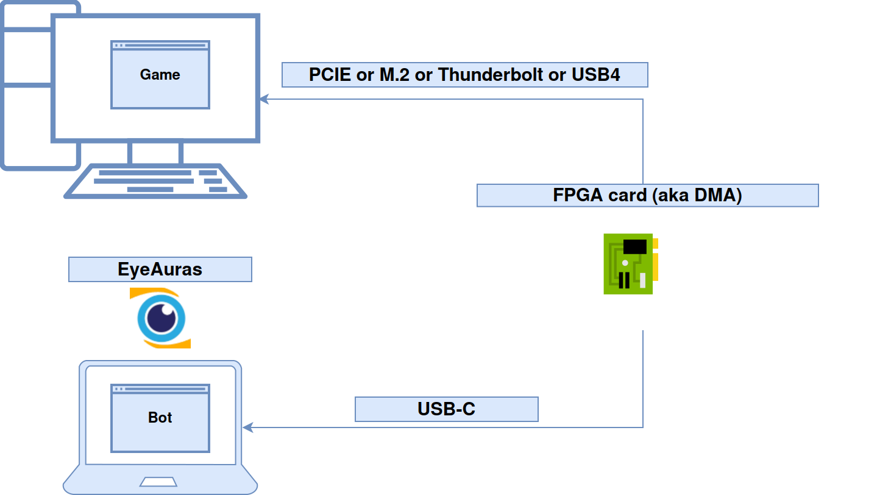
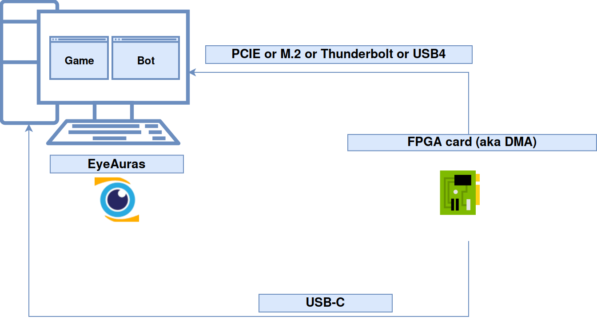

# Получить список процессов через подготовленный источник FPGA

EyeAuras умеет читать память через **MemProcFS/LeechCore** и модуль **EyeAuras.Memory.MPFS**. Для первой проверки достаточно вывести список процессов, которые видит источник. Так вы убедитесь, что данные вообще доходят, а потом уже будете читать известное значение из своего тестового приложения.

Нужны совместимая Windows-поставка с загруженным MPFS и нативными библиотеками, подготовленная FPGA и своя целевая система. Как всё подготовить и какой компьютер за что отвечает, описано в статье [Подготовка и роли компьютеров](/ru/dma/getting-started). На обычном ПК без этого оборудования это не работает, и доступ ко всем процессам не гарантирован.

## Выполнить один запрос

1. Проверьте, что модуль MPFS загружен, а источник памяти подготовлен для вашей платы и системы. Устройство должно быть подключено к тому компьютеру, на котором этот вызов открывает источник.
2. Создайте **C# Script** в [EyePad](/ru/features/eyepad). Вставьте программу в `Script.csx`:

```csharp
using EyeAuras.Memory;
using EyeAuras.Memory.MPFS;

{
    cancellationToken.ThrowIfCancellationRequested();
    var processes = LCProcess.FPGA().GetProcesses();
    Log.Info($"Видимых процессов: {processes.Count}");
    foreach (var process in processes)
        Log.Info($"PID={process.Id}; name={process.ProcessName}");
}
```

3. Нажмите **Run** один раз. В журнале появятся количество, PID и имена процессов **целевой системы**, которые видит источник. Найдите среди них свой тестовый процесс. Отсутствие нужного процесса не следует трактовать как готовый доступ к его памяти.
4. После вывода списка скрипт завершается. `GetProcesses` возвращает копию списка и закрывает VMM, созданный для этого запроса. Сам список не обновляется. Если инициализация или чтение не удались, запрос завершается ошибкой, а не пустым «успешным» результатом.

`Log` и `cancellationToken` доступны только в верхнеуровневом скрипте EyeAuras. В обычный C#-класс зависимости нужно передавать явно. Вызов синхронный: токен проверяется до него, но инициализацию внутри нативной библиотеки это сразу не отменит.

| Выбор | Что он меняет |
|---|---|
| `LCProcess.FPGA()` | Настраивает источник `FPGA`. Платы в сети сам не ищет. |
| `GetProcesses()` | Возвращает снимок видимых PID и имён. Поля игры не читает. |
| `ByProcessId(pid)` / `ByProcessName(name)` | Открывают отдельный объект процесса. После работы его нужно освободить. |
| `LCProcess.WinPMEM()` / `HyperV()` / `Custom(...)` | Другие источники, каждому нужна своя подготовка. Сами методы не устанавливают драйвер или Hyper-V и источник автоматически не переключают. |
| `WithRemote(...)` | Удалённое подключение, которое настраивается отдельно. Адрес и доступ зависят от подготовленного источника. |

## Откуда берутся данные

В схеме с двумя компьютерами целевое приложение и программа анализа работают на разных машинах. Память передаётся через плату. Подписи **Game** и **Bot** на старой схеме — это роли компьютеров, а не готовая интеграция с игрой.



Два компьютера: Game — целевое приложение, Bot — программа анализа. [Исходная схема SVG](/assets/wiki-media/m072-original.svg).

Во второй схеме EyeAuras и целевое приложение находятся на одном компьютере. Ни одна из схем не обещает невидимости, обхода защит или одинаковой скорости на всех устройствах. Доступ ограничен возможностями платы, прошивки, ОС и её защитой DMA.



Один компьютер: целевое приложение и EyeAuras вместе. [Исходная схема SVG](/assets/wiki-media/m073-original.svg).

[LeechCore](https://github.com/ufrisk/LeechCore) даёт доступ к физической памяти. MemProcFS по ней восстанавливает процессы и их виртуальное адресное пространство. В `process.Memory` адрес относится к открытому процессу, то есть он виртуальный. Физический адрес вместо него подставлять нельзя, хотя данные и получены через DMA. Список совместимого оборудования и условия подключения смотрите в [документации FPGA у автора](https://github.com/ufrisk/LeechCore/wiki/Device_FPGA). Подходит не любая плата и не любой USB-адаптер.

<details>
<summary>Прочитать известное число, когда PID и адрес уже получены</summary>

Нужны актуальный PID своего тестового приложения, **абсолютный виртуальный адрес** значения и точный тип `int`. Адрес берите из самого тестового приложения или его известной схемы, а не из чужого примера. Ниже **фрагмент — функция**. Адреса она не ищет:

```csharp
using System;
using EyeAuras.Memory;
using EyeAuras.Memory.MPFS;

static int ReadKnownInt32(int processId, IntPtr virtualAddress)
{
    using var process = LCProcess.FPGA().ByProcessId(processId);
    return process.Memory.Read<int>(virtualAddress);
}
```

Вызовите функцию со своими PID и адресом и сравните результат с известным числом. `process.Memory` принадлежит процессу, и после его освобождения пользоваться им нельзя. Обычное число читайте через `Read<T>`. Записать известное значение можно через `Write<T>`, но получится ли запись и пройдёт ли она полностью, зависит от источника. Большие бинарные блоки проверяйте отдельно, не считайте заранее, что они переданы успешно.

`process.Memory.BaseAddress` здесь равен нулю. Это не база игрового модуля. Базу модуля берите из сведений о модулях процесса. Постоянное смещение `0x1C4` ещё не даёт здоровье персонажа: разметка, тип и адрес относятся к конкретной версии целевой программы.

Высокоуровневые операции с памятью общие для нескольких способов доступа, но не всё управление процессом переносится между ними. Автоматического перехода на `ReadProcessMemory` нет. Постоянное восстановление и чтение любого защищённого процесса тоже не обещаны. Подробности — в [Memory API](/ru/scripting/api/memory). Простой пример без оборудования — [чтение собственной памяти](/ru/scripting/examples/advanced/memory/rpm-read).

</details>
