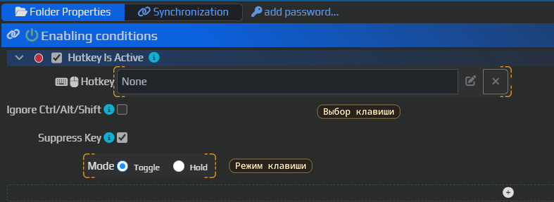
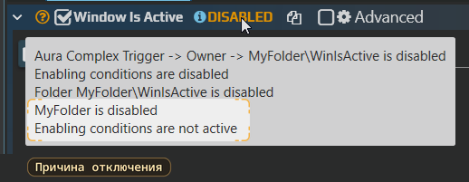

# Условия включения — работать только в нужном режиме

Иногда набор подсказок или проверок нужен только на время одной задачи. Положите такие ауры в папку и задайте ей условия включения (Enabling Conditions). Пока условие не выполнено, ауры в папке отключены и их обычные триггеры не вычисляются.

Это удобно, например, для группы поисков изображений и текста. Обычный триггер отвечает, **выполнено ли условие ауры**. Условие включения решает, **должна ли аура вообще работать**.

## Включайте группу подсказок удержанием клавиши

1. Создайте папку «Режим проверки». В её разделе **Enabling conditions** добавьте [Hotkey Is Active](/ru/triggers/hotkey-is-active), выберите свободную клавишу F8 и режим **Hold**. Других условий включения пока не добавляйте.

   

   На снимке старого редактора клавиша ещё не назначена и выбран Toggle. Вам нужны F8 и Hold.

2. В папке создайте ауру «Подсказка». В её обычные **Triggers** добавьте [Fixed Value](/ru/triggers/fixed-value) со значением **Is Active**.
3. В **Overlays** добавьте [Text](/ru/overlays/text). В Content напишите «Проверьте выбранную область», поставьте текст в нужное место экрана и включите **Locked**.
4. Выберите в дереве любую ауру вне этой папки и перейдите в рабочее приложение. Зажмите F8, затем отпустите.

Пока клавиша зажата, папка разрешает ауре работать и подсказка видна. Отпустили — подсказка исчезла. Клавиша только включает и выключает группу. Сам текст берётся из Content.

Теперь в ту же папку можно положить настроенный [Text Search](/ru/triggers/images/text-search): он будет работать только в этом режиме. Сначала убедитесь, что поиск правильно работает без ограничения.

Если группа нужна только в определённом окне, замените клавишу в Enabling conditions на [Window Is Active](/ru/triggers/window-is-active). Если проверка окна уже настроена в другой ауре, возьмите её через [Aura Is Active](/ru/triggers/aura-is-active), чтобы не создавать заново.

## Где задать условие

| Место | На что влияет |
| --- | --- |
| Enabling conditions папки | На ауры и вложенные папки внутри неё. |
| Enabling Conditions ауры | На работу одной ауры. |
| Triggers ауры | На её Active / Not Active, когда работа разрешена. Ложный триггер не отключает вычисление остальных триггеров. |

Если условий включения нет, ограничений тоже нет. Если условий несколько, посмотрите в заголовке группы, по какому правилу они объединяются. Когда итог не определён, работа не разрешается.

В старом редакторе при наведении на DISABLED видно, что не выполнены условия включения родительской папки.

Обычно отключённая папка отключает и вложенные папки. Но для настройки есть исключение: объект, выбранный в активном окне EyeAuras, может продолжать вычисляться. Поэтому проверяйте отключение, выбрав другой объект и перейдя в рабочее приложение. Разблокированный оверлей тоже остаётся видимым, чтобы его можно было настроить, — перед проверкой включите Locked.
