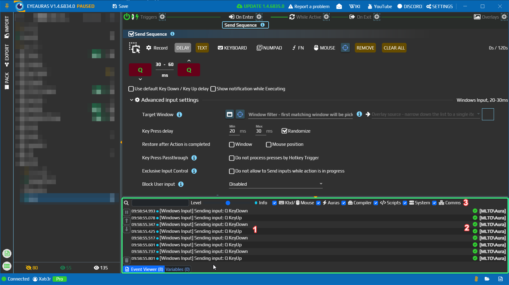

# Просмотр событий — понять, что выполнила аура

Если действие не дало ожидаемого результата, откройте Event Viewer и посмотрите, дошло ли выполнение до нужного места и не возникла ли ошибка. Каждая запись содержит время, уровень важности, сообщение и контекст — объект, который её создал.

## Найдите сообщение своего скрипта

1. В главном окне нажмите кнопку с подсказкой **Show event log** и откройте вкладку **Event Viewer**. Панель должна быть открыта до запуска проверки.
2. В ауре добавьте **C# Script** в On Enter. В редакторе верхнеуровневого скрипта оставьте одну строку:

   ```csharp
   Log.Info("Проверка журнала");
   ```

3. В Event Viewer включите фильтры кнопкой с лупой. Выставьте **Level — Info**, включите **Scripts** и очистите текстовый фильтр. Снимите паузу, если она включена.
4. Нажмите **Run** в редакторе C# Script. В текстовом фильтре Event Viewer введите `Проверка журнала`.

Появится запись с вашим сообщением и контекстом ауры/действия. Она подтверждает выполнение строки Log.Info, а не всей дальнейшей работы скрипта. Для следующей проверки очистите фильтр, иначе сообщения с другим текстом останутся скрыты.

`Log` здесь предоставляет редактор верхнеуровневого C# Script. Начало работы со скриптами описано [отдельно](/ru/scripting/getting-started).



На снимке прежнего интерфейса цифра 1 отмечает текст записей отправки клавиш, 2 — их контекст, 3 — фильтры. Это другой источник событий; устройство панели то же.

## Фильтры и управление

| Элемент | Для чего нужен |
| --- | --- |
| Текстовый фильтр | Ищет подстроку в тексте сообщения без учёта регистра. Имя контекста само по себе не является текстом сообщения. |
| Level | Минимальный уровень важности. Info показывает также Warning и Error; Debug добавляет более подробные сообщения. По умолчанию выбран Info. |
| Kbd/Mouse, Auras, Compiler, Scripts, System, Comms, Console | Разрешают категории ввода, аур, компилятора, скриптов, системы, обмена сообщениями и консоли. Для проверки скрипта нужен Scripts, для компиляции — Compiler. |
| Пауза | Останавливает приём новых записей этой панелью. Пропущенные события не появятся после снятия паузы. |
| Стрелки вверх/вниз | Переходят к началу или концу списка. |
| Корзина | Очищает записи панели. |

## Какой уровень выбрать

| Уровень | Что обычно искать |
| --- | --- |
| Trace | Самые подробные технические сообщения; их может быть много. |
| Debug | Ход операций, загрузку и выгрузку, промежуточные состояния. |
| Info | Обычные события и сообщения о выполненной работе. |
| Warning | Предупреждение, которое требует внимания, но не обязательно прерывает работу. В интерфейсе уровень может называться Warn. |
| Error | Ошибку выполнения или настройки. Читайте сообщение и его контекст. |

Панель хранит последние 250 принятых записей. При выключенной категории новые события этой категории не попадают в её историю; включение фильтра задним числом их не восстановит. Свёрнутая панель также не собирает новые записи. Для диагностики сначала откройте панель, задайте фильтры и повторите действие.

Если нужна передача диагностических данных разработчику, используйте [отчёт о проблеме](/ru/features/problem-reports), а не рассчитывайте на Event Viewer как на полный архив.
