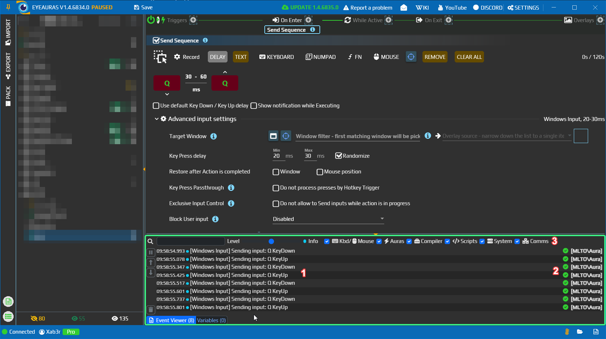
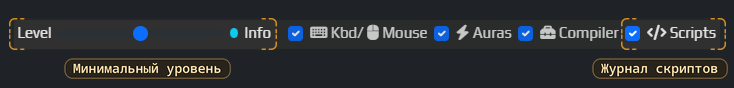

# Просмотр событий — понять, что выполнила аура

Event Viewer — это журнал событий EyeAuras. Если действие не сработало как надо, откройте его и посмотрите, дошло ли выполнение до нужного места и не было ли ошибки. В каждой записи есть время, уровень важности, сообщение и контекст — объект, который её создал.

## Найдите сообщение своего скрипта

1. В главном окне нажмите кнопку с подсказкой **Show event log** и откройте вкладку **Event Viewer**. Панель нужно открыть до запуска проверки.
2. В ауре добавьте **C# Script** в On Enter. В редакторе верхнеуровневого скрипта оставьте одну строку:

   ```csharp
   Log.Info("Проверка журнала");
   ```

3. В Event Viewer откройте фильтры кнопкой с лупой. Выставьте **Level — Info**, включите **Scripts** и очистите текстовый фильтр. Если включена пауза, снимите её.
4. Нажмите **Run** в редакторе C# Script. В текстовый фильтр Event Viewer введите `Проверка журнала`.

Появится запись с вашим сообщением и контекстом — аурой и действием. Перед следующей проверкой очистите фильтр, иначе сообщения с другим текстом будут скрыты.

`Log` здесь даёт редактор верхнеуровневого C# Script. С чего начать работу со скриптами, описано [отдельно](/ru/scripting/getting-started).



На снимке цифра 1 — текст записей об отправке клавиш, 2 — их контекст, 3 — фильтры.

## Фильтры и управление



| Элемент | Для чего нужен |
| --- | --- |
| Текстовый фильтр | Ищет подстроку в тексте сообщения без учёта регистра. Имя контекста в текст сообщения не входит. |
| Level | Минимальный уровень важности. Info показывает также Warning и Error, Debug добавляет более подробные сообщения. По умолчанию выбран Info. |
| Kbd/Mouse, Auras, Compiler, Scripts, System, Comms, Console | Включают категории: ввод, ауры, компилятор, скрипты, система, обмен сообщениями и консоль. Для проверки скрипта нужен Scripts, для компиляции — Compiler. |
| Пауза | Панель перестаёт принимать новые записи. Пропущенные события после снятия паузы не появятся. |
| Стрелки вверх/вниз | Переходят к началу или концу списка. |
| Корзина | Очищает записи панели. |

## Какой уровень выбрать

| Уровень | Что обычно искать |
| --- | --- |
| Trace | Самые подробные технические сообщения. Их может быть много. |
| Debug | Ход операций, загрузку и выгрузку, промежуточные состояния. |
| Info | Обычные события и сообщения о выполненной работе. |
| Warning | Предупреждение: на него стоит обратить внимание, но работа не обязательно прерывается. В интерфейсе уровень может называться Warn. |
| Error | Ошибку выполнения или настройки. Читайте сообщение и его контекст. |

Панель хранит последние 250 принятых записей. Если категория выключена, её новые события в историю не попадают, и включение фильтра потом их не вернёт. Свёрнутая панель тоже не собирает записи.

Если проверка по картинке не срабатывает, сначала проверьте [исходный кадр и область](/ru/triggers/images/imagecapturetriggers) и [условия включения](/ru/features/enabling-conditions).

Если диагностику нужно передать разработчику, отправьте [отчёт о проблеме](/ru/features/problem-reports).
